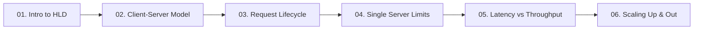

# 01. Fundamentals of System Design

[🏠 Home](../README.md) > **01. Fundamentals**

---

## Overview

The fundamentals module establishes the bedrock concepts required for any High-Level System Design. Before designing distributed clusters, caching topologies, or partitioned databases, engineers must master how computers, operating systems, and networks handle requests and data.

---

## 🎯 Key Learning Objectives

* **Macro Architecture**: Understand the 30,000-foot view of system design and the 7 core goals (scalability, availability, reliability, maintainability, performance, security, and cost).
* **Decoupled Architecture**: Grasp the client-server paradigm, thick vs. thin client trade-offs, and state delegation.
* **Request Lifecycle**: Trace the end-to-end journey of an HTTP request through DNS resolution, TCP handshake, TLS 1.3 negotiation, reverse proxies, and DB queries.
* **Concurrency Mechanics**: Understand how single servers handle concurrent traffic using multi-threaded blocking I/O vs. single-threaded event-driven models (epoll).
* **Performance Metrics**: Master the mathematical relationship between latency and throughput, interpret p50/p95/p99 percentiles, and apply Little's Law ($L = \lambda W$).
* **Scaling Vectors**: Evaluate vertical scaling (scale up) vs. horizontal scaling (scale out) and the mandatory requirement for stateless application tiers.

---

## 📚 Module Table of Contents

| # | Topic | Key Focus | Link |
|---|---|---|---|
| **01** | **Introduction to High-Level Design** | The 30,000-ft view, 7 core goals, request flow & foundational components | [Read Guide ➡️](./introduction-to-hld.md) |
| **02** | **Client-Server Architecture** | Thin vs. Thick clients, stateless servers, security boundaries, Netflix case study | [Read Guide ➡️](./client-server-architecture.md) |
| **03** | **The Request-Response Lifecycle** | Millisecond breakdown: DNS, TCP, TLS 1.3, reverse proxies, DB queries | [Read Guide ➡️](./request-lifecycle.md) |
| **04** | **How One Server Handles Requests** | 4-core 8GB concurrency model, CPU vs. I/O-bound bottlenecks, overload fixes | [Read Guide ➡️](./how-one-server-handles-requests.md) |
| **05** | **Latency vs. Throughput** | The Highway Analogy, Percentiles (p50, p95, p99), Little's Law ($L = \lambda W$) | [Read Guide ➡️](./latency-throughput.md) |
| **06** | **Scalability: Vertical vs. Horizontal** | Scale up vs. scale out, statelessness prerequisites, hardware ceilings | [Read Guide ➡️](./scaling.md) |

---

## 🔍 Detailed Topic Breakdown

* 📌 **[01. Introduction to High-Level Design](./introduction-to-hld.md)**
  * **Definition**: Macro-level system blueprint defining boundaries, technologies, communication protocols, and scaling mechanisms.
  * **Core Components**: Client, DNS, CDN, Load Balancer, Application Server, Cache, Database, Message Queue, and Monitoring.
  * **System Goals**: Balancing high availability (e.g., 99.99% SLA), low latency, horizontal scalability, fault tolerance, and cost efficiency.

* 📌 **[02. Client-Server Architecture](./client-server-architecture.md)**
  * **Architectural Separation**: Separates user presentation layers from backend business logic and database persistence.
  * **Client Form Factors**:
    * *Thin Clients*: Browsers that offload logic and state to servers; easily updated with zero client-side installation.
    * *Thick Clients*: Native mobile and desktop apps performing local rendering, validation, and offline caching.
  * **Statelessness Golden Rule**: Servers must not hold session state in memory so any incoming request can be served by any identical server.

* 📌 **[03. The Request-Response Lifecycle](./request-lifecycle.md)**
  * **Chronological Milestones**:
    * *DNS Lookup*: Recursive resolution from browser cache to Root, TLD, and Authoritative nameservers (~20–120ms).
    * *Transport Handshake*: TCP 3-way handshake (SYN, SYN-ACK, ACK) followed by TLS 1.3 key exchange (~1–2 RTT).
    * *Gateway & App Routing*: Load balancer SSL termination, reverse proxy routing, and authentication validation.
    * *Data Fetch & Serialization*: Cache check, database query execution, JSON payload assembly, and response streaming.
  * **Latency Optimization**: Utilizing persistent connection keep-alive, HTTP/2 multiplexing, and geo-distributed CDNs.

* 📌 **[04. How One Server Handles Requests](./how-one-server-handles-requests.md)**
  * **Physical Limits**: Hardware constraints governed by CPU cores, available RAM, network bandwidth, and OS file descriptors (`ulimit -n`).
  * **Concurrency Paradigms**:
    * *Thread-per-request*: Traditional blocking I/O (e.g., Apache, Tomcat) where each worker thread consumes ~1–2MB stack space.
    * *Event-driven non-blocking*: Single or multi-threaded event loop using OS readiness notifications (`epoll`/`kqueue`, e.g., Nginx, Node.js).
  * **Bottleneck Profiles**: Pinpointing CPU-bound operations (encryption, image compression) vs. I/O-bound bottlenecks (database waiting, disk writes).

* 📌 **[05. Latency vs. Throughput](./latency-throughput.md)**
  * **Core Distinction**:
    * *Latency*: The turnaround time required to process a single request (measured in milliseconds).
    * *Throughput*: The total volume of requests processed per second (measured in RPS or QPS).
  * **Little's Law Formula**: $L = \lambda \times W$ (Concurrency = Arrival Rate $\times$ Average Latency).
  * **Percentile Analysis**: Why averages are misleading; monitoring p50 (median), p95, p99, and p99.9 tail latencies to capture real user degradation.

* 📌 **[06. Scalability: Vertical vs. Horizontal](./scaling.md)**
  * **Vertical Scaling (Scale Up)**: Adding faster CPUs, more RAM, and NVMe disks to an existing machine.
    * *Advantages*: Simple, no architectural code changes, zero distributed networking overhead.
    * *Disadvantages*: Hard hardware ceilings, exponential hardware costs, and inevitable downtime.
  * **Horizontal Scaling (Scale Out)**: Adding more commodity nodes in parallel behind a load balancer.
    * *Advantages*: Near-infinite scalability, elastic auto-scaling, fault tolerance, and zero-downtime deployments.
    * *Prerequisites*: Requires completely stateless application servers and centralized session stores.

---

## 💡 Key Architectural Rules of Thumb

* **Statelessness First**: Never store sticky session data in application memory. Offload state to Redis or a relational/NoSQL database.
* **Measure Tail Latency**: Never rely on arithmetic mean/average latency; p99 and p99.9 tell you what your most active customers actually experience.
* **Design for the Bottleneck**: Identify whether your system is CPU-bound, memory-bound, disk I/O-bound, or network-bound before introducing scaling solutions.
* **Keep It Simple (YAGNI)**: Scale vertically on day one if single-server capacity easily accommodates traffic; transition to horizontal clusters as growth dictates.

---

| ⬅️ Previous Topic | 🏠 Index | Next Topic ➡️ |
|:--- |:---:| ---:|
| [Master Table of Contents](../README.md) | [01. Fundamentals Index](./README.md) | [01. Intro to HLD ➡️](./introduction-to-hld.md) |
