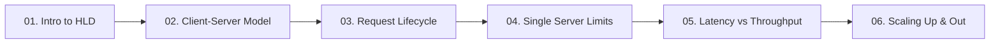

# 01. Fundamentals of System Design

[🏠 Home](../README.md) > **01. Fundamentals**

---

## Overview

The fundamentals module establishes the bedrock concepts required for any High-Level System Design. Before designing distributed clusters, caching topologies, or partitioned databases, engineers must master how computers, operating systems, and networks handle requests and data.

---

## Module Table of Contents

| # | Topic | Key Focus | Link |
|---|---|---|---|
| **01** | **Introduction to High-Level Design** | The 30,000-ft view, 7 core goals, request flow & foundational components | [Read Guide ➡️](./introduction-to-hld.md) |
| **02** | **Client-Server Architecture** | Thin vs. Thick clients, stateless servers, security boundaries, Netflix case study | [Read Guide ➡️](./client-server-architecture.md) |
| **03** | **The Request-Response Lifecycle** | Millisecond breakdown: DNS, TCP, TLS 1.3, reverse proxies, DB queries | [Read Guide ➡️](./request-lifecycle.md) |
| **04** | **How One Server Handles Requests** | 4-core 8GB concurrency model, CPU vs. I/O-bound bottlenecks, overload fixes | [Read Guide ➡️](./how-one-server-handles-requests.md) |
| **05** | **Latency vs. Throughput** | The Highway Analogy, Percentiles (p50, p95, p99), Little's Law ($L = \lambda W$) | [Read Guide ➡️](./latency-throughput.md) |
| **06** | **Scalability: Vertical vs. Horizontal** | Scale up vs. scale out, statelessness prerequisites, hardware ceilings | [Read Guide ➡️](./scaling.md) |

---

| ⬅️ Previous Topic | 🏠 Index | Next Topic ➡️ |
|:--- |:---:| ---:|
| [Master Table of Contents](../README.md) | [01. Fundamentals Index](./README.md) | [01. Intro to HLD ➡️](./introduction-to-hld.md) |
