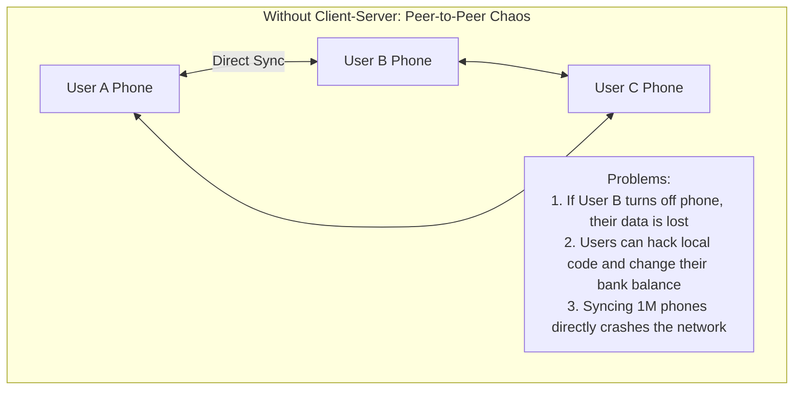

# 02. Client-Server Architecture

[🏠 Home](../README.md) > [01. Fundamentals](./README.md) > **Client-Server Architecture**

---

### 1. What is it?

Client-Server is a distributed relationship where one program (the **Client**) asks for information or actions, and another program (the **Server**) does the heavy lifting, holds the authoritative data, and sends back a response.
* **The Division of Labor:**
  * **Client (Frontend):** Browser, iOS/Android app, or CLI. Responsible for UI, capturing user input, and rendering pixels.
  * **Server (Backend):** Node.js, Go, Java, or Python process. Responsible for business logic, authentication, and database access.

---

### 2. Why do we need it? (The Problem without it)


* **Security & Trust:** You can **never trust the client**. If business rules lived on the client's phone, users could modify code to grant themselves unlimited credits or bypass paywalls. The server is the single source of truth.
* **Data Consistency:** A central server guarantees everyone sees the same inventory count (preventing two people from buying the last concert ticket).
* **Battery & Compute Savings:** Heavy tasks (video transcoding, machine learning, searching millions of records) happen on powerful cloud servers, preserving mobile battery life.

---

### 3. Architecture & Data Flow

```mermaid
flowchart LR
    subgraph Clients ["Client Devices"]
        Web[Web Browser]
        Mobile[Mobile App]
    end
    subgraph Boundaries ["Public Internet / TLS 1.3"]
        API[api.myapp.com]
    end
    subgraph ServerSide ["Secure Server Infrastructure"]
        direction TB
        LB[Load Balancer]
        App1[App Instance A]
        App2[App Instance B]
        DB[("Primary Database")]
        Cache[("Redis Cache")]
        LB --> App1 & App2
        App1 & App2 <--> Cache
        App1 & App2 --> DB
    end
    Clients -->|HTTPS JSON Request| API --> LB
    ServerSide -->>|JSON / Binary Response| Clients
```

---

### 4. Client Types: Thin vs. Thick Client

| Attribute | Thin Client (e.g. Modern Web App) | Thick / Fat Client (e.g. Mobile Game) |
|---|---|---|
| **What it does** | Minimal logic; only renders HTML/JSON from server | Downloads large assets; computes physics/gameplay locally |
| **Server Load** | Higher (Server renders or computes everything) | Lower (Server only validates final state & syncs data) |
| **Offline Mode** | Barely functional without internet | Can work offline and sync changes later |
| **Security Risk** | Low (code runs on server) | High (client binaries can be decompiled & tampered) |

---

### 5. Stateless vs. Stateful Servers

```mermaid
flowchart TD
    subgraph Stateful ["[-"] Stateful Server (Antipattern for Scaling)]
        C1[Client] --> S1["Server 1: Stores User Session in RAM"]
        C1 -.->|Next request hits Server 2| S2["Server 2: 'Who are you? Please log in again!'"]
    end
    subgraph Stateless ["[+"] Stateless Server (Cloud Native Standard)]
        C2[Client] -->|Request with JWT Token| LB2[Load Balancer]
        LB2 --> S3[Server 1]
        LB2 --> S4[Server 2]
        S3 & S4 <--> Shared[("Shared Redis Session Store")]
        Note2["Any server can handle any request!"]
    end
```
> Rule: **Golden Rule:** Always design application servers to be **stateless**. Never store session state, uploaded temp files, or user memory in a server's local RAM. Offload state to Redis or the Database.

---

### 6. Real-World Case Study: Netflix

* **Thin Client on 1,000+ Device Types:** Netflix runs on Smart TVs, PlayStations, Apple TVs, and Android phones.
* The device client only knows how to:
  1. Render the carousel UI.
  2. Stream video chunks over HTTPS.
  3. Send telemetry (playback paused, buffering).
* **The Server Backend (AWS Microservices):**
  * Handles personalized recommendations (evaluating ML models across billions of rows).
  * Enforces DRM (Digital Rights Management) so users cannot pirate streams.
  * Dynamically switches CDN video bitrates based on server-side network signals.

---

### 7. Core Takeaways

1. **Never trust client input:** Always re-validate permissions, prices, and IDs on the server.
2. **Stateless is mandatory:** If a server dies mid-request, another server must be able to pick up the next request seamlessly.
3. **Use HTTPS / TLS everywhere:** Encrypt communication between client and server to prevent Man-in-the-Middle (MITM) snooping.

---

## Related Topics & Next Steps

* [Introduction to High-Level Design](./introduction-to-hld.md) — The 30,000-ft overview of distributed architecture.
* [The Request-Response Lifecycle](./request-lifecycle.md) — The end-to-end journey of an HTTP packet.
* [How One Server Handles Requests](./how-one-server-handles-requests.md) — Understanding single-server limits.
* [Monolithic Architecture](../02-architecture/monolithic.md) — Packaging and deploying backend logic.

---

| ⬅️ Previous Topic | 🏠 Index | Next Topic ➡️ |
|:--- |:---:| ---:|
| [Introduction to HLD](./introduction-to-hld.md) | [01. Fundamentals Index](./README.md) | [The Request-Response Lifecycle ➡️](./request-lifecycle.md) |
