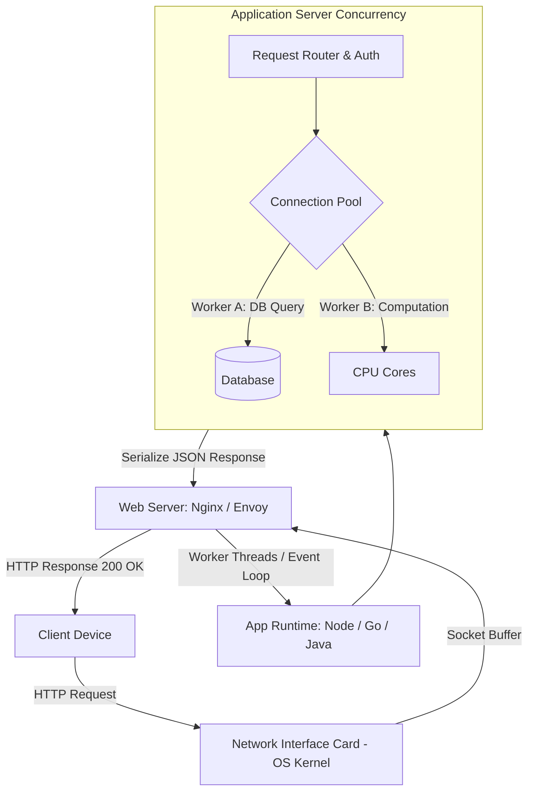
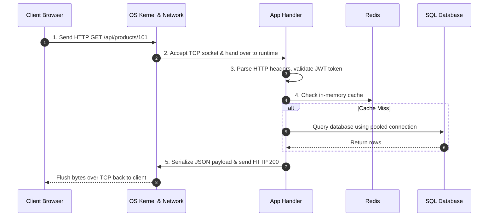
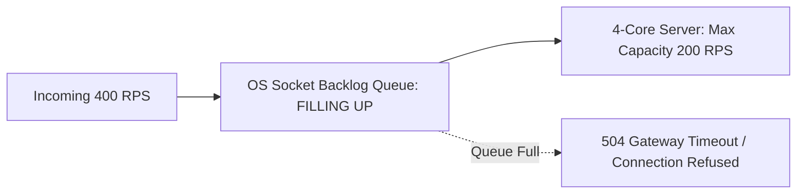

# 04. How One Server Handles Requests

[🏠 Home](../README.md) > [01. Fundamentals](./README.md) > **How One Server Handles Requests**

---

## 1. Overview: Before Adding More Servers

Before introducing distributed load balancers and complex clustering, an engineer must first understand **how a single server processes requests**, where its physical limits lie, and how its concurrency model affects throughput.

A server does not process only one request at a time. Its practical concurrency is governed by:
* Operating System process & thread scheduler
* Number of CPU cores and RAM
* Application runtime threading model (Multi-threaded vs. Event-driven async)
* I/O workload (Disk, Database, Network wait states)
* Connection pooling limits



---

## 2. Walkthrough: Server with 4 CPU Cores & 8 GB RAM

Suppose an application runs on a standard cloud virtual machine with:
* **4 CPU Cores**
* **8 GB RAM**
* A reverse proxy (e.g., Nginx)
* An application runtime (e.g., Go, Node.js, or Java Spring Boot)
* A database connection pool configured for 50 connections

### Step-by-Step Request Processing



1. **Step 1: Client sends request:** The client opens or reuses a TCP/TLS connection and submits the HTTP payload:
   ```http
   GET /api/products/101 HTTP/1.1
   Host: example.com
   Authorization: Bearer <token>
   ```
2. **Step 2: OS receives network packets:** The kernel receives packets via the Network Interface Card (NIC), reassembles the TCP stream, and places them into the socket receive buffer.
3. **Step 3: Application processes request:** The runtime reads the request, checks authentication/authorization, parses parameters, and invokes the business logic handler.
4. **Step 4: Data retrieval:** The application checks the local cache or queries the database using a connection borrowed from the connection pool.
5. **Step 5: Response transmission:** The application serializes the domain model to JSON, writes the HTTP response headers and body to the socket, and returns the connection to the pool.

---

## 3. Can One Server Handle 1,000 Requests Concurrently?

**Yes, potentially.** However, the maximum concurrency a server can sustain depends directly on whether the workload is **CPU-bound**, **I/O-bound**, or **Connection-bound**.

### Situation A: CPU-Intensive Requests
* **Workload:** Cryptographic hashing, video transcoding, PDF generation, image resizing, complex mathematical models.
* **Bottleneck:** CPU cores are pinned at 100%. Once all 4 cores are saturated, incoming requests must wait in the OS run queue.
* **Impact:** Latency skyrockets exponentially. If each request requires 50ms of pure CPU calculation:
  $$\text{Max Throughput} = \frac{4 \text{ cores}}{0.05 \text{ seconds}} = 80 \text{ Requests/sec}$$
  Trying to push 1,000 requests/sec will crash or freeze the server.

### Situation B: I/O-Intensive Requests
* **Workload:** Standard CRUD APIs, fetching database records, reading disk files, calling downstream third-party REST APIs.
* **Behavior:** The CPU spends only ~1ms executing code, but waits 30ms for the database to return rows.
* **Concurrency Fix:** Using asynchronous non-blocking I/O (Node.js, Go goroutines, Java Netty/Virtual Threads) allows a single 4-core server to keep **thousands of concurrent requests in flight** while waiting on external responses without burning CPU cycles.

### Situation C: Long-Lived Connections (e.g., WebSockets)
* **Workload:** Live chat, real-time gaming, financial tickers.
* **Behavior:** Thousands of open connections remain idle most of the time, transmitting data only intermittently.
* **Bottleneck:** Memory (RAM per socket buffer, file descriptor limits `ulimit -n`). A server with 8 GB RAM can comfortably maintain 50,000+ idle WebSocket connections if socket buffers are tuned.

---

## 4. Understanding Server Capacity & Overload Symptoms

Suppose benchmarking shows a server sustains **200 requests/sec (RPS)** at 30ms p95 latency.

| Incoming Traffic | Server State | Observable Behavior |
|---|---|---|
| **100 RPS** | **Under-utilized** | Latency is minimal (~15ms); CPU at 30%; system healthy. |
| **200 RPS** | **Optimal Capacity** | Latency stable (~30ms); resources efficiently used. |
| **350 RPS** | **Overloaded** | Request queue grows; thread starvation; p99 latency degrades to seconds; timeouts occur. |



### Classic Symptoms of an Overloaded Server
1. **P99 Latency Spikes:** Requests spend seconds sitting in memory buffers waiting for an available worker thread.
2. **Connection Pool Exhaustion:** Database connection pools run dry; threads block indefinitely awaiting an available DB connection.
3. **Memory Swapping / OOM Crashes:** As request queues grow, RAM consumption escalates until the OS Out-Of-Memory (OOM) killer terminates the process.
4. **Cascading Timeouts:** Upstream clients time out and trigger aggressive automatic retries, amplifying the load (Retry Storm).

---

## 5. Single Server Optimization Checklist

Before spending money on horizontal scaling and distributed load balancers, exhaust single-node optimizations:

* [x] **Add Missing Database Indexes:** Ensure queries use indexes rather than slow table scans.
* [x] **Enable Connection Pooling:** Reuse existing database TCP connections (e.g., PgBouncer, HikariCP) instead of paying 30ms handshakes per request.
* [x] **Introduce Local In-Memory Caching:** Use Guava, Caffeine, or local LRU caches for hot, read-mostly records.
* [x] **Use Non-Blocking Asynchronous I/O:** Switch from blocking thread-per-request models to async event loops or lightweight coroutines.
* [x] **Tune OS Kernel Limits:** Increase maximum open file descriptors (`ulimit -n 65535`) and adjust TCP backlog queue size (`net.core.somaxconn = 4096`).
* [x] **Compress Responses:** Use Gzip or Brotli compression at the reverse proxy layer to minimize network transmission time.
* [x] **Profile Code:** Find the 5% of application code consuming 80% of CPU cycles using flame graphs.

> [!IMPORTANT]
> When single-node optimizations and vertical scaling can no longer meet availability targets or traffic demands, it is time to transition to **Horizontal Scaling**.

---

## 6. Related Topics & Next Steps

* [The Request-Response Lifecycle](./request-lifecycle.md) — Millisecond-level path from DNS to DB.
* [Latency vs. Throughput](./latency-throughput.md) — Understanding Little's law and tail latency.
* [Scalability: Vertical vs. Horizontal](./scaling.md) — Adding nodes and achieving statelessness.
* [What is a Load Balancer?](../04-load-balancing/what-is-a-load-balancer.md) — Distributing traffic across multiple servers.

---

| ⬅️ Previous Topic | 🏠 Index | Next Topic ➡️ |
|:--- |:---:| ---:|
| [The Request-Response Lifecycle](./request-lifecycle.md) | [01. Fundamentals Index](./README.md) | [Latency vs. Throughput ➡️](./latency-throughput.md) |
