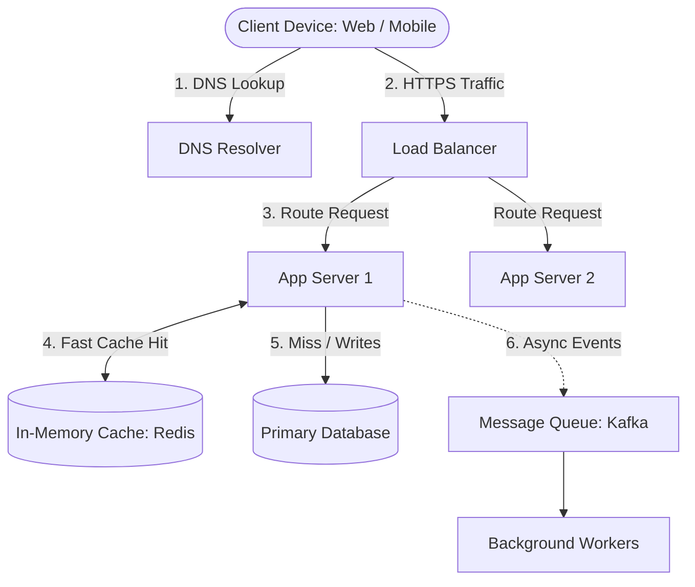
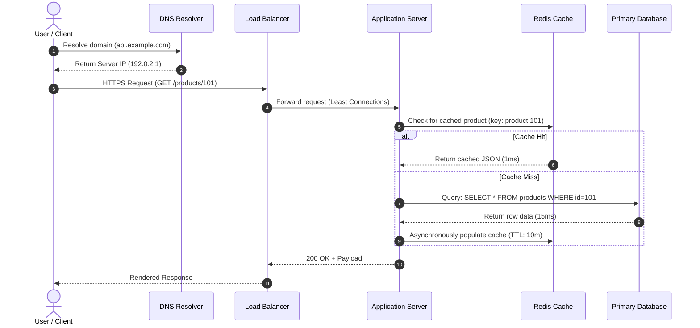

# 01. Introduction to High-Level Design

[🏠 Home](../README.md) > [01. Fundamentals](./README.md) > **Introduction to High-Level Design**

---

## 1. What is High-Level Design (HLD)?

**High-Level Design (HLD)** describes the macro-level architecture of a software system. It explains how major components communicate, where data is persisted, how requests are processed, and how the infrastructure scales as traffic increases.

HLD focuses on the **30,000-foot view** rather than the low-level implementation details of individual classes, data structures, or algorithms.

---

## 2. Key Components of System Design

A modern distributed application is composed of well-defined building blocks. Each component fulfills a specific operational responsibility:

| Component | Primary Responsibility | Common Technologies |
|---|---|---|
| **Client** | Sends user requests and renders UI | Web Browser, iOS/Android App, IoT, CLI |
| **DNS** | Resolves domain names (`api.app.com`) to IP addresses | AWS Route 53, Cloudflare DNS, CoreDNS |
| **CDN** | Caches static assets & media close to users geographically | Cloudflare, CloudFront, Fastly, Akamai |
| **Load Balancer** | Distributes incoming traffic across backend servers | Nginx, HAProxy, AWS ALB/NLB, Envoy |
| **Application Server** | Executes core business logic and API orchestration | Node.js, Go, Java (Spring), Python (FastAPI) |
| **Cache** | Stores frequently read data in RAM for sub-millisecond access | Redis, Memcached, Dragonfly |
| **Database** | Provides persistent, durable, and queryable data storage | PostgreSQL, MySQL, DynamoDB, MongoDB |
| **Message Queue** | Enables asynchronous decoupling and background task processing | Apache Kafka, RabbitMQ, AWS SQS |
| **Monitoring & Logging** | Tracks latency, errors, traffic metrics, and system health | Prometheus, Grafana, Datadog, ELK Stack |

---

## 3. Typical Request Flow

> [!NOTE]
> The cache is not queried for every single request. Static assets bypass application servers through CDNs, while write-heavy operations (e.g., checkout transactions) go directly to the primary database with proper ACID transaction guarantees.

---

## 4. The 7 Goals of Good System Design

When architecting systems for scale and reliability, engineering decisions revolve around trade-offs among seven core pillars:

1. **Scalability:** The ability to handle increasing traffic volume, data storage, and concurrency without performance degradation.
2. **Availability:** Ensuring the system remains operational and accessible even when individual hardware or software components fail (e.g., 99.99% "four nines" uptime).
3. **Reliability:** Guaranteeing that the system consistently produces correct, predictable, and fault-tolerant results under changing loads.
4. **Performance:** Minimizing response latency (p50, p95, p99) while maximizing useful throughput (Requests Per Second).
5. **Maintainability:** Structuring services and codebases so that engineering teams can fix bugs, deploy features, and monitor operations without unnecessary friction.
6. **Security:** Protecting user identities, data privacy, and infrastructure against unauthorized access, DDoS, and injection vulnerabilities.
7. **Cost Efficiency:** Maximizing resource utilization without over-provisioning expensive cloud hardware prematurely.

> [!TIP]
> **The Golden Rule of System Design (YAGNI):** "You Aren't Gonna Need It." Never design for 100 million users on Day 1. Start with the simplest working architecture, measure bottlenecks using telemetry, and scale incrementally as genuine demand requires.

---

## 5. Related Topics & Next Steps

* [Client-Server Architecture](./client-server-architecture.md) — How client and server responsibilities are divided.
* [The Request-Response Lifecycle](./request-lifecycle.md) — Detailed millisecond-by-millisecond network breakdown.
* [How One Server Handles Requests](./how-one-server-handles-requests.md) — Concurrency models, CPU vs I/O limits.

---

| ⬅️ Previous Topic | 🏠 Index | Next Topic ➡️ |
|:--- |:---:| ---:|
| [Master Table of Contents](../README.md) | [01. Fundamentals Index](./README.md) | [Client-Server Architecture ➡️](./client-server-architecture.md) |
