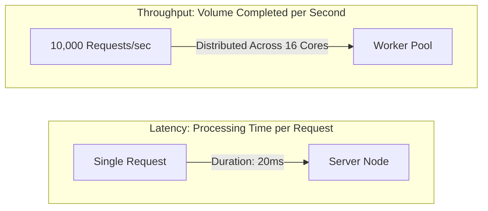
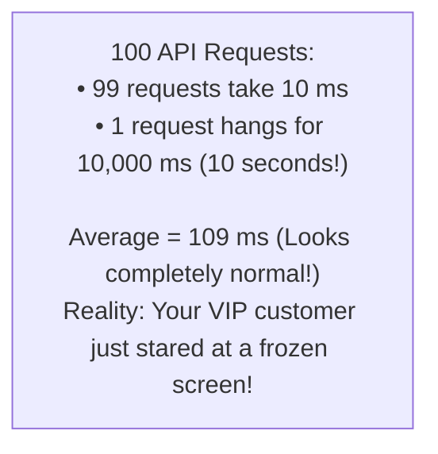
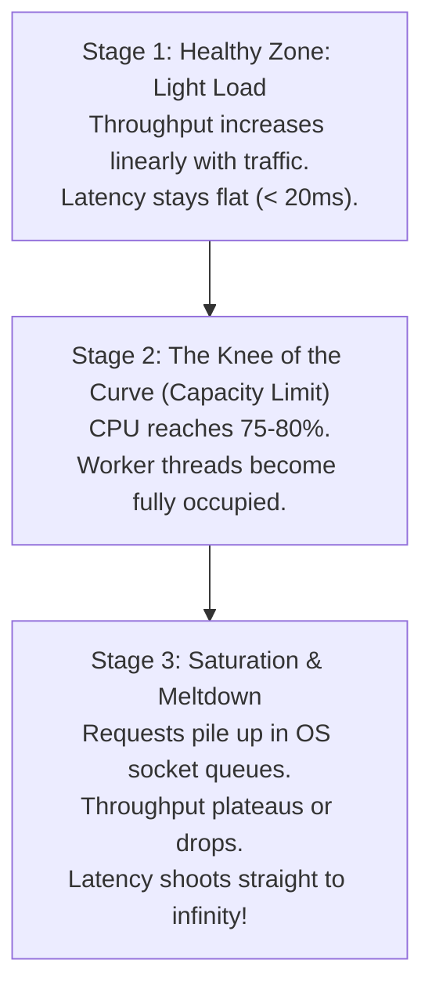

# 05. Latency vs. Throughput

[🏠 Home](../README.md) > [01. Fundamentals](./README.md) > **Latency vs. Throughput**

---

### 1. What is it? (The Highway Analogy)

| Metric | What it Measures | Analogy | Standard Unit |
|---|---|---|---|
| **Latency** | **Time** taken to complete a single task | The **speed limit** of a car on the highway | Milliseconds (`ms`) |
| **Throughput** | **Quantity** of tasks completed per unit of time | The **number of cars** passing a toll booth per minute | Queries per second (`QPS`) or `RPS` |
| **Bandwidth** | **Volume** of raw data that can flow through a pipe | The **number of physical lanes** on the highway | Megabits per second (`Mbps`) |

* **Low Latency, Low Throughput:** An empty country road with a sports car traveling at 150 km/h (1 car finishes in 5 minutes, but only 2 cars pass per hour).
* **High Latency, High Throughput:** A freight cargo ship carrying 20,000 containers across the Pacific Ocean (takes 14 days to arrive, but moves Petabytes of data per second).

---

### 2. Why "Average" Latency is a Trap (The Power of Percentiles)

Never measure your system using **Average (Mean) Latency**. Averages hide catastrophic outliers:

#### The Percentile Metrics (p50, p95, p99)

* **p50 (Median):** 50% of requests are faster than this number. Represents the standard experience.
* **p95:** 95% of requests are faster. Shows performance during minor network hiccups.
* **p99 & p99.9 (Tail Latency):** The slowest 1% (or 0.1%) of requests. **This is what FAANG monitors.**

#### Note: The Tail Latency Amplification Problem

If a single web page makes **50 microservice calls** in parallel to render your dashboard:
$$\text{Chance of hitting a p99 delay} = 1 - (0.99)^{50} \approx \mathbf{39.5\%}$$
Almost **40% of your users** will experience that excruciating p99 delay!

---

### 3. Little's Law (The Capacity Sizing Formula)

In any stable queuing system:
$$L = \lambda \times W$$
Where:
* $L$ = Number of concurrent requests currently being processed in the server.
* $\lambda$ = Arrival rate (**Throughput / QPS**).
* $W$ = Average time a request spends in the system (**Latency in seconds**).

#### Practical Interview Calculation:

> **Question:** Your app handles **5,000 QPS**, and each database query takes **200 ms ($0.2\text{s}$)**. How many concurrent database connections must your connection pool maintain?
>
> $$L = 5,000 \text{ QPS} \times 0.2 \text{ seconds} = \mathbf{1,000 \text{ connections}}$$
>
> If your connection pool is capped at 100, requests will pile up in a queue and time out!

---

### 4. The Saturation Point (The Knee of the Curve)

When a server hits 100% CPU utilization, **queuing delay** explodes exponentially. Adding just 5% more traffic can cause latency to jump from 50ms to 10 seconds.

---

### 5. How to Optimize in Production

| Goal | Architectural Fix | How it Works |
|---|---|---|
| **Reduce Latency** | **Add Redis Cache** | Serves data from RAM in 1ms instead of disk DB in 25ms |
| **Reduce Latency** | **Deploy Edge CDN** | Shortens physical distance (speed of light in fiber) |
| **Reduce Latency** | **Database Indexes** | Converts full table scan $O(N)$ into B-Tree lookup $O(\log N)$ |
| **Increase Throughput** | **Horizontal Scaling** | Adds more app server instances behind a Load Balancer |
| **Increase Throughput** | **Asynchronous Non-blocking I/O** | Single thread handles 50k idle sockets (Node.js, Go Goroutines) |
| **Increase Throughput** | **Batching (Kafka / Elasticsearch)** | Combines 1,000 individual writes into 1 bulk network disk flush |

---

### 6. Real-World FAANG Case Studies

* **Amazon:** Found that every **100 ms of added latency cost them 1% in sales**.
* **Google:** Increasing search result display time by **500 ms caused traffic to plummet by 20%**.
* **High-Frequency Trading (HFT):** Spends millions of dollars laying straight fiber-optic cables through mountains to shave **3 milliseconds** off Chicago-to-New York trades.

---

## Related Topics & Next Steps

* [How One Server Handles Requests](./how-one-server-handles-requests.md) — Understanding single-server limits.
* [Scalability: Vertical vs. Horizontal](./scaling.md) — Scaling capacity up and out.
* [Caching Fundamentals](../05-caching/cache-fundamentals.md) — Slashing database read latencies.
* [Quick Engineering Cheat Sheet](../08-cheat-sheet/quick-revision-cheat-sheet.md) — Latency numbers every engineer must know.

---

| ⬅️ Previous Topic | 🏠 Index | Next Topic ➡️ |
|:--- |:---:| ---:|
| [How One Server Handles Requests](./how-one-server-handles-requests.md) | [01. Fundamentals Index](./README.md) | [Scalability: Vertical vs. Horizontal ➡️](./scaling.md) |
