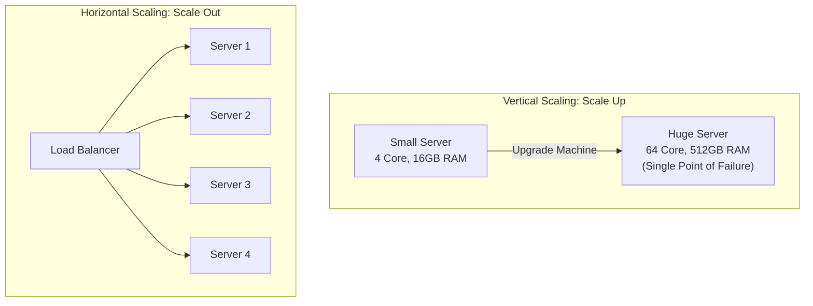

# Scalability: Vertical vs. Horizontal

> High-Level System Design | Core Fundamentals

---

### 1. What is it?

* **Plain English:** Scalability is the ability of a system to handle increasing amounts of traffic, data, or concurrent users **without degrading performance and without crashing**.
* **The Two Fundamental Scaling Paths:**
  1. **Vertical Scaling (Scale Up):** Buy a more powerful machine (more CPU cores, more RAM, faster NVMe SSD).
  2. **Horizontal Scaling (Scale Out):** Buy more machines (running identical instances of your application behind a Load Balancer).

---

### 2. Vertical vs. Horizontal: Head-to-Head Comparison

| Attribute | Vertical Scaling (Scale Up) | Horizontal Scaling (Scale Out) |
|---|---|---|
| **Action** | Upgrade to 64 vCPUs / 256 GB RAM | Add 10x smaller 4-vCPU cloud instances |
| **Downtime** | **Requires downtime** to resize VM / reboot | **Zero downtime** (Rolling deployments, dynamic autoscaling) |
| **Cost Curve** | **Exponentially expensive** at top-tier hardware | **Linear & cost-effective** using commodity hardware |
| **Hardware Limit** | Hard physical limit (highest AWS instance size) | **Virtually unlimited** (can add 1,000+ nodes) |
| **Single Point of Failure** | **High** (If that single big box dies, system is dead) | **None** (If Server 3 dies, Load Balancer routes to others) |
| **Complexity** | Extremely simple (no code changes required) | Requires **stateless architecture** + Load Balancer |


---

### 3. The #1 Prerequisite: Statelessness

You cannot scale horizontally until your application servers are **completely stateless**.
```mermaid
flowchart TD
    subgraph StatefulBug [[-] Stateful Anti-Pattern: Local Memory Sessions]
        UserA[User A] -->|1. Login Request| Serv1[Server 1: Saves Session in RAM]
        UserA -.->|2. Next Request: View Cart| Serv2[Server 2: 'Session Not Found! Please Login!']
    end
    subgraph StatelessFix [[+] Stateless Standard: Centralized State]
        UserB[User B] --> LB2[Load Balancer]
        LB2 --> Serv3[Server 1]
        LB2 --> Serv4[Server 2]
        Serv3 & Serv4 <--> RedisSession[(Centralized Redis / Memcached Session Store)]
    end
```

#### What must be removed from Application Servers?

1. **User Sessions:** Store in an in-memory database like Redis, or use signed stateless JWT tokens.
2. **Uploaded Files:** Never save user avatars or file uploads to local disk (`/var/uploads`). Save directly to **Object Storage (AWS S3, Google Cloud Storage)**.
3. **Background Jobs:** Never run cron jobs on a single app server instance (or multiple instances will execute the same job twice). Offload to a dedicated worker pool via RabbitMQ or Kafka.

---

### 4. Concurrency Models: Thread-per-Request vs. Event-Driven

How your server handles concurrent connections dictates its scaling limit:
```mermaid
flowchart LR
    subgraph ThreadPerRequest [Thread-per-Request (e.g. Traditional Tomcat/Apache)]
        direction TB
        Req1[Req 1] --> T1[Thread 1: Blocks on DB query...]
        Req2[Req 2] --> T2[Thread 2: Blocks on DB query...]
        Req3[Req 3] --> T3[Thread 3: Memory limit reached! Out of Memory!]
    end
    subgraph EventLoop [Event-Driven Non-Blocking (Node.js, Go Goroutines, Nginx)]
        direction TB
        AllReqs[10,000 Concurrent Requests] --> Loop[Single Event Loop / Go Scheduler]
        Loop -->|Dispatches async I/O| OS[OS Kernel / epoll]
    end
```
* **Thread-per-Request:** Each thread consumes 1MB–2MB of stack RAM. 5,000 concurrent threads consume 10GB of RAM just sitting idle waiting for database responses.
* **Event-Driven / Coroutines (Go Goroutines, Node.js, Netty):** Uses OS `epoll` or lightweight user-space green threads (Go goroutines cost just 2KB of memory). Can easily hold **100,000+ idle connections** on a single budget server.

---

### 5. Practical Scaling Decision Tree

```mermaid
graph TD
    Start{Where is the system bottleneck?}
    Start -->|CPU / App Logic Saturated| App[App Servers]
    App --> MakeStateless[Make app stateless]
    MakeStateless --> AddLB[Place behind Load Balancer & Autoscale horizontally]
    Start -->|Slow Database Queries| DB[Database Bottleneck]
    DB --> Index[1. Add B-Tree Indexes on query columns]
    Index --> Cache[2. Add Redis Cache for hot reads]
    Cache --> Replicas[3. Add Read Replicas (Primary-Replica)]
    Replicas --> Shard[4. Shard data across multiple DB nodes]
```

---

### 6. Real-World Case Study: WhatsApp

* **The Challenge:** WhatsApp needed to support hundreds of millions of users with a tiny team of only 30 engineers.
* **The Solution:** Instead of spinning up 10,000 servers, they scaled a single FreeBSD server running **Erlang** to maintain over **2 million simultaneous, active TCP WebSocket connections**.
* **Key Takeaway:** Concurrency architecture and efficient OS socket tuning beat raw hardware brute force.
