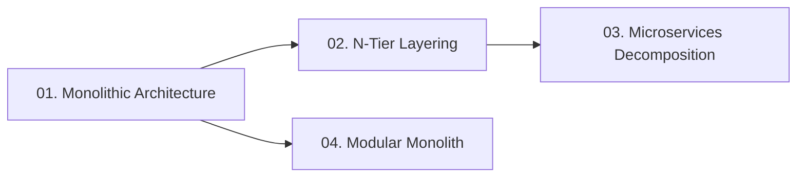

# 02. System Architecture

[🏠 Home](../README.md) > **02. Architecture**

---

## Overview

System Architecture defines how software components are organized, bounded, and deployed. Choosing the right architectural paradigm balances development speed, team coordination, system resilience, and runtime performance.

---

## 🎯 Key Learning Objectives

* **Architectural Trade-offs**: Understand the core spectrum between single-binary monoliths, layered N-tier structures, microservices, and modern modular monoliths.
* **Organizational Alignment**: Discover how Conway's Law shapes system design and when team boundaries necessitate service decoupling.
* **Database Isolation**: Compare shared monolithic database patterns against the strict database-per-service pattern in microservices.
* **Failure Blast Radiuses**: Evaluate how runtime failures propagate across architectural models and how circuit breakers isolate faults.
* **Pragmatic Evolution**: Learn why industry leaders (Shopify, Basecamp) advocate starting with modular monoliths before splitting into microservices.

---

## 📚 Module Table of Contents

| # | Topic | Key Focus | Link |
|---|---|---|---|
| **01** | **Monolithic Architecture** | Single deployable unit, module composition, when to use | [Read Guide ➡️](./monolithic.md) |
| **02** | **N-Tier Architecture** | Presentation, application, and data layers; separation of concerns | [Read Guide ➡️](./n-tier.md) |
| **03** | **Microservices Architecture** | Autonomous services, database per service, organizational scaling, Uber case study | [Read Guide ➡️](./microservices.md) |
| **04** | **Modular Monolith** | Bounded contexts, in-memory domain events, logical schemas, Shopify case study | [Read Guide ➡️](./modular-monolith.md) |
| **05** | **Server Engineering Guide** | Capacity math, Little's Law, Free vs Paid cloud limits, k6 load testing, scaling | [Read Master Guide ➡️](./server.md) |

---

## 🔍 Detailed Topic Breakdown

* 📌 **[01. Monolithic Architecture](./monolithic.md)**
  * **Core Structure**: Single unified codebase packaged and deployed as a single executable binary or container (e.g., Rails, Django, Spring Boot).
  * **Key Strengths**:
    * Zero distributed networking overhead; function calls occur directly in memory (~nanoseconds).
    * Atomic ACID transactions across all business domains within a single database.
    * Trivial local development, debugging, and end-to-end testing.
  * **Scaling Bottlenecks**: Tight coupling, single deployment bottlenecks, blast radius of crashes, and scaling the entire codebase rather than hot modules.
  * **The Modern Alternative**: *Modular Monolith*—strict in-process domain boundaries and explicit module APIs without microservice operational tax.

* 📌 **[02. N-Tier Architecture](./n-tier.md)**
  * **Layered Separation**: Enforces unidirectional dependencies across distinct functional tiers:
    * *Presentation Tier*: User interface, web browsers, mobile apps, and edge delivery.
    * *Application / Logic Tier*: Business rules, orchestration, domain calculations, and authorization.
    * *Data Tier*: Relational / NoSQL databases, file systems, and enterprise data warehouses.
  * **Security Boundaries**: Isolated subnets (public DMZ for web tier, private VPC subnets for application and database tiers).
  * **Maintainability & Decoupling**: Ability to refactor data schemas or replace UI presentation without rewriting domain business logic.

* 📌 **[03. Microservices Architecture](./microservices.md)**
  * **Core Tenets**:
    * Autonomous, loosely-coupled services organized around distinct business capabilities (Domain-Driven Design).
    * Independent CI/CD deployment cycles, individual scaling factors, and polyglot tech stacks.
    * Strict *Database-per-Service* pattern to ensure zero schema coupling.
  * **Distributed System Tax**:
    * Inter-service network latency and serialization overhead (HTTP/gRPC).
    * Eventual consistency requirements (Saga pattern replaces distributed 2-Phase Commit).
    * Operational complexity: distributed tracing (Jaeger/Zipkin), service discovery, API Gateways, and centralized logging.
  * **Real-World Case Study**: Uber's evolution from a single Python/PostgreSQL monolith to thousands of microservices and subsequent domain-oriented microservices (DOMA).

* 📌 **[04. Modular Monolith Architecture](./modular-monolith.md)**
  * **Core Structure**: Single unified deployable process structured into strictly encapsulated, domain-driven modules with explicit public APIs and isolated schemas.
  * **In-Memory Speed**: Modules communicate in nanoseconds via in-memory calls or in-process domain event buses without distributed network hops.
  * **Evolutionary Architecture**: Serves as the optimal starting architecture and seamless stepping stone to microservices if specific domains ever require independent scaling.
  * **Industry Validation**: Proven at global scale by Shopify (Packwerk) and Basecamp.

* 📌 **[05. Server Engineering & Capacity Guide](./server.md)**
  * **Comprehensive Deep-Dive**: How servers work from hardware/kernel to user space, concurrency models, and CPU/RAM sizing equations.
  * **Free vs. Paid Cloud Analysis**: Cold start sleep delays, database connection starvation, and burstable CPU throttling.
  * **Little's Law & Verification**: Real capacity calculation ($L = \lambda W$) and k6 stress testing playbooks.

---

## 💡 Key Architectural Rules of Thumb

* **Start Monolithic**: Default to a well-structured modular monolith for new products; decompose into microservices only when organizational scaling or independent scaling boundaries demand it.
* **Honor Conway's Law**: Organizations design systems that mirror their communication structures; microservices succeed when small, two-pizza teams independently own whole services end-to-end.
* **Strict Database Isolation**: If microservices share a common relational database, you have created a distributed monolith—combining the fragility of microservices with the coupling of monoliths.
* **Design for Partial Failure**: In distributed architectures, assume downstream dependencies will fail, timeout, or slow down; enforce aggressive timeouts, retries with jitter, and circuit breakers.

---

| ⬅️ Previous Module | 🏠 Index | Next Module ➡️ |
|:--- |:---:| ---:|
| [01. Fundamentals](../01-fundamentals/README.md) | [System Design Hub](../README.md) | [03. Networking & Communication ➡️](../03-networking/README.md) |
