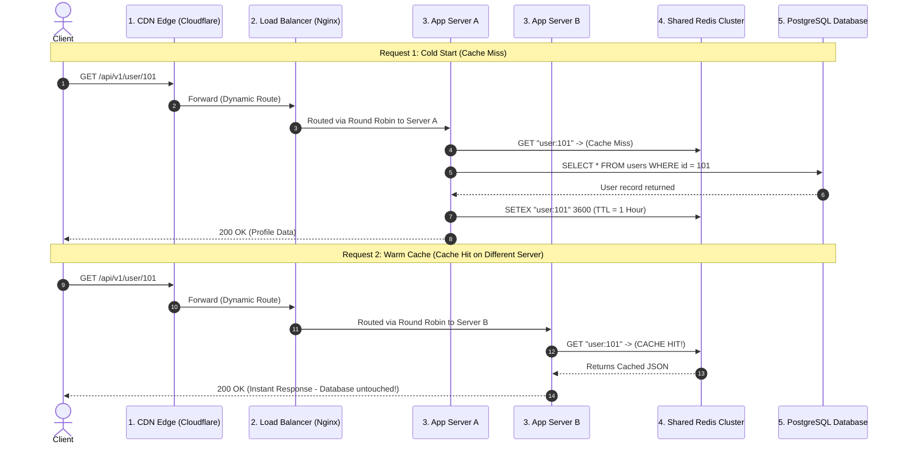

# End-to-End System Integration: Connecting Caching and Load Balancing

[System Design Hub](../README.md) > [02. Architecture](./README.md) > **Caching & Load Balancing Integration**

---

## 1. High-Level Architecture Overview

In a production web backend, Caching and Load Balancing work hand-in-hand to deliver high availability, low latency, and massive throughput.

```text
                        CLIENTS (Browsers, Mobile Apps)
                                       │
                                       ▼
                       [1] CDN EDGE CACHE (Cloudflare)
                             (Static Assets & HTML)
                                       │
                                       ▼
                     [2] REVERSE PROXY LOAD BALANCER
                             (Layer 7 - NGINX)
                                       │
                   ┌───────────────────┴───────────────────┐
                   │                                       │
                   ▼                                       ▼
         [3] App Server A                        [3] App Server B
          (Stateless C++)                         (Stateless C++)
                   │                                       │
                   └───────────────────┬───────────────────┘
                                       │
                                       ▼
                       [4] DISTRIBUTED REDIS CACHE
                                       │
                                       ▼
                       [5] PRIMARY DATABASE (PostgreSQL)
```

---

## 2. Complete Request Flow Diagram



---

## 3. Five Real-World Production Scenarios

### Scenario 1: First Request — Cold Start (Cache Miss)
1. **User Action:** The user visits their profile for the first time.
2. **CDN:** Identifies `/api/v1/user/101` as a dynamic API route and forwards it upstream.
3. **Load Balancer:** Uses Round Robin or Least Connections to choose **App Server A**.
4. **App Server A:** Queries Redis for key `user:101`.
5. **Result:** **Cache Miss** (key does not exist).
6. **Database Fallback:** Server A queries PostgreSQL: `SELECT * FROM users WHERE id = 101`.
7. **Cache Population:** Server A writes the result to Redis with a 1-hour TTL (`SETEX user:101 3600 {...}`).
8. **Response:** 200 OK returned to the user.
9. **Database Load:** Exactly 1 disk read.

### Scenario 2: Second Request — Warm Cache (Cache Hit)
1. **User Action:** The user refreshes their profile 10 seconds later.
2. **Load Balancer:** Routes the request to **App Server B**.
3. **App Server B:** Queries the **shared Redis cluster** for key `user:101`.
4. **Result:** **Cache Hit!**
5. **Response:** Server B immediately returns the profile data in $< 2\text{ ms}$.
6. **Database Load:** **Zero queries!** The database is completely protected from repeated reads.

### Scenario 3: Third Request — Stateless App Servers Sharing Cache
* Because the application tier is **stateless**, application servers do not store user sessions in local process RAM.
* Instead, all servers (Server A, Server B, Server C) connect to the **same shared Redis cluster**.
* It does not matter which server receives the user's next request; any server can instantly read the cached data written by any other server.

### Scenario 4: Fourth Request — Cache Expiration (TTL Reached)
1. **Event:** 1 hour passes, and Redis automatically evicts key `user:101`.
2. **Next Request:** Arrives at Server A.
3. **Result:** Cache Miss.
4. **Action:** Server A safely queries PostgreSQL, updates Redis with fresh data for another hour, and returns the response.

### Scenario 5: Fifth Request — Server Failure and Automatic Failover
1. **Event:** App Server A experiences a kernel panic or hardware failure.
2. **Health Check:** The Load Balancer's heartbeat probe (`GET /healthz`) detects Server A is down within 2–5 seconds.
3. **Failover:** The Load Balancer immediately marks Server A as dead and drops it from the active rotation.
4. **Traffic Rerouting:** 100% of subsequent user requests are seamlessly handled by Server B and Server C.
5. **User Experience:** Zero downtime and zero dropped requests.

---

## 4. Key Rules of Thumb for Architecture Interviews
1. **Always decouple Application State:** Never store user sessions or caches inside the application container's local memory if multiple servers are running behind a load balancer. Use a shared Redis instance.
2. **Invalidate Cache on Writes (Cache-Aside):** When a user updates their profile, write to the database and immediately delete the corresponding key from Redis (`DEL user:101`). Do not wait for the TTL to expire.
3. **Use Multiple Load Balancers in Active-Passive mode:** Use VRRP / Keepalived with a floating Virtual IP (VIP) to prevent the load balancer itself from becoming a Single Point of Failure (SPOF).

