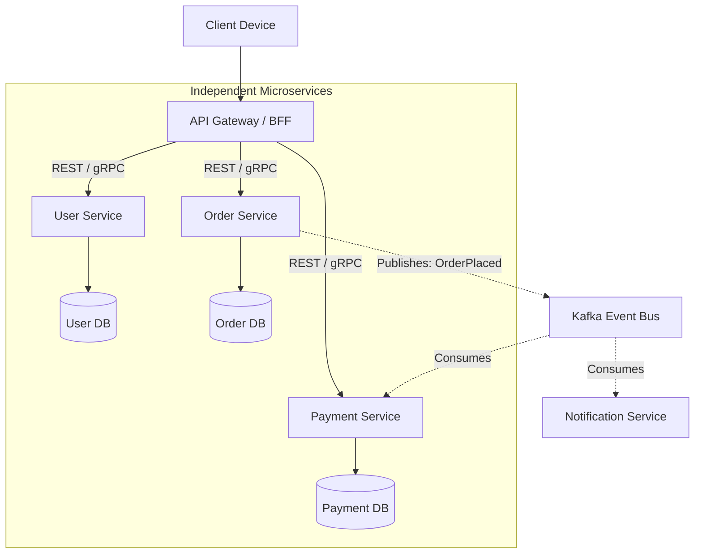

# 03. Microservices Architecture

[🏠 Home](../README.md) > [02. Architecture](./README.md) > **Microservices Architecture**

---

## 1. What is it?

**Microservices Architecture** structures a large application as a collection of **small, loosely coupled, autonomous, and independently deployable services**.

Each service models a distinct bounded business domain (e.g., Authentication, Orders, Inventory, Payments) and communicates with other services over lightweight network protocols, predominantly **REST over HTTP/JSON** or **gRPC over HTTP/2**.

---

## 2. Why do we need it?

* **The Problem without it:** In a 500-engineer monolithic codebase, deployment coordination becomes an organizational bottleneck. A single syntax error or failing test in a secondary feature delays the deployment of the entire core product for days.
* **The Real-World Benefit:** Engineering squads own services end-to-end. Autonomous teams can deploy changes to production 50+ times a day without cross-team meetings or shared release freezes.

---

## 3. Core Microservice Principles

1. **Database per Service:** Services must **never share a common database**. A shared database creates hidden schema coupling, breaks data encapsulation, and re-introduces single points of failure.
2. **Domain-Driven Design (DDD):** Services align with business capabilities. If two services must change simultaneously for every feature, they are too tightly coupled and should likely be merged.
3. **Decentralized Failure Domains:** If the Recommendation Service or Review Service crashes, the primary Checkout and Payment services must continue operating without interruption (graceful degradation).
4. **Smart Endpoints, Dumb Pipes:** Keep message brokers focused on fast message delivery; place business logic and routing decisions inside the services themselves.

---

## 4. Practical Trade-offs: Monolith vs. Microservices

| Dimension | Monolithic Architecture | Microservices Architecture |
|---|---|---|
| **Organizational Scale** | Difficult to coordinate past 100+ engineers | **[+] Enables 1,000+ engineers across autonomous squads** |
| **Operational Complexity** | Simple single CI/CD pipeline & container | **[-] Extreme:** Requires Kubernetes, Envoy, Jaeger, APM |
| **Network Latency** | **[+] Zero:** Nanosecond in-memory function calls | **[-] High:** Multi-hop network serialization ($5\text{–}25\,\text{ms}$) |
| **Transactions & Consistency** | **[+] Simple:** Single-database ACID guarantees | **[-] Complex:** Eventual consistency, Saga patterns, 2PC |
| **Debugging & Observability** | **[+] Easy:** Single stack trace in local debugger | **[-] Hard:** Requires distributed correlation IDs & tracing |
| **Deployment Speed** | Deploy all or nothing | **[+] Deploy individual services independently** |

---

## 5. Real-World Case Study: Uber

* **The Evolution:** Uber originally launched on a monolithic Python/PostgreSQL codebase. As the company expanded globally to hundreds of cities, hundreds of engineers collided on the monolithic repository.
* **The Migration:** They transitioned to thousands of microservices written in Go and Java, communicating via gRPC. Each domain (dispatch, trip pricing, driver onboarding, fraud detection) has a dedicated engineering squad and independent deployment pipeline.
* **The Lesson:** Microservices solve **organizational scaling problems**, not raw code efficiency problems. Do not adopt microservices until your engineering team size justifies the distributed systems tax.

---

## 6. Related Topics & Next Steps

* [Monolithic Architecture](./monolithic.md) — When to prefer a unified codebase over microservices.
* [Modular Monolithic Architecture](./modular-monolith.md) — Structuring a unified codebase with clean domain boundaries.
* [RPC and gRPC](../03-networking/rpc-and-grpc.md) — High-performance binary communication between microservices.
* [Communication Style Comparison](../03-networking/communication-style-comparison.md) — Choosing the right protocol for service-to-service communication.

---

| ⬅️ Previous Topic | 🏠 Index | Next Topic ➡️ |
|:--- |:---:| ---:|
| [N-Tier Architecture](./n-tier.md) | [02. Architecture Index](./README.md) | [Modular Monolithic Architecture ➡️](./modular-monolith.md) |
