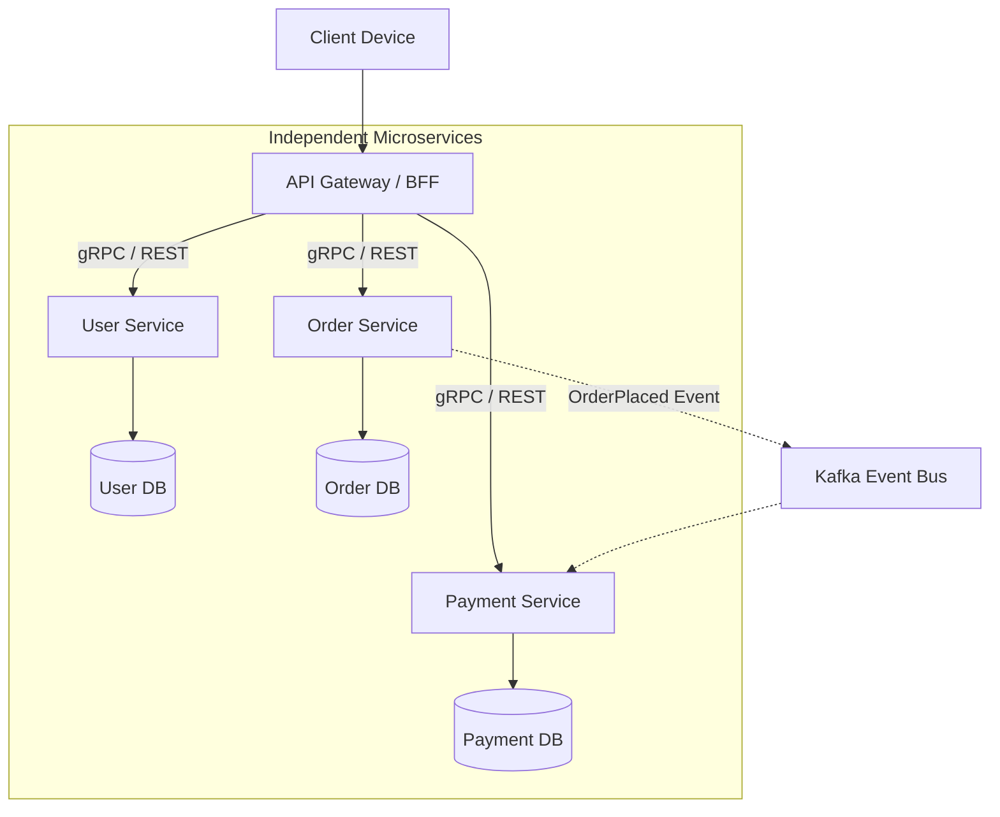

# Microservices Architecture

> High-Level System Design | Application Architecture

---

### 1. What is it?
Microservices Architecture is an approach where a large application is structured as a collection of **small, autonomous, and independently deployable services**. Each service models a specific business domain (e.g. Auth, Billing, Inventory) and communicates over lightweight network protocols (HTTP/REST or gRPC).

---

### 2. Why do we need it?
* **Problem without it:** In a 500-engineer monolithic codebase, team coordination becomes a bottleneck. A single bug in the search feature can delay deployment of the billing system for days.
* **Real-world benefit:** Autonomous teams can deploy changes to their specific service 50 times a day without coordinating with other engineering teams.

---

### 3. Architecture & Data Flow

---

### 4. Core Microservice Principles

1. **Database per Service:** Services must **never share a database**. Sharing a database creates hidden coupling and breaks schema isolation.
2. **Domain-Driven Design (DDD):** Services are scoped to bounded contexts.
3. **Decentralized Deployments:** A failure in the Recommendation Service must not bring down the Checkout Service.

---

### 5. Practical Trade-offs

| Dimension | Monolithic Architecture | Microservices Architecture |
|---|---|---|
| **Organizational Scale** | Hard to scale past 100+ engineers | **[+] Enables 1,000+ engineers across squads** |
| **Operational Complexity** | Simple single deployment pipeline | **[-] High:** Requires Kubernetes, Envoy, Jaeger, APM |
| **Network Latency** | **[+] Zero:** Nanosecond in-memory calls | **[-] High:** Multi-hop network serialization |
| **Transactions** | **[+] Simple:** Single DB ACID transactions | **[-] Hard:** Saga patterns, distributed compensation |
| **Debugging** | **[+] Easy:** Single stack trace in debugger | **[-] Hard:** Requires distributed correlation IDs |

---

### 6. Real-World Case Study
* **Uber:** Migrated from a monolithic Python backend to thousands of microservices in Go and Java to allow independent city teams and feature squads to ship updates without blocking each other.
