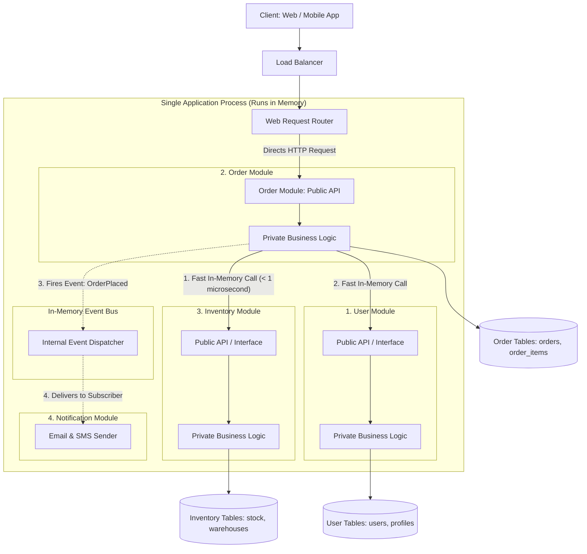

# 04. Modular Monolithic Architecture

[Home](../README.md) > [02. Architecture](./README.md) > **Modular Monolithic Architecture**

---

## 1. What is a Modular Monolith in Simple Terms?

A **Modular Monolith** is a software design where an entire application runs as **one single program** (one process, one server deployment), but the code inside is divided into **independent, neatly separated boxes called modules**.

### The Real-World Analogy
* **Traditional Monolith (Spaghetti):** A messy dorm room. All belongings are mixed together on the floor. Anyone can grab or break anything at any time.
* **Modular Monolith:** A well-organized office building. Every department (Finance, HR, Sales) has its own locked office, its own private filing cabinet, and an official reception desk.
* **Microservices:** Moving every department into separate buildings in different cities. Now, every simple conversation requires driving on a highway (network latency and transit risks).

In a Modular Monolith:
* You get the **clean organization and boundaries** of microservices.
* You keep the **simplicity, low cost, and lightning-fast speed** of a single server.

---

## 2. Architecture Diagram

The diagram below shows how a Modular Monolith works inside a single application server:



---

## 3. Step-by-Step: How a Request Flows Through the System

Let us walk through what happens when a customer clicks **"Place Order"**:

1. **Request Arrives:** The request reaches the **Web Router**. The router forwards the request to the `Order Module` through its official **Public API**.
2. **Checking Stock (In-Memory Function Call):** The `Order Module` needs to know if the item is in stock. Instead of making an expensive network call over the internet, it calls `InventoryModule.CheckStock(itemId)` directly inside computer memory. This takes **less than 1 microsecond**.
3. **Writing to Database:** The `Order Module` writes the order details into its own private table (`orders`). It **never** directly touches or edits the `inventory` or `users` tables.
4. **Publishing a Domain Event:** Once the order is saved, the `Order Module` fires an internal event: `OrderPlacedEvent`.
5. **Background Tasks:** The in-memory event dispatcher notifies the `Notification Module`, which sends a confirmation email to the user in the background.

Everything happens inside one server process without any complex network calls or distributed server crashes.

---

## 4. The 3 Golden Rules of a Modular Monolith

To keep a Modular Monolith clean and prevent it from turning into spaghetti code, engineers must follow three rules:

### Rule 1: Never Query Another Module's Database Tables Directly
* **Forbidden (Anti-Pattern):** An SQL query in the Order module directly joining the User table:
  ```sql
  -- BAD: Violates module boundaries!
  SELECT orders.id, users.email 
  FROM orders 
  JOIN users ON orders.user_id = users.id;
  ```
* **Recommended (Best Practice):** The Order module queries its own `orders` table. If it needs the user's email, it asks the User module via its public code interface:
  ```go
  // GOOD: Clean, encapsulated call
  userEmail := userModule.GetEmail(order.UserID)
  ```

### Rule 2: Strict Public Interfaces
Each folder in your project has two distinct areas:
* `api/` or `public/`: The only interfaces, types, and functions that other modules are allowed to use.
* `internal/`: All private database queries, domain logic, and helper functions. Code outside this module cannot import anything from `internal/`.

### Rule 3: Use In-Memory Events for Loose Coupling
When something happens in Module A that Module B needs to know about, do not tightly couple them together with direct dependencies. Emit an in-memory event instead:
```go
// Order module emits an event
eventBus.Publish(OrderPlacedEvent{
    OrderID: "ORD-9481",
    UserID:  "USR-102",
    Amount:  89.50,
})
```
The Notification and Analytics modules listen for this event and run their work independently.

---

## 5. Folder Structure Example

Here is how a clean Modular Monolith project looks on disk:

```text
my-application/
├── cmd/
│   └── server/
│       └── main.go              # Single entry point that starts the server
├── modules/
│   ├── users/
│   │   ├── api.go               # Public interface for other modules
│   │   └── internal/            # Private logic, models, and SQL queries
│   │       ├── service.go
│   │       └── repository.go
│   ├── orders/
│   │   ├── api.go               # Public interface
│   │   └── internal/
│   │       ├── service.go
│   │       └── repository.go
│   └── inventory/
│       ├── api.go               # Public interface
│       └── internal/
│           ├── service.go
│           └── repository.go
└── shared/
    └── eventbus/                # In-memory domain event dispatcher
```

---

## 6. Comparison: Monolith vs. Modular Monolith vs. Microservices

| Feature | Traditional Monolith | Modular Monolith | Microservices |
|---|---|---|---|
| **Deployable Units** | 1 single binary / container | **1 single binary / container** | 10 to 50+ independent services |
| **Speed of Communication** | Nanoseconds (in-memory) | **Nanoseconds (in-memory)** | 5 to 25 milliseconds (network) |
| **Code Structure** | Mixed and tangled | **Strictly separated modules** | Separate repositories / services |
| **Database Ownership** | Everyone shares all tables | **Each module owns its tables** | Separate database per service |
| **Cloud Infrastructure Cost** | Very low | **Very low** | Very high (Kubernetes, tracing, meshes) |
| **Debugging Difficulty** | Easy (single debugger) | **Easy (single debugger)** | Hard (distributed tracing required) |
| **Team Autonomy** | Low | **High (teams own modules)** | High |

---

## 7. Real-World Case Study: Shopify

In 2020, Shopify operated one of the largest e-commerce platforms in the world on a monolithic Ruby on Rails backend. 

As their engineering team grew to hundreds of developers, they faced code organization challenges. Instead of splitting into dozens of microservices, Shopify chose to build a **Modular Monolith**:
1. They wrote an open-source static analysis tool called **Packwerk** to enforce strict module boundaries at compile time.
2. If an engineer working on the `Cart` module tried to access private code inside the `Inventory` module, the automated test build failed immediately.
3. **The Result:** Shopify serves hundreds of thousands of requests per second during peak events like Black Friday from a clean, maintainable Modular Monolith without paying the heavy infrastructure and network costs of microservices.

---

## 8. When Should You Choose a Modular Monolith?

* **Default Choice for Most Projects:** Start with a Modular Monolith for any new product, MVP, or mid-sized business.
* **When You Want Fast Development:** Developers can clone one repository, run one command to start the entire system, and test everything locally with zero complex networking setup.
* **Future-Proofing for Microservices:** If one specific module (such as video encoding or payment processing) ever experiences massive traffic and needs independent server hardware, it is already cleanly isolated. You can extract it into an independent microservice in a few days.

---

## 9. Related Topics & Next Steps

* [Monolithic Architecture](./monolithic.md) - Understanding single deployable units.
* [N-Tier Architecture](./n-tier.md) - Layered separation of presentation, business logic, and data.
* [Microservices Architecture](./microservices.md) - Decomposing domains into distributed network services.

---

| Previous Topic | Index | Next Module |
|:--- |:---:| ---:|
| [Microservices Architecture](./microservices.md) | [02. Architecture Index](./README.md) | [03. Networking & Communication ->](../03-networking/README.md) |
