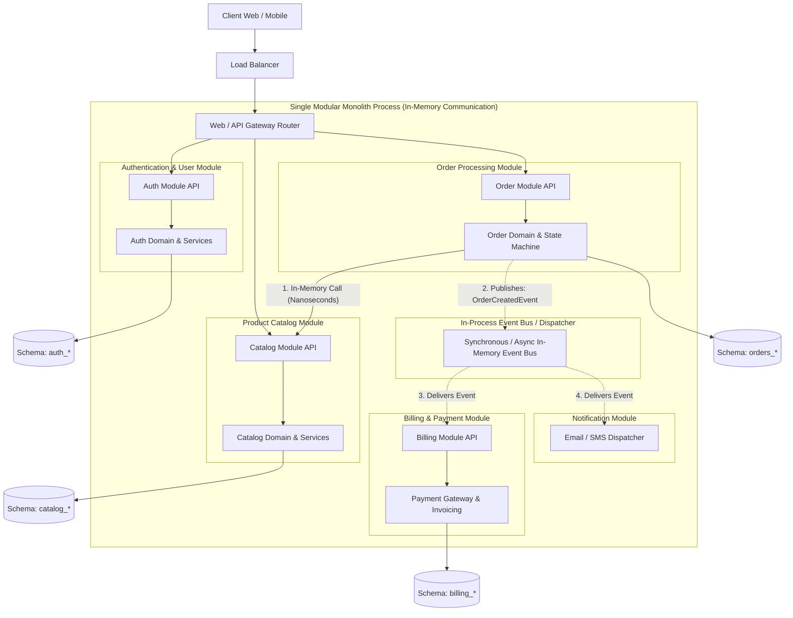
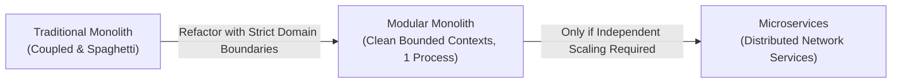

# 04. Modular Monolithic Architecture

[🏠 Home](../README.md) > [02. Architecture](./README.md) > **Modular Monolithic Architecture**

---

## 1. What is a Modular Monolith?

A **Modular Monolith** is an architectural pattern where an application is built and deployed as a **single physical unit** (one executable binary, container, or process), but internally structured into **strictly isolated, independent, and encapsulated modules**.

Unlike a traditional "spaghetti" monolith where any function can arbitrarily call any other function or query any database table, a Modular Monolith enforces:
1. **Explicit Module Boundaries:** Each module owns a specific business domain (e.g., Users, Catalog, Orders, Billing).
2. **Strict Public APIs:** Modules can only interact through well-defined public interfaces or contracts; internal implementations and data structures remain strictly private.
3. **Encapsulated Data Boundaries:** Each module owns its own tables or schema; direct SQL queries or joins across module boundaries are prohibited.
4. **Asynchronous In-Memory Events:** Modules communicate decoupled domain events (e.g., `OrderPlaced`) via an in-process event bus without distributed network hops.

---

## 2. Architecture Diagram



---

## 3. Why Modular Monolith? (The Best of Both Worlds)

Many engineering teams adopt microservices prematurely to solve code organization issues, only to suffer from:
* Distributed network latency ($10\text{–}50\,\text{ms}$ vs. $< 1\,\mu\text{s}$).
* Extreme infrastructure costs (Kubernetes clusters, service meshes, observability pipelines).
* Distributed transaction failures, eventual consistency nightmares, and complex debugging.

A Modular Monolith provides the **code clarity, boundaries, and team autonomy of microservices** with the **operational simplicity, zero network overhead, and single deployment of a monolith**.



---

## 4. Architectural Rules of a Modular Monolith

### Rule 1: No Direct Database Cross-Queries
* ❌ **Forbidden:** An order SQL query directly joining the `users` table:
  ```sql
  SELECT * FROM orders o JOIN users u ON o.user_id = u.id; -- VIOLATION!
  ```
* ✅ **Allowed:** The `Order` module calls `UserService.GetUserDetails(userId)` in memory or queries through the public User module interface.

### Rule 2: Explicit Public APIs (Contracts)
Each module contains:
* `public/` or `api/`: Interfaces, data transfer objects (DTOs), and event definitions exposed to other modules.
* `internal/`: Business logic, domain entities, repositories, and private utilities. Code outside this module cannot import from `internal/`.

### Rule 3: Decoupled Domain Events
When an event occurs in one module that another module cares about, emit an in-memory event:
```go
// Example: Emitting an event in Go
eventBus.Publish(OrderCreatedEvent{
    OrderID:    "ord_12345",
    UserID:     "usr_987",
    TotalPrice: 199.99,
})
```
The Billing and Notification modules register event handlers that execute asynchronously on background goroutines or worker threads.

---

## 5. Architectural Comparison

| Dimension | Traditional Monolith | Modular Monolith | Microservices |
|---|---|---|---|
| **Deployable Units** | 1 | **1** | 10 to 100+ |
| **Inter-Module Call Overhead** | $< 1\,\mu\text{s}$ (In-memory) | **$< 1\,\mu\text{s}$ (In-memory)** | $5\text{–}25\,\text{ms}$ (Network RPC) |
| **Code Boundaries** | Blurry / Spaghetti | **Strictly Enforced Bounded Contexts** | Physically Isolated Repositories |
| **Database Schema** | Single tangled schema | **Logically Isolated Schemas / Tables** | Physical Database Per Service |
| **Distributed Complexity** | Zero | **Zero** | Extreme (Sagas, Tracing, Meshes) |
| **Team Autonomy** | Low | **High (Module Ownership)** | High |
| **Cost & Cloud Resources** | Low | **Low (Single Server / Cluster)** | High |

---

## 6. Real-World Case Study: Shopify

In 2020, Shopify—one of the largest e-commerce platforms in the world handling hundreds of billions in commerce—faced scaling challenges in their monolithic Ruby on Rails codebase. 

Instead of rewriting their backend into hundreds of microservices, Shopify decided to build a **Modular Monolith**:
1. They created open-source tooling named **Packwerk** to enforce strict compile-time/static-analysis boundaries between packages.
2. If a developer in the `Cart` package attempted to directly access a private model in the `Tax` package, the build pipeline automatically failed.
3. They organized their codebase into bounded contexts matching their business domains.
4. **Outcome:** Shopify handles millions of requests per minute during Black Friday while maintaining developer velocity and avoiding the operational tax of distributed microservices.

---

## 7. Migration Path: Preparing for Microservices

A Modular Monolith is the ultimate bridge to microservices:
1. Because module boundaries and data ownership are already strictly separated, if a single module (e.g., Image Processing, Search, or Payment) ever requires independent autoscaling or separate hardware, it can be extracted into an independent microservice with minimal code refactoring.
2. You only pay the distributed systems tax where it is mathematically and operationally proven to be necessary.

---

## 8. Related Topics & Next Steps

* [Monolithic Architecture](./monolithic.md) — Packaging applications into single deployable units.
* [N-Tier Architecture](./n-tier.md) — Separation of concerns across presentation, logic, and data tiers.
* [Microservices Architecture](./microservices.md) — Decomposing into distributed autonomous services.

---

| ⬅️ Previous Topic | 🏠 Index | Next Module ➡️ |
|:--- |:---:| ---:|
| [Microservices Architecture](./microservices.md) | [02. Architecture Index](./README.md) | [03. Networking & Communication ➡️](../03-networking/README.md) |
