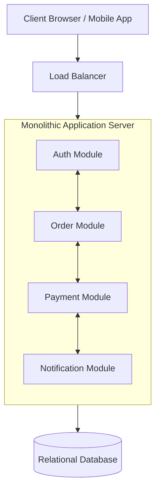

# Monolithic Architecture

> High-Level System Design | Application Architecture

---

### 1. What is it?
A Monolithic Architecture is a software model where all components—user interface handling, business logic, authentication, background workers, and data access—are packaged, compiled, and deployed together as a **single unified codebase and executable unit**.

---

### 2. Why do we need it?
* **Problem without it:** Microservices introduced on Day 1 add massive distributed systems overhead: network latency between services, complex deployments, distributed tracing, and cross-service data synchronization.
* **Real-world benefit:** A monolith provides ultra-fast development velocity, zero network overhead between internal modules (functions call each other in-memory), and simple single-command deployments.

---

### 3. Architecture & Data Flow

---

### 4. How it Works in Practice
1. The client sends an HTTP request to the monolith endpoint.
2. The internal router dispatches the request to the relevant domain controller.
3. Modules communicate via direct, high-speed **in-memory function calls** rather than network RPCs.
4. Transactions execute atomically using standard ACID database transactions.

---

### 5. Practical Trade-offs

| Dimension | Monolithic Architecture | Distributed Microservices |
|---|---|---|
| **Deployment** | **[+] Simple:** Single binary or container artifact | **[-] Complex:** Requires Kubernetes, service meshes |
| **Inter-Module Latency** | **[+] In-memory:** Nanosecond function calls | **[-] Network:** Millisecond HTTP/gRPC overhead |
| **Data Consistency** | **[+] ACID:** Single database transaction | **[-] Eventual:** Distributed 2PC or Saga patterns |
| **Fault Isolation** | **[-] Poor:** A memory leak in one module crashes all | **[+] Isolated:** One failing service does not crash others |
| **Team Scaling** | **[-] Merge conflicts:** Large teams clash on shared repo | **[+] Autonomous:** Teams own independent services |

---

### 6. Real-World Case Study
* **Shopify:** Powers millions of online storefronts on a single massive, highly organized **Modular Monolith** in Ruby on Rails. Instead of splitting into hundreds of microservices, they enforced strict boundaries inside the monolith, saving millions in infrastructure complexity.
