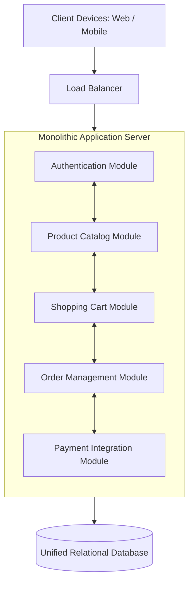

# 01. Monolithic Architecture

[🏠 Home](../README.md) > [02. Architecture](./README.md) > **Monolithic Architecture**

---

## 1. What is it?

A **Monolithic Architecture** packages all functional components of an application—user interface presentation, business logic workflows, background workers, and data access—into a **single unified codebase and deployable unit**.

For example, an e-commerce platform built as a monolith contains:
* **User Authentication Module:** Password hashing, session management, OAuth.
* **Product Catalog Module:** Search, categories, inventory levels.
* **Shopping Cart Module:** Item additions, coupon validation.
* **Order Management Module:** Checkout processing, fulfillment status.
* **Payment Integration Module:** Third-party gateway handshakes (Stripe, PayPal).

These modules run within the same operating system process, sharing CPU cycles, memory address space, and database connections.

---

## 2. Advantages & Disadvantages

### Advantages
* **Simplicity of Development & Deployment:** One codebase to clone, build, and test. Deployments require packaging a single binary, JAR, or Docker image.
* **Zero Inter-Module Network Overhead:** Modules communicate via nanosecond in-memory function calls rather than millisecond network RPCs or HTTP serialization.
* **Trivial Local Debugging:** Engineers can run the complete system locally with a single command (e.g., `npm start` or `cargo run`). Setting breakpoints and inspecting variables works across the entire stack.
* **ACID Transaction Simplicity:** Cross-module operations execute within standard single-database ACID transactions, eliminating complex distributed 2-phase commit or saga patterns.
* **Lower Initial Operational Costs:** Requires fewer cloud instances, no complex Kubernetes clusters, and minimal networking infrastructure.

### Disadvantages
* **Difficult Independent Scaling:** If the Payment module experiences heavy CPU load due to cryptographic signatures, you must scale the entire monolith rather than just the payment logic.
* **Lack of Fault Isolation:** A memory leak, unhandled exception, or CPU spike in one non-critical module (e.g., PDF generation) can crash the entire application process for all users.
* **Deployment Bottlenecks:** As teams grow, large codebases suffer from merge conflicts, longer CI/CD build times, and risky releases where a bug in one module blocks the entire release.
* **Tight Architectural Coupling:** Without strict internal discipline, module boundaries blur over time, resulting in "spaghetti code."

---

## 3. When to Use a Monolithic Architecture

A monolith is the optimal choice for:
* **Small to Medium Applications & MVPs:** Validate product-market fit with minimal operational overhead.
* **Early-Stage Startups:** Maximizes engineering velocity when requirements pivot frequently.
* **Small Engineering Teams:** A team of 2–10 engineers spends time building product features rather than debugging distributed microservice networks.
* **Uniform Scaling Requirements:** Workloads where all domains experience similar traffic patterns.

> [!IMPORTANT]
> **The Modular Monolith Alternative:** A monolith is not inherently "bad design." A **Modular Monolith** enforces strict encapsulation, clean internal domain boundaries, and private interfaces within a single deployable repository. This architecture powers multi-billion dollar companies like **Shopify** and **Basecamp** with immense reliability.

---

## 4. Monolithic vs. N-Tier vs. Microservices

| Attribute | Monolithic Architecture | N-Tier Architecture | Microservices Architecture |
|---|---|---|---|
| **Packaging** | Single deployable binary / artifact | Logically or physically separated tiers | Dozens / hundreds of independent services |
| **Inter-Component Call** | In-memory function call ($< 1\,\mu\text{s}$) | Network call or internal call ($1\text{–}5\,\text{ms}$) | Network RPC / HTTP ($5\text{–}25\,\text{ms}$) |
| **Data Boundary** | Single unified database | Data access isolated to data tier | Independent database per service |
| **Operational Overhead** | Low | Low to Moderate | High (requires K8s, tracing, service mesh) |
| **Team Autonomy** | Moderate (shared deployment) | Moderate | High (independent deployments) |

---

## 5. Related Topics & Next Steps

* [N-Tier Architecture](./n-tier.md) — Separating presentation, application, and data layers.
* [Microservices Architecture](./microservices.md) — Decomposing domains into independently deployable services.
* [Scalability: Vertical vs. Horizontal](../01-fundamentals/scaling.md) — How monoliths scale on modern cloud hardware.

---

| ⬅️ Previous Topic | 🏠 Index | Next Topic ➡️ |
|:--- |:---:| ---:|
| [Scalability: Vertical vs. Horizontal](../01-fundamentals/scaling.md) | [02. Architecture Index](./README.md) | [N-Tier Architecture ➡️](./n-tier.md) |
