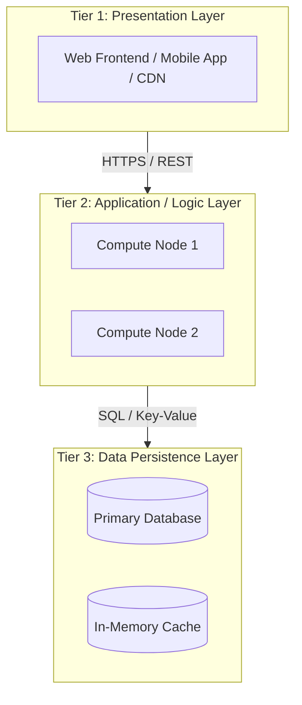

# N-Tier Architecture

> High-Level System Design | Application Architecture

---

### 1. What is it?
N-Tier Architecture separates an application into physically or logically distinct layers (tiers), where each tier has a specific responsibility and can only communicate with adjacent tiers. The classic structure is the **3-Tier Architecture**: Presentation Tier, Application (Logic) Tier, and Data Tier.

---

### 2. Why do we need it?
* **Problem without it:** In spaghetti architectures, presentation code queries the database directly, and business rules are scattered everywhere. Changing a database schema requires modifying frontend views.
* **Real-world benefit:** Enforces clean separation of concerns. You can swap out the database engine without touching frontend code, and you can scale the application compute tier independently from the storage tier.

---

### 3. Architecture & Data Flow

---

### 4. The 3 Standard Tiers

1. **Presentation Tier (UI):** Renders HTML/CSS/JS, collects user inputs, and displays data. Communicates exclusively with the Application Tier.
2. **Application Tier (Business Logic):** Validates data, enforces business rules, manages workflows, and coordinates database access. Contains no UI code and no direct SQL storage engines.
3. **Data Tier (Storage):** Relational databases (PostgreSQL, MySQL), NoSQL stores, and in-memory caches. Accessible only by the Application Tier, never directly by clients.

---

### 5. Practical Trade-offs

| Dimension | N-Tier Architecture | Single-Tier Desktop / Monolith |
|---|---|---|
| **Independent Scaling** | **[+] High:** Scale App Tier compute without adding DB licenses | **[-] None:** Entire system must scale together |
| **Security Isolation** | **[+] Secure:** Database placed in private subnet, inaccessible to internet | **[-] Risk:** App and DB share the same network zone |
| **Operational Overhead** | **[-] Moderate:** Multiple server layers to monitor and manage | **[+] Minimal:** Single box to deploy |
| **Latency** | **[-] Network hops:** 1-5ms network transit between tiers | **[+] Zero hops:** All inside same machine |
