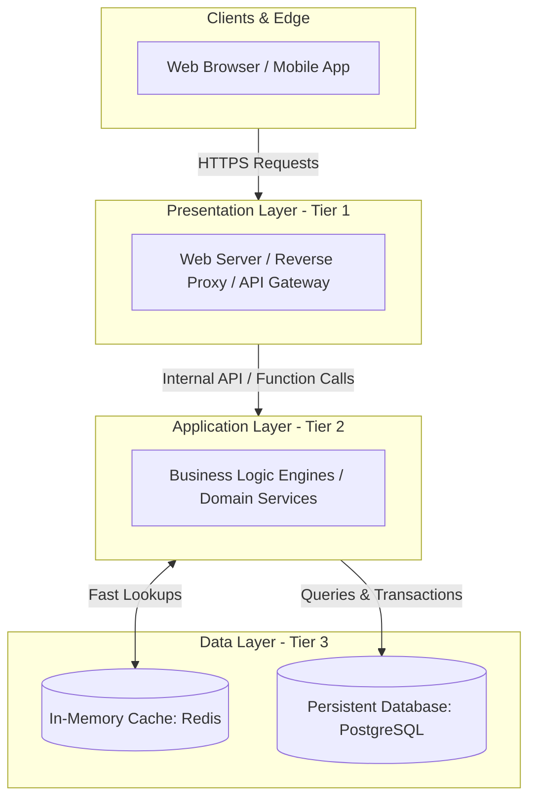

# 02. N-Tier Architecture

[🏠 Home](../README.md) > [02. Architecture](./README.md) > **N-Tier Architecture**

---

## 1. What is it?

**N-Tier Architecture** structures an application by separating concerns into **logical or physical layers (tiers)** according to their specific operational responsibilities. 

The classic and most ubiquitous variation is the **3-Tier Architecture**:
1. **Presentation Layer (Tier 1):** User interfaces, API Gateways, request routing.
2. **Application / Business Logic Layer (Tier 2):** Workflows, domain rules, validation, calculations.
3. **Data Layer (Tier 3):** Relational databases, NoSQL stores, distributed caches, and persistent files.

---

## 2. Layer Responsibilities & Technologies

| Layer | Primary Responsibility | Common Technologies |
|---|---|---|
| **Presentation** | Handles HTTP/WebSocket handshakes, parses JSON input, validates client cookies, and formats output views. | React, Vue, Next.js, Nginx, AWS CloudFront |
| **Application** | Implements core business rules, workflow transitions, pricing calculations, authentication logic, and domain authorization. | Go, Java (Spring Boot), Node.js, Python (FastAPI), C# (.NET) |
| **Data** | Stores, indexes, mutates, and retrieves persistent application state; coordinates transactions and caching. | PostgreSQL, MySQL, Redis, MongoDB, Cassandra |

---

## 3. Advantages & Disadvantages

### Advantages
* **Strict Separation of Concerns:** Changing the database engine from MySQL to PostgreSQL requires modifications only in the Data Access Layer; the Presentation Layer remains untouched.
* **Independent Scalability:** In physically separated tiers, if business logic compute spikes due to heavy CPU calculations, you can scale the Application Tier instances horizontally without provisioning extra database hardware.
* **Granular Security Isolation:** The database tier can be locked inside a private VPC subnet with strict firewall rules, inaccessible from the public internet. Only the Application Tier has authorized network access.
* **Easier Testing & Maintainability:** Mocking interfaces between layers allows frontend and backend teams to develop and unit test concurrently.

### Disadvantages
* **Network Latency Hops:** When tiers are deployed onto physically separate clusters or virtual machines, every request incurs extra network serialization and transit latency (1–5ms per hop).
* **Operational Overhead:** Managing separate continuous integration pipelines, health checks, and monitoring systems for multiple tiers adds infrastructure complexity.
* **Risk of Over-Engineering:** For simple CRUD applications, passing simple requests across 3 or 4 rigid layers can introduce boilerplate and slow down feature velocity.

---

## 4. Key Concept: Monolithic vs. N-Tier Architecture

Engineers frequently confuse these two architectural dimensions. They describe completely different aspects of a system:
* **Monolithic** describes how application functionality is **packaged and deployed** (single executable vs. distributed services).
* **N-Tier** describes how functional responsibilities are **divided into layers** (separation of concerns).

> [!NOTE]
> **An application can be both Monolithic and N-Tier!**
> A single deployable Node.js or Java monolith can internally implement clean 3-tier separation:
> * Presentation layer (`controllers/`, `routes/`)
> * Business logic layer (`services/`, `domain/`)
> * Data access layer (`repositories/`, `models/`)

---

## 5. Related Topics & Next Steps

* [Monolithic Architecture](./monolithic.md) — Packaging code into a single deployable unit.
* [Microservices Architecture](./microservices.md) — Decomposing tiers into autonomous domain services.
* [REST API Design](../03-networking/rest.md) — Standardized HTTP communication across presentation and application tiers.

---

| ⬅️ Previous Topic | 🏠 Index | Next Topic ➡️ |
|:--- |:---:| ---:|
| [Monolithic Architecture](./monolithic.md) | [02. Architecture Index](./README.md) | [Microservices Architecture ➡️](./microservices.md) |
