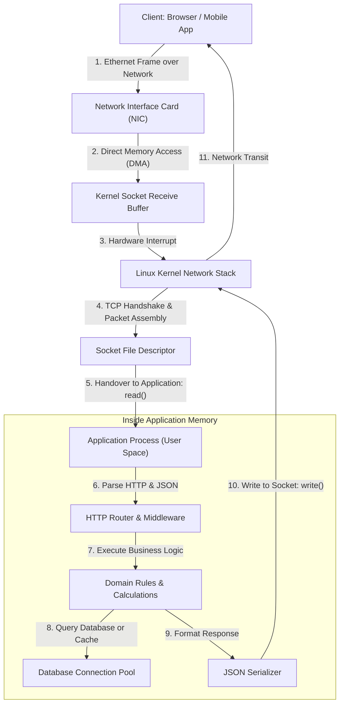
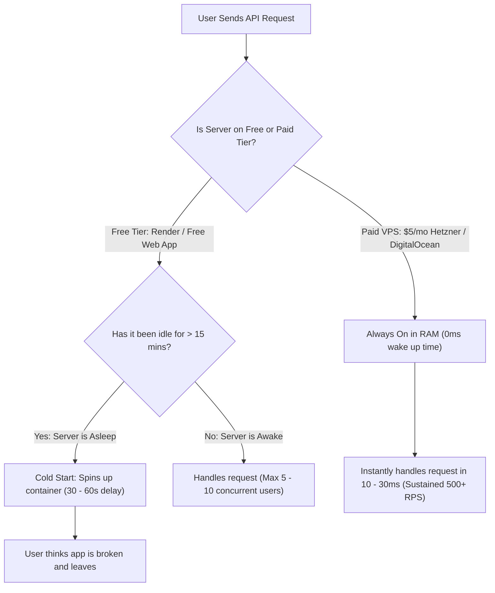
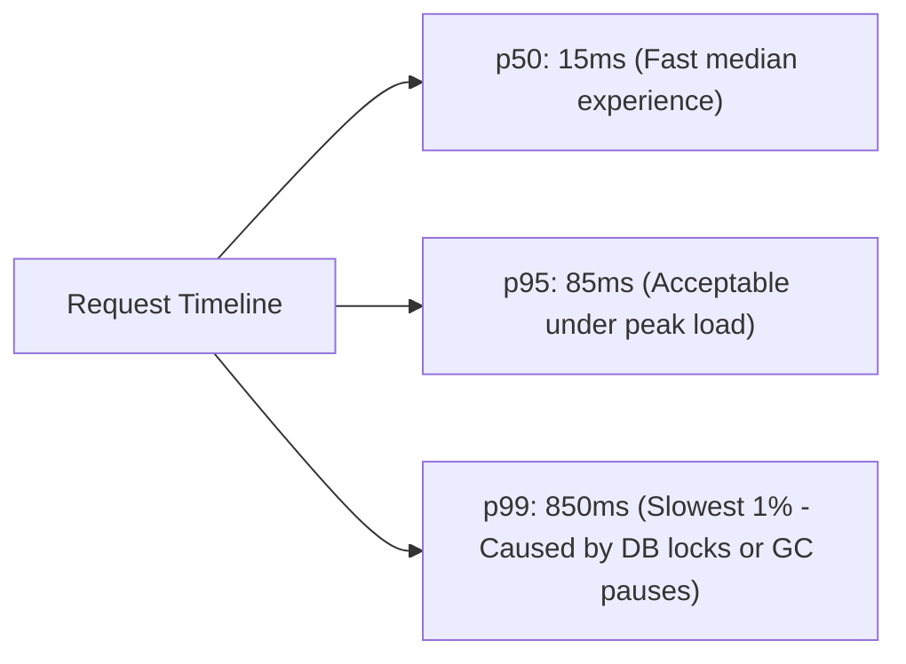
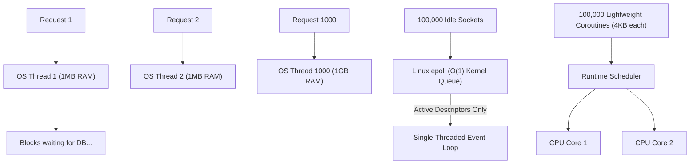
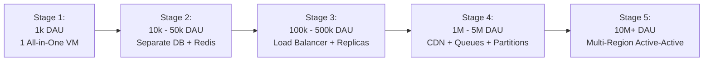
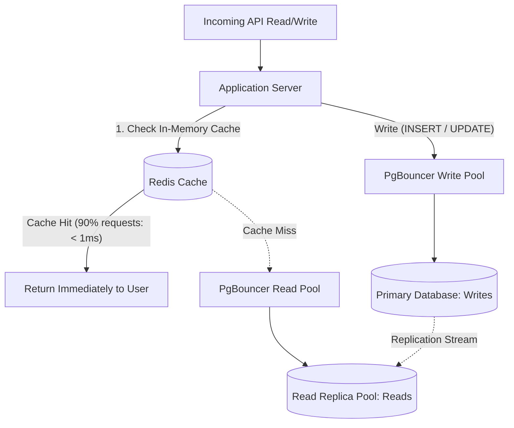
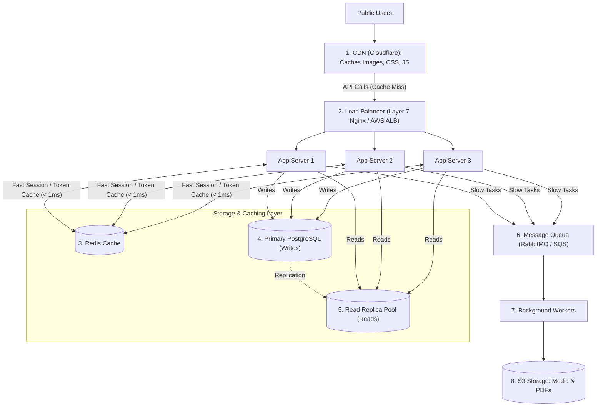
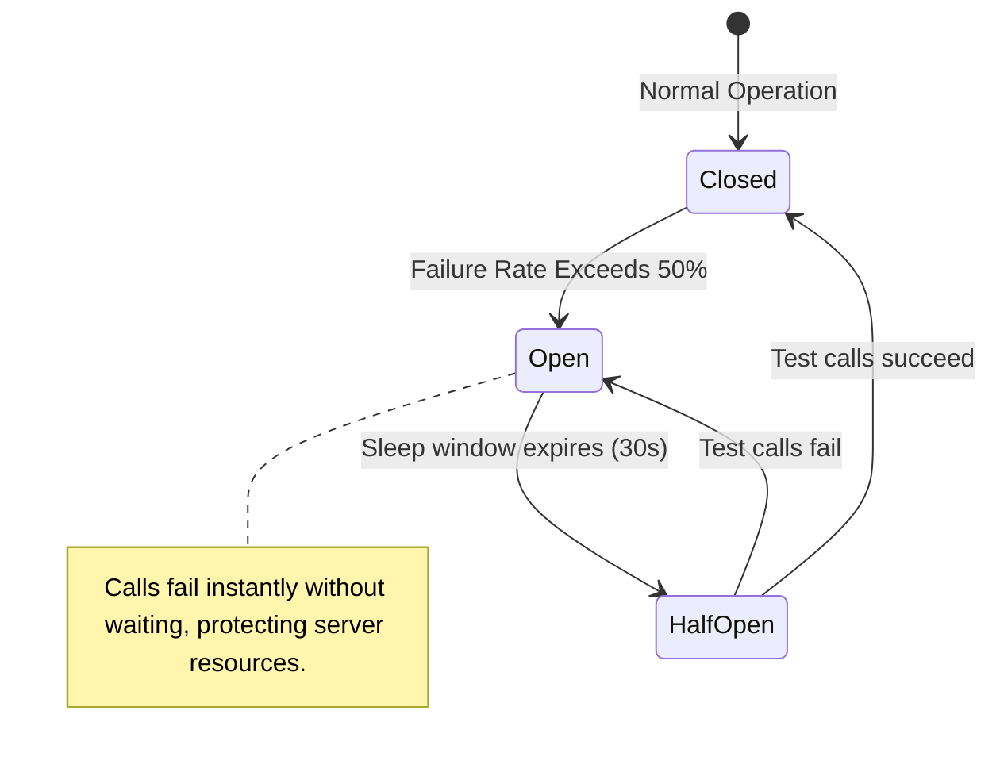
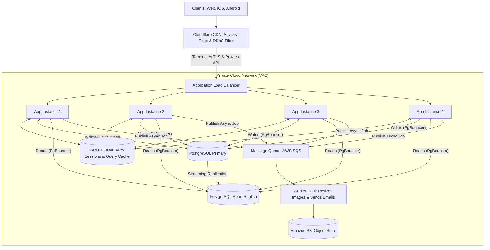

# The Complete Engineering Guide to Servers: Architecture, Capacity, Performance and Scaling

[System Design Hub](../README.md) > [02. Architecture](./README.md) > **Server Engineering Guide**

---

## Table of Contents

1. [Server Basics: How Servers Work Internally (With Plain-English Analogies)](#1-server-basics-how-servers-work-internally)
2. [Free Cloud Services vs. Paid Servers: Real Capacity Limits and The Brutal Truth](#2-free-cloud-services-vs-paid-servers-real-capacity-limits-and-the-brutal-truth)
3. [Server Capacity: Real Hardware Calculations (Without Guessing)](#3-server-capacity-real-hardware-calculations-without-guessing)
4. [Latency: Why Servers Get Slow and How to Fix It](#4-latency-why-servers-get-slow-and-how-to-fix-it)
5. [Throughput: Requests Per Second (RPS) and Little's Law](#5-throughput-requests-per-second-rps-and-littles-law)
6. [Concurrency: Handling Hundreds to Millions of Connections](#6-concurrency-handling-hundreds-to-millions-of-connections)
7. [Scaling Roadmap: Step-by-Step From 1,000 to 10,000,000 Active Users](#7-scaling-roadmap-step-by-step-from-1000-to-10000000-active-users)
8. [Database Performance: Eliminating the Number 1 Server Bottleneck](#8-database-performance-eliminating-the-number-1-server-bottleneck)
9. [Load Testing: How to Verify Real Capacity Using k6](#9-load-testing-how-to-verify-real-capacity-using-k6)
10. [Capacity Planning: CPU, RAM, Bandwidth, and Monthly Cloud Cost Math](#10-capacity-planning-cpu-ram-bandwidth-and-monthly-cloud-cost-math)
11. [High-Scale Architecture: Load Balancers, Redis, CDN, and Message Queues](#11-high-scale-architecture-load-balancers-redis-cdn-and-message-queues)
12. [Observability and Monitoring: Knowing What Your Server is Doing (RED and USE)](#12-observability-and-monitoring-knowing-what-your-server-is-doing-red-and-use)
13. [Reliability Engineering: Preventing Crashes, Handling Spikes, and Rate Limiting](#13-reliability-engineering-preventing-crashes-handling-spikes-and-rate-limiting)
14. [Optimization Tricks: Kernel Tuning, Keep-Alive, and Zero-Copy](#14-optimization-tricks-kernel-tuning-keep-alive-and-zero-copy)
15. [Real-World Backend Design: Complete 1 Million User Application Architecture](#15-real-world-backend-design-complete-1-million-user-application-architecture)
16. [Production Troubleshooting: Finding and Fixing Slow Servers in Minutes](#16-production-troubleshooting-finding-and-fixing-slow-servers-in-minutes)

---

## 1. Server Basics: How Servers Work Internally

At its core, a server is simply a computer running an operating system (usually Linux) that never goes to sleep. It runs a program that continuously listens for incoming network messages, executes business logic, and sends back responses.

### 1.1 The Everyday Restaurant Analogy
To understand every component inside a server, think of a busy restaurant:
* **The Client (Browser/Phone):** A hungry customer walking up to the restaurant counter.
* **The Network Cable & Card (NIC):** The front door and reception lobby where customers enter.
* **The Operating System Kernel:** The restaurant manager who checks reservations, hands out menus, and organizes the queue.
* **Socket Buffer:** The waiting bench where incoming customers sit before being seated.
* **Worker Threads / Application Code:** The chefs and waiters who take orders, cook food, and hand meals to the customer.
* **The Database:** The cold storage warehouse in the back where all ingredients and recipes are permanently stored.

### 1.2 Physical Hardware to Operating System Kernel



### 1.3 The Step-by-Step Life of a Single Request
When a user taps a button on their phone to fetch an API resource:
1. **Physical Reception:** The Network Interface Card (NIC) receives electrical or light signals from the fiber optic cable and converts them into digital bytes.
2. **Direct Memory Access (DMA):** The NIC copies these raw bytes directly into computer RAM without bothering the CPU.
3. **Kernel Processing:** The Linux operating system inspects the packet, validates the TCP checksum, reassembles broken segments in sequence, and places bytes into the socket receive buffer (`SO_RCVBUF`).
4. **Waking the Application:** The application server (written in Go, Node.js, Java, Python, or C++) is notified that new data has arrived via an event mechanism (`epoll`).
5. **Running Code:** The application reads the HTTP request, verifies the login token (JWT), runs pricing calculations, and queries the database.
6. **Sending the Answer:** The application formats a JSON response and writes it to the output socket (`SO_SNDBUF`). The Linux kernel wraps it into TCP packets and sends it back through the network cable to the user phone.

---

## 2. Free Cloud Services vs. Paid Servers: Real Capacity Limits and The Brutal Truth

Many beginners build an app and ask: *Can I run my real startup or production API on free tiers like Render, Vercel, or Supabase?*

Here is the objective reality: **Free cloud services are designed for learning, prototypes, and hobby demos. They are not designed for active production traffic.**

### 2.1 The Free Tier Reality Table

| Cloud Provider | Free Plan Details | Inactivity Sleep (Cold Start) | Max Database Connections | Real Maximum RPS | When It Breaks |
|---|---|---|---|---|---|
| **Render (Free Web Service)** | 0.1 vCPU, 512 MB RAM | **Shuts down after 15 min of no traffic.** Takes **30 to 60 seconds** to wake up on the next request. | N/A | ~2 - 5 RPS | Breaks when 10 to 20 users click simultaneously. Returns `502 Bad Gateway`. |
| **Vercel (Hobby Free)** | Serverless functions (Edge/Node) | Cold start: 200ms - 1.5s on first run. 10s execution limit. | Connection pooling required (exhausts Postgres fast) | ~50 - 100 RPS | Breaks if function runs longer than 10s or exceeds 100GB monthly bandwidth limit. |
| **Supabase (Free Tier)** | 2 Shared vCPUs, 500 MB DB size | **Pauses project after 7 days of inactivity.** | **Max 15 to 20 direct connections.** | ~15 - 30 QPS | Breaks when 25 concurrent users open the app. Returns `FATAL: remaining connection slots are reserved`. |
| **Railway (Starter Trial)** | Shared CPU, 512 MB RAM | Shuts off once $5 free credit runs out. | ~20 connections | ~10 - 20 RPS | Hard stops when memory hits 512MB or monthly trial credit runs out. |
| **AWS Free Tier (t2.micro / t3.micro)** | 1 vCPU, 1 GB RAM, 750 hours/month | **Does not sleep, but uses Burstable CPU credits.** | Depends on self-hosted setup (~50) | ~30 - 80 RPS | **CPU Throttling Trap:** When CPU credits run out after heavy load, CPU drops to 10%, freezing the server. |
| **Oracle Cloud (Always Free)** | 4 ARM Ampere Cores, 24 GB RAM | **Never sleeps (Best free tier available).** | 200+ | ~2,000 - 4,000 RPS | Account termination risk if Oracle flags account as idle; complex setup. |
| **Paid VPS (Hetzner / DigitalOcean $4 - $6/mo)** | 1 to 2 Dedicated/Shared vCPUs, 2 GB - 4 GB RAM | **Never sleeps. Zero cold starts.** | 100 - 300 connections | **~800 - 2,500 RPS** | Can handle **20,000 to 50,000 active daily users** easily without breaking. |



### 2.2 The 5 Hidden Gotchas of Free Cloud Services

1. **The Sleep Problem (Cold Starts):**
   Free servers turn off when nobody is using them to save power. When a new customer visits, the platform must find a server, boot a Docker container, load your code, and connect to the database. Your user stares at a blank loading screen for **45 seconds**.
2. **Database Connection Starvation:**
   PostgreSQL on free tiers limits direct connections to 15 or 20. If 20 people tap your app at the exact same second, user #21 gets an error: `Connection limit exceeded`.
3. **Burstable CPU Throttling:**
   AWS `t2.micro` instances give you CPU credits. Under normal traffic, you accumulate credits. During a traffic spike, you spend credits. Once credits hit zero, AWS artificially limits your CPU to 10% speed. Your server appears completely frozen even though it has not crashed.
4. **Memory (RAM) Crash - The OOM Killer:**
   Free servers usually give you 512 MB of RAM. A single Node.js or Python backend takes 100 MB just to boot. When users upload an image or query a large table, RAM hits 512 MB. The Linux kernel Out-Of-Memory (OOM) Killer immediately terminates your app process (`SIGKILL 9`).
5. **Egress Bandwidth Shock:**
   Free tiers allow 10 GB to 100 GB of outgoing network traffic per month. If your website serves high-resolution photos, you will blow through this limit in days.

### 2.3 When is Free OK, and When Must You Pay?
* **Use Free Services When:** You are practicing code, showing a demo to college classmates, building a portfolio project, or creating a private tool for yourself.
* **Pay for a Server ($4 to $10/month) When:** You launch to real users, collect payments, build a mobile app, or run automated background jobs. A single cheap $5/month Linux VPS (from Hetzner, DigitalOcean, or Linode) will easily outperform ten free instances combined.

---

## 3. Server Capacity: Real Hardware Calculations (Without Guessing)

Stop guessing how many users a server can handle. Server capacity is determined by **CPU execution time** and **RAM allocation limits**.

### 3.1 CPU-Bound vs. I/O-Bound Workloads

* **CPU-Bound Tasks:** The CPU core is actively computing mathematical instructions. Examples: encrypting passwords with bcrypt, compressing video files, generating PDF invoices, calculating complex financial routes.
* **I/O-Bound Tasks:** The CPU is relaxed and mostly waiting for other machines to answer. Examples: waiting for PostgreSQL to return rows, waiting for Redis to fetch a key, waiting for an external Stripe API response.

### 3.2 The Master Formula for Maximum RPS

The maximum number of requests per second a server can process is:

$$\text{RPS}_{\text{max}} = \frac{N_{\text{cores}} \times \text{Target CPU Utilization}}{\text{CPU Time Per Request (seconds)}}$$

#### Worked Example:
Suppose you have an API running on a **4-core server**.
* Each request takes a total of $50\,\text{ms}$ ($0.05\,\text{seconds}$) to complete.
* But inside those $50\,\text{ms}$, the request only spends **$4\,\text{ms}$ ($0.004\,\text{seconds}$)** executing code on the CPU core. The other $46\,\text{ms}$ are spent waiting on PostgreSQL.
* We want our server to stay safe at **$75\%$ ($0.75$)** peak CPU utilization.

$$\text{RPS}_{\text{max}} = \frac{4 \times 0.75}{0.004} = \frac{3.0}{0.004} = 750\text{ Requests Per Second (RPS)}$$

Even though the total latency is $50\,\text{ms}$, the 4 cores can start and finish **750 requests every single second**.

### 3.3 Hardware Capacity Table (Real Tested Benchmarks)

The table below shows what real production Linux servers handle under standard web workloads (APIs returning JSON with a database call):

| CPU Cores | RAM | Language / Stack | CPU Time per Request | Safe RPS (70% CPU) | Concurrent Active Users | Recommended Hardware Tier |
|:---:|:---:|---|:---:|:---:|:---:|---|
| **1 Core** | **1 GB** | Go / Rust (Optimized API) | $0.8\,\text{ms}$ | **875 RPS** | 10,000 – 15,000 | Hetzner CX22 / DO Basic ($4/mo) |
| **1 Core** | **1 GB** | Python / Ruby (Django/Rails) | $15.0\,\text{ms}$ | **46 RPS** | 500 – 1,000 | Basic VPS (Not suitable for high traffic) |
| **2 Cores** | **4 GB** | Node.js (Express / Fastify) | $3.0\,\text{ms}$ | **466 RPS** | 5,000 – 10,000 | Hetzner CPX21 / DO ($12/mo) |
| **4 Cores** | **8 GB** | Java (Spring Boot) | $4.0\,\text{ms}$ | **700 RPS** | 10,000 – 25,000 | AWS c6i.xlarge / Hetzner CPX31 |
| **4 Cores** | **8 GB** | Go (Gin / Fiber) | $1.0\,\text{ms}$ | **2,800 RPS** | 40,000 – 70,000 | AWS c7g.xlarge |
| **8 Cores** | **16 GB**| Mixed E-Commerce Platform | $4.5\,\text{ms}$ | **1,244 RPS** | 25,000 – 50,000 | AWS c6i.2xlarge |
| **16 Cores**| **32 GB**| High-Volume Auth & Payment Gateway | $1.5\,\text{ms}$ | **7,466 RPS** | 100,000 – 200,000 | AWS c6i.4xlarge |
| **32 Cores**| **64 GB**| Enterprise Bank / FinTech API | $2.5\,\text{ms}$ | **8,960 RPS** | 200,000 – 400,000 | AWS c6i.8xlarge |

*What is a Concurrent Active User?* A typical human user does not click every second. They click a button, read the screen for 15 to 20 seconds, and then click again. Therefore, a server delivering $1,000\text{ RPS}$ easily supports $1,000 \times 20 = 20,000$ active users browsing simultaneously.

### 3.4 RAM Sizing: Why Lack of Memory Kills Servers
RAM does not make your CPU faster; **RAM allows the server to keep open connections without crashing**.

$$\text{RAM Needed} = \text{OS Base (400 MB)} + \text{App Heap (100 MB - 1 GB)} + (\text{Active Sockets} \times \text{Buffer Size})$$

* Multi-threaded servers (Java Tomcat, PHP-FPM, Apache): Each worker thread allocates $1\text{ MB}$ of stack memory. 1,000 threads consume $1\text{ GB}$ of RAM before doing any work.
* Event-driven servers (Node.js, Go, Nginx): Each connection uses a tiny goroutine or file descriptor taking just $2\text{ KB} - 4\text{ KB}$. You can hold 100,000 connections in just $400\text{ MB}$ of RAM.

---

## 4. Latency: Why Servers Get Slow and How to Fix It

**Latency** is the time delay between the moment a user clicks a button and the moment the response shows up on their screen.

### 4.1 The Highway Analogy
* **Throughput (RPS):** How many cars pass under a bridge per hour.
* **Latency (ms):** How many minutes it takes for one specific car to drive from City A to City B.

A highway can have high throughput (thousands of cars moving), but if there is an accident or toll booth, latency shoots through the roof.

### 4.2 Why Averages are a Dangerous Lie: The Percentiles Rule
Never use average latency to measure your application.

Imagine 100 people visit your website:
* 99 people experience fast $10\,\text{ms}$ latency.
* 1 person gets stuck in a database lock and waits $10,000\,\text{ms}$ ($10\text{ seconds}$).

$$\text{Average Latency} = \frac{(99 \times 10) + 10,000}{100} = \frac{990 + 10,000}{100} = 109.9\,\text{ms}$$

The management report says: *Average latency is 110ms, our app is doing great.*
In reality, your paying customer just waited 10 seconds and closed their browser in frustration.

#### The Metrics You Must Track:
* **p50 (Median):** The speed experienced by the middle user. Half of your users are faster, half are slower.
* **p95:** The speed experienced by 95% of users. Good baseline for everyday health.
* **p99 (Tail Latency):** The slowest 1% of requests. If your app has 1 million clicks a day, **p99 impacts 10,000 customer sessions every single day**.



### 4.3 Why Latency Increases and How to Fix It

| Latency Cause | What is Actually Happening | Simple Fix |
|---|---|---|
| **Thread Queuing** | All worker threads are busy; new requests wait in an OS queue before being touched. | Switch to asynchronous non-blocking I/O or add more server instances. |
| **Geographic Distance** | Data travels through glass fiber optic cables at the speed of light (~$5\,\text{ms}$ per $1,000\,\text{km}$). | Put a CDN (Cloudflare) in front of your server so assets load from the user city. |
| **Missing DB Index** | The database reads millions of rows off the hard drive one by one (Full Table Scan). | Add a B-Tree index on the queried columns (`CREATE INDEX`). |
| **Garbage Collection (GC) Pauses** | In Java or Go, the runtime pauses execution for 50ms to clean up unused memory. | Reuse memory buffers using object pools (`sync.Pool`), tune memory allocation. |
| **No Connection Pool** | The server opens a brand new TCP and TLS handshake with PostgreSQL on every single HTTP request. | Use connection poolers like PgBouncer or HikariCP. |

---

## 5. Throughput: Requests Per Second (RPS) and Little's Law

### 5.1 What is Throughput?
Throughput is the volume of work your server completes per unit of time, usually measured in **Requests Per Second (RPS)** or **Queries Per Second (QPS)**.

### 5.2 Little's Law: The Mathematical Proof of Server Capacity
Discovered by mathematician John Little in 1961, **Little's Law** proves how concurrency, throughput, and latency are permanently tied together:

$$L = \lambda \times W$$

Where:
* $L$ = **Concurrent Requests In-Flight** (requests currently inside the server being processed).
* $\lambda$ = **Throughput (RPS)** (requests arriving and finishing per second).
* $W$ = **Average Latency (Service Time)** in seconds.

Rearranging the formula gives:

$$\text{RPS} = \frac{L}{W} \quad \text{and} \quad L = \text{RPS} \times W$$

#### Real-Life Calculation:
Suppose your application server thread pool can hold $100$ concurrent requests at one time ($L = 100$).

* **Case 1: Your database is fast ($W = 20\,\text{ms} = 0.02\,\text{s}$)**
  $$\text{RPS} = \frac{100}{0.02} = 5,000\text{ RPS}$$
* **Case 2: Your database slows down ($W = 200\,\text{ms} = 0.2\,\text{s}$)**
  $$\text{RPS} = \frac{100}{0.2} = 500\text{ RPS}$$

**The Brutal Lesson:** When your database gets $10\times$ slower, your server throughput immediately collapses by $90\%$. This is why slow database queries cause servers to run out of memory and crash.

---

## 6. Concurrency: Handling Hundreds to Millions of Connections

How does a single computer stay connected to 50,000 open mobile phone sockets without catching fire? Over the decades, servers evolved through three distinct concurrency models.



### 6.1 Model 1: Multi-Threaded Blocking I/O (Thread-per-Request)
* **Used by:** Classic Apache HTTP Server, older Spring Boot Tomcat, PHP-FPM.
* **How it works:** When a request arrives, the operating system assigns a full OS thread to it. If the request calls the database and waits for 50ms, that thread sits idle, doing nothing, but still holding its memory.
* **The Limit:** The Linux kernel struggles when managing more than $\sim 2,000 - 5,000$ OS threads because the CPU spends all its time switching between threads (context switching) instead of running code.

### 6.2 Model 2: Event-Driven Non-Blocking I/O (The Reactor Pattern)
* **Used by:** Nginx, Node.js, Redis, Netty.
* **How it works:** A single worker thread runs an infinite loop. When an I/O task (database query or file read) starts, the thread does not wait. It registers a notification with the Linux kernel via `epoll` and immediately handles the next user.
* **Why `epoll` is Magic:** In the 1990s, old systems scanned all 10,000 open connections in a loop to see who was talking ($O(N)$). Linux `epoll` is an $O(1)$ event table: the kernel only notifies the application when a specific socket has data ready to read.

### 6.3 Model 3: User-Space Coroutines (Lightweight Green Threads)
* **Used by:** Go (Goroutines), Elixir (BEAM processes), Java 21+ (Virtual Threads / Project Loom).
* **How it works:** You write simple, readable code that looks synchronous, but the language runtime manages millions of tiny user-space coroutines (each starting at just $2\,\text{KB} - 4\,\text{KB}$ of memory) mapped onto a handful of real CPU cores.
* **Result:** You can spawn 100,000 concurrent goroutines in just $400\,\text{MB}$ of RAM without stalling the operating system.

---

## 7. Scaling Roadmap: Step-by-Step From 1,000 to 10,000,000 Active Users

Do not build a complex distributed cluster to cross the street. Scale your application in practical, cost-effective stages.



### Stage 1: 1,000 Daily Active Users (DAU)
* **Traffic:** $\approx 10\text{ requests per minute}$. Peak $\approx 2 - 5\text{ RPS}$.
* **Setup:** Single virtual server (2 vCPU, 2 GB RAM, costing $5 - $10 / month).
* **Components:** App server, web proxy (Nginx), and PostgreSQL all live on the same machine.
* **Backups:** Automated nightly database dump pushed to cloud storage (S3).

### Stage 2: 10,000 to 50,000 DAU
* **Traffic:** Peak $\approx 50 - 150\text{ RPS}$.
* **The Change:** Split the database onto its own dedicated server so it does not fight the application for RAM and CPU.
* **Components Added:**
  * **Application Server:** $2\,\text{vCPU}, 4\,\text{GB RAM}$.
  * **Database Server:** $2\,\text{vCPU}, 8\,\text{GB RAM}$ (SSD storage).
  * **Redis Cache:** Put popular user profiles and sessions into Redis ($1\,\text{GB RAM}$) to cut database load by $80\%$.

### Stage 3: 100,000 to 500,000 DAU
* **Traffic:** Peak $\approx 500 - 1,500\text{ RPS}$.
* **The Change:** Make the application completely **stateless** and place multiple copies behind a Load Balancer.
* **Components Added:**
  * **Load Balancer:** Distributes traffic across 3 to 6 identical app servers.
  * **Database Read Replicas:** 1 Primary DB handles writes (`INSERT`/`UPDATE`), while 2 Read Replicas handle read queries (`SELECT`).

### Stage 4: 1,000,000 to 5,000,000 DAU
* **Traffic:** Sustained $2,000\text{ RPS}$, Peak $5,000 - 10,000\text{ RPS}$.
* **The Change:** Offload static traffic to the edge and handle slow jobs asynchronously.
* **Components Added:**
  * **CDN (Cloudflare / CloudFront):** Absorbs $95\%+$ of static asset requests (images, videos, CSS).
  * **Message Queues (RabbitMQ / Kafka / AWS SQS):** When a user buys an item, the app saves the order, pushes a message to the queue, and immediately returns success. Background workers send emails, update warehouses, and generate invoices.

### Stage 5: 10,000,000+ DAU (Global Scale)
* **Traffic:** $30,000 - 100,000+\text{ RPS}$.
* **The Change:** Multi-region active-active deployment.
* **Components Added:**
  * **Anycast Geo-DNS:** Routes European users to Frankfurt, American users to Virginia, and Asian users to Singapore.
  * **Database Sharding:** Data is partitioned across multiple database clusters (e.g., users 1 to 5M on Cluster A, 5M to 10M on Cluster B).

---

## 8. Database Performance: Eliminating the Number 1 Server Bottleneck

In almost every slow web application, the code is fine—**the database is choking**.



### 8.1 Database Connection Pooling
Every time your application connects directly to PostgreSQL:
1. It performs a TCP 3-way handshake.
2. It negotiates TLS encryption.
3. It checks passwords and permissions.
4. PostgreSQL forks a dedicated backend process that consumes **$5\,\text{MB} - 10\,\text{MB}$ of memory**.

If 500 users click at once, PostgreSQL runs out of memory and crashes.
**The Fix:** Use a connection pooler (**PgBouncer** or **HikariCP**). The app keeps a steady pool of 50 open connections. Incoming requests borrow an existing connection for 2ms, run their query, and return it to the pool immediately.

### 8.2 B-Tree Indexes (Turning Minutes into Milliseconds)
Without an index, the database must read every single row from the disk. On a table with 10 million rows, this takes 10 to 30 seconds.
A **B-Tree index** organizes data into a sorted tree structure. Finding any record takes only 3 or 4 fast pointer jumps ($< 1\,\text{ms}$).

```sql
-- BAD: Scans all 10,000,000 rows sequentially!
SELECT id, total_amount, created_at 
FROM orders 
WHERE user_id = 94821 AND status = 'COMPLETED';

-- GOOD: Creates a Composite B-Tree Index
-- Rule: Put Equality columns first (=), Range columns last (>, <, ORDER BY)
CREATE INDEX idx_orders_user_status_created 
ON orders (user_id, status, created_at DESC);
```

---

## 9. Load Testing: How to Verify Real Capacity Using k6

Never assume your server works until you have actively tested it with synthetic traffic.

### 9.1 The 5 Types of Load Tests
1. **Smoke Test:** 1 to 5 virtual users. Validates that endpoints don't return 500 errors.
2. **Load Test:** Simulates everyday expected traffic. Measures p95 latency.
3. **Stress Test:** Gradually increases users until the server breaks. Identifies your exact breaking point.
4. **Spike Test:** Goes from 0 to 5,000 users in 10 seconds. Verifies how your system handles sudden surges.
5. **Soak Test:** Runs at 70% load for 24 hours. Catches memory leaks and disk-space exhaustion.

### 9.2 Complete k6 Test Script (`load_test.js`)

Install k6 (free and open source):
```bash
# On Linux/macOS
brew install k6 # or sudo apt install k6
```

Save this script as `load_test.js`:
```javascript
import http from 'k6/http';
import { check, sleep } from 'k6';

export const options = {
  stages: [
    { duration: '1m', target: 50 },   // Warm-up to 50 users
    { duration: '3m', target: 200 },  // Sustained load: 200 users
    { duration: '2m', target: 800 },  // Stress phase: 800 users
    { duration: '1m', target: 0 },    // Ramp-down
  ],
  thresholds: {
    http_req_duration: ['p(95)<200'], // 95% of requests must finish within 200ms
    http_req_failed: ['rate<0.01'],   // Errors must be less than 1%
  },
};

export default function () {
  const res = http.get('https://api.myapp.com/api/v1/products?limit=10');
  
  check(res, {
    'status is 200': (r) => r.status === 200,
    'response under 200ms': (r) => r.timings.duration < 200,
  });

  sleep(1); // User think time
}
```

Run the test:
```bash
k6 run load_test.js
```

**How to find your breaking point:** Look at the output graph. Throughput (RPS) will rise steadily with users. At a certain point, RPS will flatline, and latency will shoot up vertically. **That plateau is your true maximum server capacity.**

---

## 10. Capacity Planning: CPU, RAM, Bandwidth, and Monthly Cloud Cost Math

Let us calculate the exact hardware and cloud cost needed for an application with **2 Million Registered Users**.

### 10.1 Traffic Calculation
* **Registered Users:** $2,000,000$
* **Daily Active Users (DAU):** $150,000$ ($7.5\%$ of users visit each day)
* **Actions per User:** An active user makes $30$ API calls during an average session.
* **Daily Total Requests:** $150,000 \times 30 = 4,500,000\text{ requests per day}$
* **Average RPS:** $4,500,000 / 86,400\text{ seconds} \approx 52\text{ RPS}$
* **Peak Traffic Window:** $40\%$ of traffic arrives between 18:00 and 22:00 (a 4-hour window).
* **Peak 4-Hour RPS:** $(4,500,000 \times 0.40) / (4 \times 3600) = 1,800,000 / 14,400 = 125\text{ RPS}$
* **Design Target (with 3x Flash Spike buffer):** $125 \times 3 = \mathbf{375\text{ Peak RPS}}$

### 10.2 Server & Core Math
Profiling shows each request takes an average of **$8\,\text{ms}$ ($0.008\,\text{seconds}$)** of CPU time.
To handle $375\text{ RPS}$ at $60\%$ maximum CPU load:

$$\text{Cores Needed} = \frac{375 \times 0.008}{0.60} = \frac{3.0}{0.60} = 5\text{ CPU Cores}$$

Using standard $2\,\text{vCPU}$ cloud instances:
* Base instances needed: $5 / 2 = 2.5 \implies 3\text{ instances}$.
* Add $N+1$ redundancy (so 1 instance can die without affecting users): **4 Application Instances ($2\,\text{vCPU}, 4\,\text{GB RAM}$ each)**.

### 10.3 Realistic Monthly Cloud Bill

| Infrastructure Component | Hardware Spec | Quantity | Estimated Cost |
|---|---|:---:|:---:|
| **App Servers** | 2 vCPU, 4 GB RAM (Hetzner / AWS) | 4 | $96 / month |
| **Primary Database** | 4 vCPU, 16 GB RAM, NVMe SSD | 1 | $110 / month |
| **Read Replica Database** | 4 vCPU, 16 GB RAM, NVMe SSD | 1 | $110 / month |
| **Redis Cache** | 4 GB Managed In-Memory Cluster | 1 | $35 / month |
| **Load Balancer** | Cloud Managed ALB / HAProxy | 1 | $22 / month |
| **Cloudflare CDN** | Edge Caching & DDoS Protection | 1 Domain | $25 / month |
| **Storage & Backups** | Amazon S3 (500 GB) | 1 | $12 / month |
| **Total Production Cost** | *High-availability, zero-downtime architecture* | - | **~$410 / month** |

---

## 11. High-Scale Architecture: Load Balancers, Redis, CDN, and Message Queues



### 11.1 Layer 4 vs. Layer 7 Load Balancing
* **Layer 4 (Transport Layer):** Looks only at IP addresses and TCP port numbers. It does not inspect HTTP headers or cookies. Super fast (millions of packets per second). Example: AWS NLB.
* **Layer 7 (Application Layer):** Inspects HTTP URLs, cookies, and JSON payloads. It terminates SSL/TLS and routes `/api/users` to the User cluster and `/api/videos` to the Video cluster. Example: AWS ALB, Nginx, HAProxy.

### 11.2 What Redis Does in High-Traffic Systems
Redis stores key-value pairs in **pure computer RAM**, making reads and writes take under **1 millisecond**:
1. **Query Caching:** Saves the JSON output of expensive SQL queries.
2. **User Sessions:** Keeps login tokens so if Server 1 reboots, the user stays logged in on Server 2.
3. **Rate Limiting:** Keeps a fast counter of how many times an IP address clicked in the last 60 seconds.
4. **Distributed Locks:** Ensures two users cannot book the exact same airline seat at the same microsecond.

---

## 12. Observability and Monitoring: Knowing What Your Server is Doing (RED and USE)

If you do not monitor your servers, your users become your monitoring system (by complaining on social media).

### 12.1 The RED Method (For Applications)
* **Rate:** How many requests per second are arriving?
* **Errors:** How many requests are failing (returning HTTP 500 or 502)?
* **Duration:** How long are requests taking (p50, p95, p99 latency)?

### 12.2 The USE Method (For Hardware)
* **Utilization:** How busy is the resource? (e.g. CPU at 75%).
* **Saturation:** Is extra work waiting in line? (e.g. CPU run queue $> \text{core count}$, or disk queue $> 0$).
* **Errors:** Are there hardware or network drops? (e.g. dropped network packets).

### 12.3 What the Four HTTP Status Families Mean
* **HTTP 200 OK:** Everything worked as expected.
* **HTTP 400 - 429 (Client Errors):** The user did something wrong (bad password, missing field, or clicked too fast `429 Too Many Requests`).
* **HTTP 500 (Internal Server Error):** Your backend code threw an unhandled exception or crashed on a null pointer.
* **HTTP 502 / 504 (Gateway Error / Timeout):** Your web proxy (Nginx) tried to reach your backend application or database, but the backend was dead or took too long to answer.

---

## 13. Reliability Engineering: Preventing Crashes, Handling Spikes, and Rate Limiting

### 13.1 The Circuit Breaker Pattern
If your third-party payment gateway (like PayPal or Stripe) slows down and takes 30 seconds to answer:
* Without a Circuit Breaker: Every incoming customer waits 30 seconds. Your server runs out of worker threads and crashes for everyone.
* With a Circuit Breaker: After 10 failed requests, the breaker **opens**. For the next 30 seconds, it immediately returns: *Payment gateway currently experiencing delays, please try again* without waiting. Your main server stays alive.



### 13.2 Rate Limiting (Token Bucket Algorithm)
To stop malicious bots and scrapers from exhausting your CPU, enforce the **Token Bucket** algorithm:
* Imagine a bucket holding 10 tokens. Every second, 2 new tokens are dropped in.
* Every time a user makes a request, 1 token is removed.
* If a bot makes 20 requests in half a second, the bucket runs out of tokens. The server immediately returns **HTTP 429 Too Many Requests**.

---

## 14. Optimization Tricks: Kernel Tuning, Keep-Alive, and Zero-Copy

### 14.1 The Magic of HTTP Keep-Alive
Opening a new TCP connection requires a 3-way handshake (`SYN -> SYN-ACK -> ACK`) plus a TLS cryptographic handshake. This takes **3 round-trips ($40\,\text{ms} - 100\,\text{ms}$)** before sending a single byte of data.
* **Without Keep-Alive:** The browser opens and closes a new connection for every single image and API call.
* **With Keep-Alive (`Connection: keep-alive`):** The browser reuses the same open TCP connection for all requests, making subsequent requests take only **$5\,\text{ms} - 15\,\text{ms}$**.

### 14.2 Zero-Copy File Transfers (`sendfile`)
When serving an image or file from disk:
* Standard Way: Kernel reads file into kernel RAM -> copies to app RAM -> app copies back to kernel network buffer -> sent to NIC. (4 context switches, high CPU load).
* **Zero-Copy (`sendfile`):** The kernel pipes bytes directly from the disk cache straight into the network card without touching application memory. CPU usage drops to almost zero.

---

## 15. Real-World Backend Design: Complete 1 Million User Application Architecture

Here is the exact production blueprint for a modern SaaS app with **1,000,000 Registered Users** ($\approx 100,000\text{ DAU}$, $1,200\text{ Peak RPS}$):



### Key Design Highlights:
1. **Presigned Uploads to S3:** When users upload photos, they do NOT upload them to the application server. The app server gives them a secure S3 Presigned URL. The user uploads directly to Amazon S3. This saves massive server bandwidth and memory.
2. **Stateless App Nodes:** If traffic spikes, the auto-scaler automatically spins up 2 additional instances in 60 seconds without dropping user sessions.

---

## 16. Production Troubleshooting: Finding and Fixing Slow Servers in Minutes

When production is slow or throwing errors, follow this fast diagnostic checklist:

### The 4-Step Terminal Triage

#### Step 1: Check CPU and System Load
```bash
# Open interactive process viewer
htop

# Check 1-minute, 5-minute, and 15-minute load averages
uptime
# RULE: If the 1-minute load average is greater than your number of CPU cores,
# your CPU is overloaded and requests are waiting in line!
```

#### Step 2: Check Memory and Swap Death
```bash
# Check free memory in Megabytes
free -m

# Inspect memory stats every 2 seconds
vmstat 2
# CRITICAL RULE: Look at the 'si' (swap-in) and 'so' (swap-out) columns.
# If these numbers are greater than 0, your server has run out of RAM and is
# using the hard drive as memory. Your server will run 1,000x slower!
```

#### Step 3: Check Disk Saturation
```bash
# Check disk utilization
iostat -xz 1
# CRITICAL RULE: Look at '%util'. If '%util' is near 100%, your hard drive is
# saturated with database reads or logging writes!
```

#### Step 4: Find Stuck Slow Database Queries in PostgreSQL
```sql
-- Find all queries currently running for more than 2 seconds
SELECT 
    pid, 
    now() - pg_stat_activity.query_start AS duration, 
    query, 
    state 
FROM pg_stat_activity 
WHERE (now() - pg_stat_activity.query_start) > interval '2 seconds'
  AND state != 'idle'
ORDER BY duration DESC;

-- Kill a hung query that is locking tables
SELECT pg_cancel_backend(14920);
```

---

## Quick Reference Summary

* **Always Measure Percentiles:** Track p95 and p99, never averages.
* **Keep Application Servers Stateless:** Store sessions in Redis so servers can be added or deleted at any time.
* **Free Services are for Learning:** Upgrade to a simple paid VPS ($4 to $10/mo) before launching to real users to eliminate cold starts and connection limits.
* **Pool Your Database Connections:** Always use PgBouncer or HikariCP to prevent connection exhaustion.
* **Index Your SQL Queries:** Ensure columns in `WHERE` and `ORDER BY` clauses use composite B-Tree indexes.
* **Verify With Load Tests:** Run k6 stress tests to discover your true saturation point before your users find it for you!
