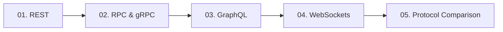

# 03. Networking and API Communication

[🏠 Home](../README.md) > **03. Networking**

---

## Overview

Distributed systems rely entirely on networking protocols and API communication patterns to coordinate services, exchange data, and deliver results to users. Choosing the appropriate protocol directly impacts latency, throughput, mobile battery consumption, and team development speed.

---

## Module Table of Contents

| # | Topic | Key Focus | Link |
|---|---|---|---|
| **01** | **REST (Representational State Transfer)** | Resource design, HTTP verbs & idempotency, status codes, RESTful URL patterns | [Read Guide ➡️](./rest.md) |
| **02** | **RPC and gRPC** | Protocol Buffers, HTTP/2 multiplexing, unary & bidirectional streaming, service contracts | [Read Guide ➡️](./rpc-and-grpc.md) |
| **03** | **GraphQL** | Client-driven querying, queries/mutations/subscriptions, N+1 problem & DataLoader | [Read Guide ➡️](./graphql.md) |
| **04** | **WebSockets** | Full-duplex persistent TCP channels, handshake upgrade, Redis Pub/Sub scaling | [Read Guide ➡️](./websockets.md) |
| **05** | **Communication Style Comparison** | Master feature comparison matrix, decision flowchart, production coexistence | [Read Guide ➡️](./communication-style-comparison.md) |

---

| ⬅️ Previous Module | 🏠 Index | Next Module ➡️ |
|:--- |:---:| ---:|
| [02. Architecture](../02-architecture/README.md) | [System Design Hub](../README.md) | [04. Load Balancing ➡️](../04-load-balancing/README.md) |
