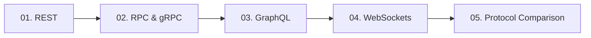

# 03. Networking and API Communication

[🏠 Home](../README.md) > **03. Networking**

---

## Overview

Distributed systems rely entirely on networking protocols and API communication patterns to coordinate services, exchange data, and deliver results to users. Choosing the appropriate protocol directly impacts latency, throughput, mobile battery consumption, and team development speed.

---

## 🎯 Key Learning Objectives

* **Transport & Protocol Foundations**: Understand the trade-offs between HTTP/1.1 text-based pipelines, HTTP/2 binary multiplexing, and full-duplex TCP streams.
* **Payload Serialization**: Compare human-readable JSON payloads against compact, strongly-typed Protocol Buffers (Protobuf).
* **Idempotency & Semantics**: Master standard HTTP verbs (`GET`, `POST`, `PUT`, `DELETE`, `PATCH`), idempotent operations, and correct HTTP status code usage.
* **Client-Driven vs. Server-Driven APIs**: Contrast fixed-endpoint REST models with dynamic, flexible GraphQL schemas and combat the N+1 query problem.
* **Real-Time Communication**: Implement bidirectional, event-driven WebSockets and scale concurrent persistent connections using Pub/Sub brokers.
* **Protocol Selection**: Confidently choose between REST, gRPC, GraphQL, and WebSockets based on latency budgets, network constraints, and team boundaries.

---

## 📚 Module Table of Contents

| # | Topic | Key Focus | Link |
|---|---|---|---|
| **01** | **REST (Representational State Transfer)** | Resource design, HTTP verbs & idempotency, status codes, RESTful URL patterns | [Read Guide ➡️](./rest.md) |
| **02** | **RPC and gRPC** | Protocol Buffers, HTTP/2 multiplexing, unary & bidirectional streaming, service contracts | [Read Guide ➡️](./rpc-and-grpc.md) |
| **03** | **GraphQL** | Client-driven querying, queries/mutations/subscriptions, N+1 problem & DataLoader | [Read Guide ➡️](./graphql.md) |
| **04** | **WebSockets** | Full-duplex persistent TCP channels, handshake upgrade, Redis Pub/Sub scaling | [Read Guide ➡️](./websockets.md) |
| **05** | **Communication Style Comparison** | Master feature comparison matrix, decision flowchart, production coexistence | [Read Guide ➡️](./communication-style-comparison.md) |

---

## 🔍 Detailed Topic Breakdown

* 📌 **[01. REST (Representational State Transfer)](./rest.md)**
  * **Architectural Constraints**: Statelessness, client-server decoupling, cacheability headers (`ETag`, `Cache-Control`), and uniform resource interfaces.
  * **Resource Modeling**: Plural nouns for collections (`/users`, `/orders`), hierarchical nested relationships (`/users/{id}/orders`), and query parameter filtering.
  * **Idempotency & Verbs**:
    * `GET`, `PUT`, `DELETE`, `HEAD`: Strictly idempotent (repeating identical requests produces identical side-effects).
    * `POST`, `PATCH`: Non-idempotent by default; require idempotency keys in payment and order processing.
  * **HTTP Status Code Precision**: 2xx (Success), 3xx (Redirection), 4xx (Client errors: 400 Bad Request, 401 Unauthorized, 403 Forbidden, 404 Not Found, 429 Too Many Requests), 5xx (Server errors: 500 Internal, 502 Bad Gateway, 503 Service Unavailable, 504 Gateway Timeout).

* 📌 **[02. RPC and gRPC](./rpc-and-grpc.md)**
  * **Core Paradigm**: Remote Procedure Calls treating remote network operations as local language method invocations with strict contracts.
  * **Protocol Buffers (Protobuf)**: Language-neutral, binary serialization format; 3–10x smaller and 20–50x faster to serialize/deserialize than JSON.
  * **HTTP/2 Transport Superpowers**: Binary framing, header compression (HPACK), and single-TCP connection multiplexing (eliminating head-of-line blocking at the application layer).
  * **Streaming Capabilities**: Unary (standard request-response), Server Streaming (real-time market feeds), Client Streaming (bulk telemetry upload), and Bidirectional Streaming.
  * **Ideal Use Cases**: High-throughput inter-service microservice backbones, polyglot backend systems, and resource-constrained IoT/mobile networks.

* 📌 **[03. GraphQL](./graphql.md)**
  * **The Problem Solved**: Eliminates *over-fetching* (downloading 50 unused fields) and *under-fetching* (issuing 10 sequential REST requests to render a single screen).
  * **Schema & Type System**: Single strongly-typed schema declaring Types, Queries (read), Mutations (write), and Subscriptions (reactive push).
  * **The N+1 Query Dilemma**: How nested resolvers trigger explosive database query storms ($1$ parent query + $N$ child queries).
  * **DataLoader Batching**: Collecting IDs within an execution frame and executing a single bulk SQL `WHERE id IN (...)` query with memoized caching.
  * **Best Fit**: Complex frontends, mobile client aggregations, and public developer APIs aggregating multiple microservices.

* 📌 **[04. WebSockets](./websockets.md)**
  * **Persistent Bidirectional Channel**: Begins as an HTTP/1.1 `Upgrade: websocket` handshake and transforms into a persistent, full-duplex TCP stream with minimal 2-byte framing overhead.
  * **Heartbeats & Keep-Alive**: Ping/Pong control frames to detect silently dropped connections, dead mobile nodes, and middlebox NAT timeouts.
  * **Horizontal Scaling Challenge**: WebSockets are stateful; client A and client B may be connected to different physical servers.
  * **Pub/Sub Fanout Broker**: Using Redis Pub/Sub, Kafka, or RabbitMQ to route messages across distributed WebSocket server fleets.
  * **Target Workloads**: Real-time multiplayer gaming, live chat messaging, collaborative document editing (Google Docs), and financial ticker feeds.

* 📌 **[05. Communication Style Comparison](./communication-style-comparison.md)**
  * **Comprehensive Feature Matrix**: Comparing transport protocols, payload formats, performance overhead, browser support, and caching maturity.
  * **Architectural Decision Trees**: Exact criteria for selecting REST vs. gRPC vs. GraphQL vs. WebSockets based on clients, latency, and team scale.
  * **Production Coexistence Pattern**: How modern tech giants deploy GraphQL/REST at the edge/client gateway while utilizing gRPC internally across microservices and WebSockets for real-time channels.

---

## 💡 Key Architectural Rules of Thumb

* **Internal vs. External Traffic**: Use REST or GraphQL for external mobile/web clients (broad browser compatibility, firewall-friendly, mature edge caching); use gRPC for internal service-to-service microservice backbones (ultra-low latency, CPU efficiency).
* **Always Solve N+1 in GraphQL**: Never launch a production GraphQL service without batching libraries like DataLoader; unbatched resolvers will overwhelm backend databases.
* **Enforce Idempotency**: For critical write endpoints (charges, order creation), accept a unique `Idempotency-Key` header to safely handle client network retries without double-charging.
* **Beware WebSocket Overhead**: WebSockets maintain open file descriptors and TCP state on servers; use HTTP/2 Server-Sent Events (SSE) if data flow is purely unidirectional from server to client.

---

| ⬅️ Previous Module | 🏠 Index | Next Module ➡️ |
|:--- |:---:| ---:|
| [02. Architecture](../02-architecture/README.md) | [System Design Hub](../README.md) | [04. Load Balancing ➡️](../04-load-balancing/README.md) |
