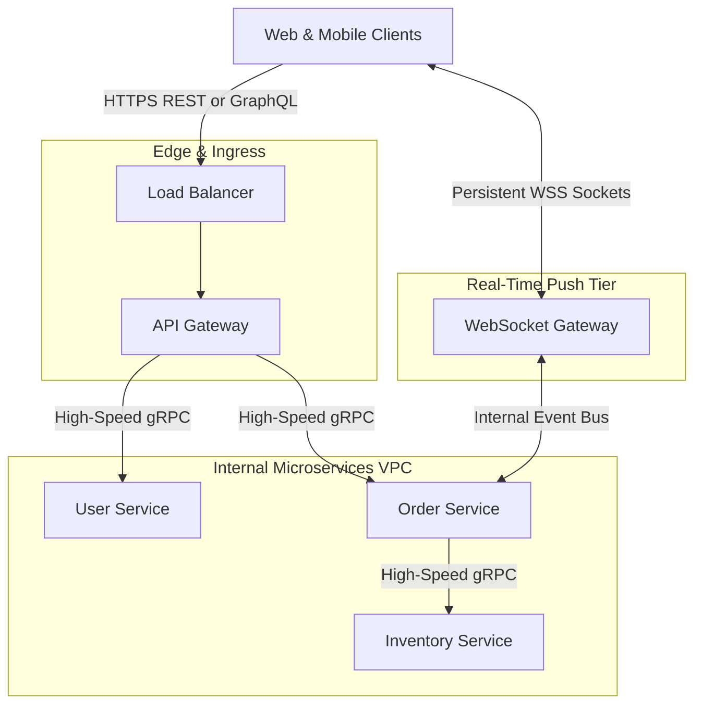
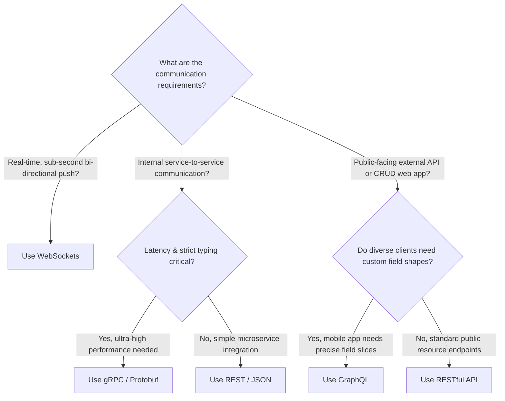

# 05. Communication Style Comparison

[🏠 Home](../README.md) > [03. Networking](./README.md) > **Communication Style Comparison**

---

## 1. Overview: Selecting the Right API Paradigm

In modern distributed systems, no single protocol satisfies every communication need. High-scale architectures typically **combine multiple communication styles** across different boundaries:
* **Edge / Public Internet:** REST or GraphQL for client applications.
* **Internal Microservices:** gRPC for fast, low-latency, strongly typed calls.
* **Live Features:** WebSockets for real-time bidirectional push events.

---

## 2. Head-to-Head Comparison Matrix

| Feature | REST | RPC / gRPC | GraphQL | WebSockets |
|---|---|---|---|---|
| **Architectural Model** | Resource-oriented | Operation-oriented (RPC) | Graph & Schema-oriented | Channel & Message-oriented |
| **Communication Flow** | Unidirectional Request-Response | Request-Response & Streaming | Unidirectional Request-Response | **Full-Duplex Bidirectional** |
| **Underlying Protocol** | HTTP/1.1 or HTTP/2 | **HTTP/2 (Mandatory)** | HTTP/1.1 or HTTP/2 (POST) | **TCP (WebSocket Framing)** |
| **Wire Data Format** | JSON, XML, Plaintext | **Binary Protocol Buffers** | JSON | Arbitrary Text (JSON) or Binary |
| **Client Field Selection** | Fixed by endpoint structure | Defined by IDL method contract | **Full client query control** | Defined by application payload |
| **Streaming Support** | No (Limited SSE) | **Native (Client, Server, BiDi)** | Via Subscriptions | **Continuous raw streaming** |
| **HTTP Caching** | **Excellent (Native URL / CDN)** | Requires application caching | Complex (all HTTP POST) | Not applicable |
| **Payload Overhead** | Medium to High (JSON strings) | **Minimal (Compact binary tags)** | Medium (JSON strings) | **Minimal (~2 bytes per frame)** |
| **Connection Nature** | Short-lived / Keep-Alive | Persistent HTTP/2 connection | Short-lived / Keep-Alive | **Long-lived persistent TCP** |

---

## 3. Architectural Decision Flowchart

---

## 4. Practical Rules of Thumb

1. **Use REST** for standard public-facing developer APIs, simple CRUD resources, and web applications that benefit from out-of-the-box CDN edge caching.
2. **Use gRPC** for internal service-to-service communication within your cloud cluster where low latency, compact bandwidth, and strict multi-language type contracts are essential.
3. **Use GraphQL** when building multi-platform frontend applications (iOS, Android, Web, Smart TVs) with diverse data requirements aggregating data from multiple backend microservices.
4. **Use WebSockets** whenever either the server or client must push events instantly without polling (live chat, game state, collaborative documents, order tracking).

> [!TIP]
> **Coexistence in Production:** It is common for a production application to expose a **GraphQL API Gateway** to mobile apps, use **WebSockets** for push notifications, and route backend requests between microservices via **gRPC**.

---

## 5. Related Topics & Next Steps

* [What is a Load Balancer?](../04-load-balancing/what-is-a-load-balancer.md) — Distributing HTTP and TCP traffic across backend pools.
* [Layer 4 vs. Layer 7 Load Balancing](../04-load-balancing/layer-4-vs-layer-7.md) — Understanding application-level vs. transport-level routing.

---

| ⬅️ Previous Topic | 🏠 Index | Next Topic ➡️ |
|:--- |:---:| ---:|
| [WebSockets](./websockets.md) | [03. Networking Index](./README.md) | [What is a Load Balancer? ➡️](../04-load-balancing/what-is-a-load-balancer.md) |
