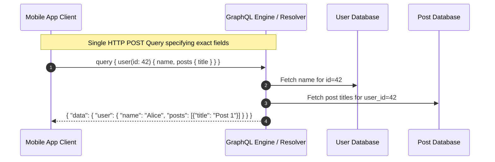

# GraphQL

> High-Level System Design | Networking & Communication Protocols

---

### 1. What is it?
GraphQL is a query language and server runtime for APIs developed by Meta (Facebook). Instead of multiple fixed endpoints returning fixed data structures (like REST), GraphQL exposes a **single endpoint** where the client specifies the exact fields and nested relationships it requires.

---

### 2. Why do we need it?
* **Problem without it:**
  * **Over-fetching:** A mobile app only needs a user's name, but `/api/users/42` returns 50 fields including address, phone, and history, wasting mobile data.
  * **Under-fetching (N+1 Calls):** To render a profile page, the client must call `/users/42`, then `/users/42/posts`, then `/posts/101/comments` across multiple round trips.
* **Real-world benefit:** The client retrieves everything it needs in a **single HTTP request** with zero wasted bandwidth.

---

### 3. Architecture & Data Flow

---

### 4. Practical Trade-offs

| Dimension | GraphQL | REST |
|---|---|---|
| **Payload Control** | **[+] Exact Fields:** Client never receives unused data | Fixed payload determined by backend |
| **Network Requests** | **[+] Single Request:** Aggregates multiple resources | Multiple round trips to different endpoints |
| **Server-Side Complexity** | **[-] High:** Requires writing resolvers, DataLoader to fix N+1 | Simpler route controllers |
| **Caching with CDNs** | **[-] Complex:** Queries use HTTP POST; edge caching is difficult | **[+] Native HTTP GET caching** |
| **Query Vulnerabilities** | **[-] Denial of Service:** Deeply nested recursive queries | Pre-defined, bounded queries |

---

### 5. Real-World Case Study
* **GitHub & Shopify:** Provide public GraphQL APIs so third-party developers and mobile apps can extract tailored data without requesting multiple endpoints or downloading bloated JSON objects.
