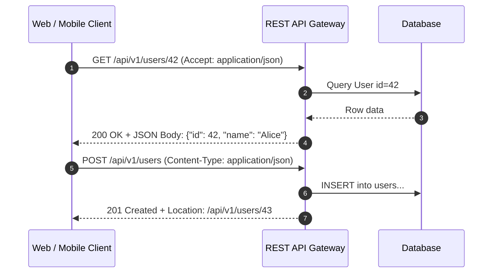

# REST (Representational State Transfer)

> High-Level System Design | Networking & Communication Protocols

---

### 1. What is it?
REST is an architectural style for designing networked web APIs. It models data as **resources** identified by clean URIs (e.g. `/users/42`), manipulated using standard **HTTP verbs** (`GET`, `POST`, `PUT`, `PATCH`, `DELETE`), and transferred using structured formats like JSON.

---

### 2. Why do we need it?
* **Problem without it:** Ad-hoc remote procedure calls without standards create messy endpoints like `/getUser`, `/fetchUserById`, `/delete_user_record`, making client-server integration difficult and breaking standard HTTP caching.
* **Real-world benefit:** Universal interoperability. Any programming language, browser, or device that speaks HTTP can consume a REST API without custom client SDKs.

---

### 3. Architecture & Data Flow

---

### 4. The 6 Constraints of REST

1. **Client-Server Separation:** UI logic is completely isolated from data storage logic.
2. **Statelessness:** No client context is stored on the server between requests. Every request contains all necessary credentials (e.g. Bearer token).
3. **Cacheability:** Responses explicitly define whether they can be cached via `Cache-Control` headers.
4. **Uniform Interface:** Standard URI paths, HTTP verbs, and status codes (200, 201, 400, 404, 500).
5. **Layered System:** The client cannot tell whether it is connected directly to the end server or to an intermediary proxy/CDN.
6. **Code on Demand (Optional):** Servers can temporarily extend client functionality by transferring executable code (e.g. JavaScript).

---

### 5. Practical Trade-offs

| Dimension | REST | gRPC | GraphQL |
|---|---|---|---|
| **Ecosystem & Tooling** | **[+] Universal:** Works in every language and browser | Requires Protobuf compiler & client SDKs | Requires client libraries (Apollo, Relay) |
| **Performance** | **[-] Text-based JSON overhead:** Slower parsing | **[+] Binary serialization:** 7-10x faster | Moderate JSON overhead |
| **Data Fetching Efficiency** | **[-] Over-fetching:** Returns all fields even if only 1 is needed | Precise schema fields | **[+] Client queries exact fields** |
| **HTTP Caching** | **[+] Native:** Works out of the box with CDNs | Complex | Hard (all queries are HTTP POST) |
