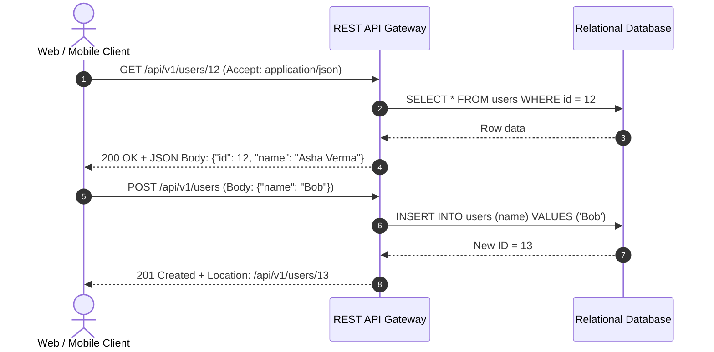

# 01. REST (Representational State Transfer)

[🏠 Home](../README.md) > [03. Networking](./README.md) > **REST**

---

## 1. What is REST?

**REST (Representational State Transfer)** is an architectural style commonly used to build networked web APIs over HTTP. It models application state and data as **resources** identified by uniform URIs (e.g., `/api/v1/users/12`), manipulated using standard **HTTP verbs** (`GET`, `POST`, `PUT`, `PATCH`, `DELETE`), and represented in structured formats like JSON.



---

## 2. Core Principles of REST

| Principle | Meaning & Engineering Impact |
|---|---|
| **Stateless Communication** | Each request contains all credentials and parameters needed to process it. No client session state is retained in server RAM. |
| **Resource-Oriented Design** | Entities are nouns identified by intuitive URLs (e.g., `/orders`, `/orders/101`). |
| **Standard HTTP Methods** | Explicit operations use standard HTTP semantics (`GET`, `POST`, `PUT`, `PATCH`, `DELETE`). |
| **Representations** | Clients and servers negotiate formats (typically JSON, but can be XML, HTML, or CSV). |
| **Cacheability** | HTTP responses explicitly define caching rules via `Cache-Control` and `ETag` headers. |

---

## 3. HTTP Methods & Idempotency

> [!IMPORTANT]
> **Idempotency Defined:** An HTTP method is **idempotent** if making the same request multiple times produces the exact same side-effect on server state as executing it once. (Note: The response status or body does not need to be identical).

| Method | Purpose | Idempotent? | Example URI |
|---|---|:---:|---|
| **GET** | Retrieve a resource representation | **Yes** | `GET /api/v1/users/12` |
| **POST** | Create a new subordinate resource or trigger an operation | **No** | `POST /api/v1/users` |
| **PUT** | Create or completely replace a resource at a known URI | **Yes** | `PUT /api/v1/users/12` |
| **PATCH** | Partially update specific attributes of a resource | **Depends** | `PATCH /api/v1/users/12` |
| **DELETE** | Delete a specified resource | **Yes** | `DELETE /api/v1/users/12` |

---

## 4. Request & Response Lifecycle Example

### Client Request
```http
GET /api/v1/users/12 HTTP/1.1
Host: example.com
Accept: application/json
Authorization: Bearer eyJhbGciOi...
```

### Server Response
```http
HTTP/1.1 200 OK
Content-Type: application/json; charset=utf-8
Cache-Control: max-age=300, public
ETag: "33a64df551425fcc55e4d42a148795d9f25f89d4"

{
  "id": 12,
  "name": "Asha Verma",
  "email": "asha@example.com",
  "created_at": "2026-03-15T09:30:00Z"
}
```

---

## 5. Common HTTP Status Codes

| Status Code | Meaning | When to Return |
|---|---|---|
| **200 OK** | Success | Standard response for successful `GET`, `PUT`, `PATCH`. |
| **201 Created** | Created | Successful `POST` creating a new resource; return `Location` header. |
| **204 No Content** | No Content | Successful operation with no return payload (e.g., `DELETE`). |
| **400 Bad Request** | Client Error | Malformed JSON syntax or schema validation failure. |
| **401 Unauthorized** | Unauthenticated | Missing or expired authentication token / credentials. |
| **403 Forbidden** | Unauthorized | Client is authenticated, but lacks permission to view the resource. |
| **404 Not Found** | Missing Resource | The requested URI does not map to any database entity. |
| **429 Too Many Requests** | Rate Limited | Client exceeded API rate limits (Token Bucket exhaustion). |
| **500 Internal Error** | Server Error | Unhandled runtime exception or crash in application code. |
| **503 Service Unavailable** | Overloaded | Server cannot handle load or downstream database is unreachable. |

---

## 6. Clean RESTful URL Design Patterns

Follow these conventions for intuitive APIs:

```http
# Collections & Items
GET    /users              # List users (paginated)
POST   /users              # Create a new user
GET    /users/12           # Get user 12
PUT    /users/12           # Replace user 12
PATCH  /users/12           # Update email of user 12
DELETE /users/12           # Delete user 12

# Nested Sub-Resources
GET    /users/12/orders    # List orders placed by user 12
POST   /users/12/orders    # Create order for user 12
GET    /orders/101         # Direct access to order 101
```

---

## 7. Advantages, Disadvantages & Best Use Cases

### Advantages
* **Universal Browser & Tooling Compatibility:** Supported natively by every language, browser, Postman, curl, and API gateway.
* **Built-in HTTP Caching:** Leverages intermediate CDN edge proxies, browser caches, and reverse proxies out-of-the-box.
* **Stateless Horizontally Scalable:** Servers maintain no local session state, making horizontal auto-scaling seamless.

### Disadvantages
* **Over-Fetching & Under-Fetching:** Endpoints return fixed data structures. A mobile screen needing only a user's name must download the full 50-field JSON payload.
* **Chatty Network Calls:** Rendering a complex dashboard may require multiple sequential round-trips (`/user`, `/orders`, `/recommendations`).

### Best Use Cases
* Public external developer APIs.
* Standard CRUD web and mobile applications.
* E-commerce catalog and checkout backends.

---

## 8. Related Topics & Next Steps

* [RPC and gRPC](./rpc-and-grpc.md) — High-performance binary alternative for internal microservices.
* [GraphQL](./graphql.md) — Flexible client-driven querying to eliminate over-fetching.
* [WebSockets](./websockets.md) — Persistent bidirectional protocol for real-time events.
* [Communication Style Comparison](./communication-style-comparison.md) — Master protocol comparison matrix.

---

| ⬅️ Previous Topic | 🏠 Index | Next Topic ➡️ |
|:--- |:---:| ---:|
| [Microservices Architecture](../02-architecture/microservices.md) | [03. Networking Index](./README.md) | [RPC and gRPC ➡️](./rpc-and-grpc.md) |
