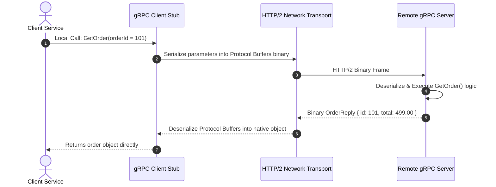
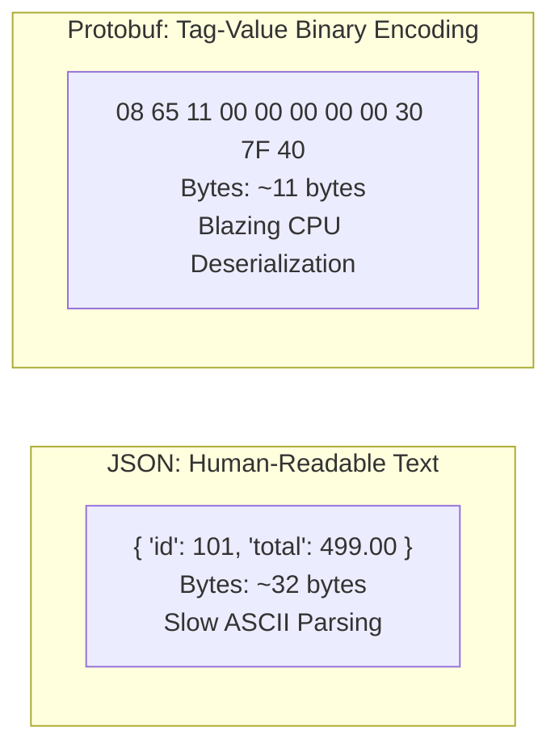

# 02. RPC and gRPC

[🏠 Home](../README.md) > [03. Networking](./README.md) > **RPC and gRPC**

---

## 1. What is RPC?

**RPC (Remote Procedure Call)** is a distributed communication model that enables a client program to invoke a procedure or subroutine on a remote server as if it were a local function call in memory.

Unlike REST, which organizes APIs around **nouns and resources** (`GET /orders/101`), RPC organizes APIs around **operations and procedures** (`OrderService.GetOrder(101)`).



---

## 2. What is gRPC?

**gRPC** is Google's open-source, high-performance universal RPC framework. It runs on top of **HTTP/2** (providing bi-directional streaming, header compression, and multiplexing) and uses **Protocol Buffers (Protobuf)** as its Interface Definition Language (IDL) and binary wire format.

### Example Service Contract (`order.proto`)

```protobuf
syntax = "proto3";

package ecommerce;

// Service definition exposing remote callable procedures
service OrderService {
  rpc GetOrder (OrderRequest) returns (OrderReply);
  rpc StreamOrders (CustomerRequest) returns (stream OrderReply); // Server streaming
}

// Request data structure
message OrderRequest {
  int32 id = 1;
}

// Response data structure
message OrderReply {
  int32 id = 1;
  double total = 2;
  string status = 3;
}
```

Code generation compilers (`protoc`) take this `.proto` file and automatically generate strongly typed client stubs and server boilerplate in Go, Java, Python, C++, TypeScript, and Rust.

---

## 3. Protocol Buffers vs. JSON Serialization



* **Tag-based Encoding:** Protobuf maps field names to small integer tags (e.g., `id = 1`). Over the wire, it transmits only the tag and value, omitting repetitive string keys.
* **CPU Efficiency:** Serialization avoids string scanning, heap allocations, and ASCII parsing, resulting in **7x to 10x lower CPU utilization** than standard JSON parsers.

---

## 4. Advantages & Disadvantages of gRPC

### Advantages
* **Strict Type Safety & Code Generation:** The `.proto` file serves as a single source of truth across all polyglot microservices, preventing runtime schema mismatches.
* **High Performance & Low Latency:** Compact binary payloads and HTTP/2 multiplexing allow thousands of requests to travel concurrently over a single TCP connection.
* **Native Streaming Capabilities:** Supports four communication modes:
  1. **Unary:** Single request $\to$ single response.
  2. **Server Streaming:** Single request $\to$ stream of responses.
  3. **Client Streaming:** Stream of requests $\to$ single response.
  4. **Bidirectional Streaming:** Client and server read/write streams concurrently.

### Disadvantages
* **Not Browser Friendly:** Web browsers cannot easily send raw HTTP/2 frames or binary Protobuf without intermediary proxies like `grpc-web` or Envoy.
* **Difficult Manual Inspection:** You cannot inspect binary gRPC packets in standard curl or browser dev tools without specialized tools (e.g., `grpcurl`, Postman gRPC).
* **Tight Coupling to Service Contracts:** Breaking schema changes require careful field deprecation management.

---

## 5. Best Use Cases

* **Internal Microservice Communication:** Low-latency service-to-service calls inside cloud Kubernetes clusters.
* **Real-Time Data Streaming:** High-frequency IoT telemetry, financial price feeds, and chat notifications.
* **Polyglot Backends:** Distributed teams writing services across Go, Java, C++, and Python sharing strict IDL contracts.

---

## 6. Related Topics & Next Steps

* [REST Architecture](./rest.md) — Universal resource-oriented API style for public clients.
* [GraphQL](./graphql.md) — Client-driven data fetching for complex frontend screens.
* [Communication Style Comparison](./communication-style-comparison.md) — REST vs. gRPC vs. GraphQL vs. WebSockets.

---

| ⬅️ Previous Topic | 🏠 Index | Next Topic ➡️ |
|:--- |:---:| ---:|
| [REST Architecture](./rest.md) | [03. Networking Index](./README.md) | [GraphQL ➡️](./graphql.md) |
