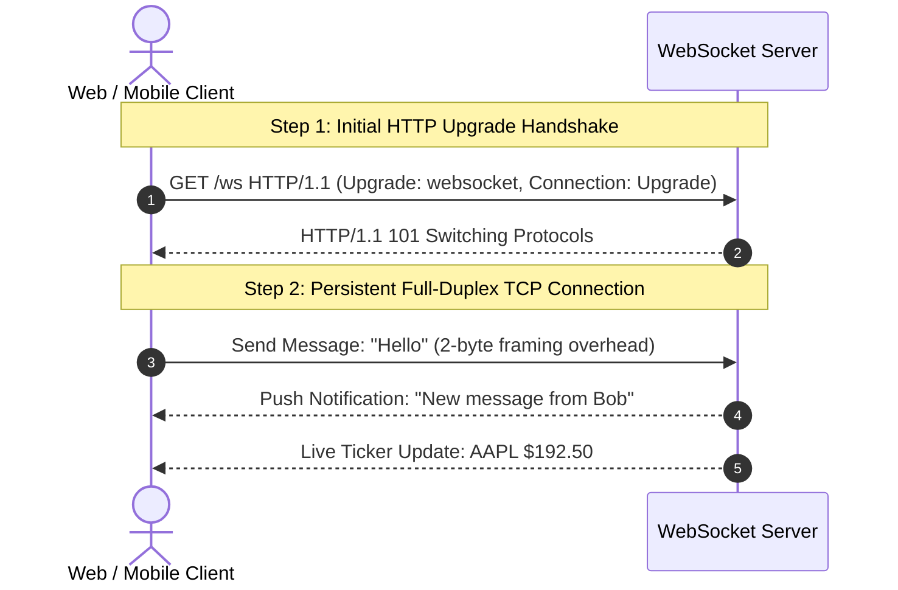

# WebSockets

> High-Level System Design | Networking & Communication Protocols

---

### 1. What is it?
WebSocket is a communication protocol that establishes a **persistent, bidirectional, full-duplex TCP connection** between a client and a server over a single socket. Either side can send data at any time with minimal header overhead (2 to 10 bytes per frame vs. 1,000 bytes for an HTTP header).

---

### 2. Why do we need it?
* **Problem without it:** Traditional HTTP is unidirectional (client requests, server responds). To get live updates, clients must use **Short Polling** (sending HTTP requests every 2 seconds) or **Long Polling**, which overwhelms servers with millions of wasteful TCP/TLS handshakes.
* **Real-world benefit:** Real-time push updates. The server instantly pushes new chat messages or stock prices to the client without waiting for a request.

---

### 3. Architecture & Data Flow

---

### 4. Comparison: WebSockets vs. Short Polling vs. Long Polling vs. SSE

| Technology | Direction | Connection Type | Protocol | Best Use Case |
|---|---|---|---|---|
| **Short Polling** | Client $\to$ Server | Repeated new HTTP requests | HTTP | Rare updates, low traffic |
| **Long Polling** | Client $\to$ Server | Holds request open until data arrives | HTTP | Fallback when WebSockets blocked |
| **Server-Sent Events (SSE)** | Server $\to$ Client (One-Way) | Persistent single connection | HTTP | Stock tickers, news feeds, live sports scores |
| **WebSockets** | **Bidirectional (Both Ways)** | **Persistent full-duplex socket** | **TCP (WS / WSS)** | **Chat apps, Multiplayer games, Collaborative tools** |

---

### 5. Practical Trade-offs

* **Advantages:**
  * [+] **Instant Low Latency:** Sub-10ms delivery since the TCP connection is already open.
  * [+] **Minimal Bandwidth Overhead:** No redundant HTTP headers sent on each message.
* **Disadvantages:**
  * [-] **Stateful Connections:** Makes horizontal load balancing harder; requires an external session registry (Redis) to route messages across instances.
  * [-] **Firewall & Proxy Issues:** Some corporate firewalls and older reverse proxies block non-HTTP traffic.
