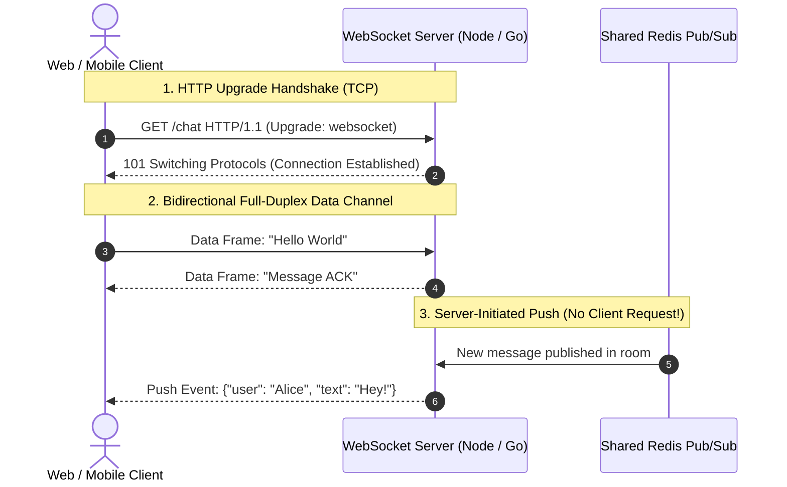
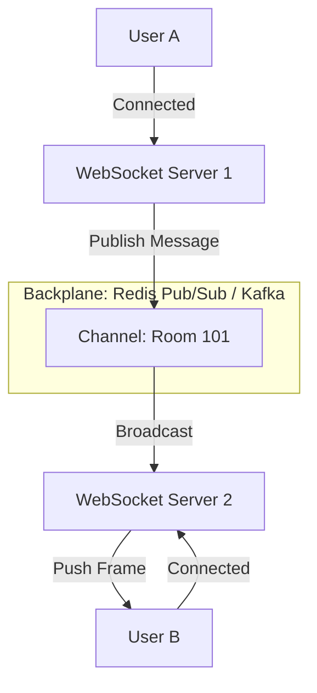

# 04. WebSockets

[🏠 Home](../README.md) > [03. Networking](./README.md) > **WebSockets**

---

## 1. What are WebSockets?

The **WebSocket Protocol (RFC 6455)** provides a persistent, full-duplex, bidirectional communication channel between a client and a server over a single long-lived TCP connection.

Unlike standard HTTP request-response communication (where the client must always initiate a request and the server only replies), WebSockets allow **either endpoint to send messages at any time** with minimal frame overhead (2 to 10 bytes).



---

## 2. Protocol Handshake & URLs

A WebSocket session begins with an HTTP/1.1 request containing an `Upgrade: websocket` header:

```http
GET /socket HTTP/1.1
Host: example.com
Upgrade: websocket
Connection: Upgrade
Sec-WebSocket-Key: dGhlIHNhbXBsZSBub25jZQ==
Sec-WebSocket-Version: 13
```

The server agrees by responding with `HTTP/1.1 101 Switching Protocols`. From that moment on, the socket transitions from HTTP to the raw WebSocket binary/text framing protocol.

### URL Schemes
* `ws://example.com/socket` — Plaintext WebSocket (Port 80)
* `wss://example.com/socket` — Encrypted WebSocket over TLS (Port 443, **Mandatory for production**)

---

## 3. Browser Client Implementation

```javascript
// Open encrypted WebSocket connection to production gateway
const socket = new WebSocket("wss://api.example.com/live");

// Event: Connection opened
socket.onopen = (event) => {
  console.log("Connected to WebSocket server");
  // Send message from client to server
  socket.send(JSON.stringify({ action: "subscribe", channel: "market-ticker" }));
};

// Event: Server pushes data to client
socket.onmessage = (event) => {
  const payload = JSON.parse(event.data);
  console.log("Received server push update:", payload);
};

// Event: Connection closed
socket.onclose = (event) => {
  console.log("Socket connection closed. Initiating exponential backoff reconnect...");
};

// Event: Network error
socket.onerror = (error) => {
  console.error("WebSocket error:", error);
};
```

---

## 4. Scaling WebSockets Horizontally (The Multi-Server Problem)

When multiple application servers sit behind a Load Balancer, User A is connected to **Server 1** and User B is connected to **Server 2**. How does User A send a direct chat message to User B?



> [!IMPORTANT]
> **The Pub/Sub Backplane Solution:** WebSocket servers must be integrated with an external distributed message broker (such as **Redis Pub/Sub**, **RabbitMQ**, or **NATS**). When Server 1 receives a message, it publishes it to the shared channel; Server 2 receives the event and pushes it down User B's active TCP socket.

---

## 5. Advantages & Disadvantages

### Advantages
* **Instantaneous Real-Time Delivery:** Eliminates HTTP polling delays; latency is bounded only by network propagation.
* **Low Network Overhead:** After the initial handshake, messages do not re-send HTTP headers, reducing bandwidth overhead from ~800 bytes per poll to ~2 bytes per frame.
* **True Server Push:** Enables servers to stream notifications, live metrics, and collaborative cursor movements instantly.

### Disadvantages
* **Resource Consumption:** Each active client holds an open TCP socket in server RAM and consumes an OS file descriptor.
* **Stateful Load Balancing:** Connections are persistent. Standard round-robin load balancing fails; sticky sessions and socket affinity are required.
* **Complex Connection Lifecycle:** Must implement custom application-level heartbeats (`PING`/`PONG`), reconnect loops with jitter, and dead socket pruning.

---

## 6. Best Use Cases

* **Instant Messaging & Chat Apps:** Slack, WhatsApp Web, Discord.
* **Multiplayer Online Gaming:** Synchronizing player coordinates with sub-50ms latency.
* **Financial Tickers & Trading Dashboards:** Live stock prices and crypto order book feeds.
* **Collaborative Tools:** Google Docs, Figma (live multi-user editing).

---

## 7. Related Topics & Next Steps

* [Communication Style Comparison](./communication-style-comparison.md) — REST vs. gRPC vs. GraphQL vs. WebSockets.
* [Layer 4 vs. Layer 7 Load Balancing](../04-load-balancing/layer-4-vs-layer-7.md) — Routing persistent TCP socket connections.
* [System Design: Real-Time Chat Application](../07-system-design-examples/chat-application.md) — Deep architectural case study.

---

| ⬅️ Previous Topic | 🏠 Index | Next Topic ➡️ |
|:--- |:---:| ---:|
| [GraphQL](./graphql.md) | [03. Networking Index](./README.md) | [Communication Style Comparison ➡️](./communication-style-comparison.md) |
