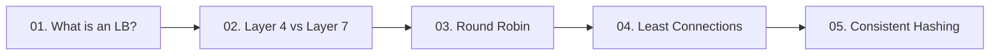

# 04. Load Balancing and Traffic Routing

[🏠 Home](../README.md) > **04. Load Balancing**

---

## Overview

Load balancing distributes client traffic across a pool of application servers, ensuring no single server is overwhelmed. It is the primary enabler of horizontal scalability, zero-downtime rolling deployments, and fault tolerance against backend crashes.



---

## 🎯 Key Learning Objectives

* **Core Responsibilities**: Understand reverse proxying, high availability, TLS termination, and health check mechanics (liveness vs. readiness).
* **OSI Layer Routing**: Contrast Layer 4 (Transport / TCP/UDP, IP hash) with Layer 7 (Application / HTTP, header/cookie/path routing).
* **Scheduling Algorithms**: Evaluate Round Robin, Weighted Round Robin, Least Connections, and IP Hash algorithms for distinct workload profiles.
* **Consistent Hashing**: Master the distributed hash ring ($0$ to $2^{32}-1$), virtual node distribution, and minimal key migration during cluster resizing.
* **Eliminating Single Points of Failure**: Implement Active-Passive pairs with Virtual Router Redundancy Protocol (VRRP / Keepalived) and BGP Anycast routing.

---

## 📚 Module Table of Contents

| # | Topic | Key Focus | Link |
|---|---|---|---|
| **01** | **What Is a Load Balancer?** | Traffic distribution, liveness vs. readiness probes, eliminating SPOF with VRRP/Anycast | [Read Guide ➡️](./what-is-a-load-balancer.md) |
| **02** | **Layer 4 vs. Layer 7 Load Balancing** | Transport (TCP/UDP) vs. Application (HTTP/TLS) routing, two-tier enterprise architecture | [Read Guide ➡️](./layer-4-vs-layer-7.md) |
| **03** | **Round Robin Scheduling** | Sequential rotation, weighted balancing for mixed hardware fleets, trade-offs | [Read Guide ➡️](./round-robin.md) |
| **04** | **Least Connections** | Active connection tracking, handling long-running requests, Least Requests in HTTP/2 | [Read Guide ➡️](./least-connections.md) |
| **05** | **Consistent Hashing** | Hash ring ($0$ to $2^{32}-1$), virtual nodes (vNodes), avoiding cache stampedes | [Read Guide ➡️](./consistent-hashing.md) |

---

## 🔍 Detailed Topic Breakdown

* 📌 **[01. What Is a Load Balancer?](./what-is-a-load-balancer.md)**
  * **Core Functions**: Reverse proxy request routing, connection pooling, SSL/TLS offloading, rate limiting, and DDoS mitigation.
  * **Health Checking Strategies**:
    * *Liveness Probes*: Testing if the process is alive (e.g., HTTP 200 on `/healthz`).
    * *Readiness Probes*: Checking if downstream dependencies (DB, Redis) are warmed before directing traffic.
  * **Eliminating the LB as a SPOF**:
    * *Active-Passive Failover*: Floating virtual IP (VIP) managed via VRRP (Keepalived).
    * *Active-Active via BGP Anycast*: Advertising the same IP address from multiple geographic points of presence simultaneously.

* 📌 **[02. Layer 4 vs. Layer 7 Load Balancing](./layer-4-vs-layer-7.md)**
  * **Layer 4 (Transport Layer)**:
    * Operates on IP address and TCP/UDP port without decrypting or inspecting packet payloads.
    * Ultra-high throughput (millions of PPS), minimal CPU and memory overhead, NAT/DSR (Direct Server Return) routing.
    * Examples: AWS NLB, IPVS, HAProxy (TCP mode).
  * **Layer 7 (Application Layer)**:
    * Fully terminates TCP and decrypts TLS to inspect HTTP headers, cookies, URLs, and JSON payloads.
    * Smart content-based routing (e.g., `/video/*` to media servers, `/api/*` to microservices), cookie-based session affinity, and gzip compression.
    * Examples: AWS ALB, Nginx, Envoy, Traefik.
  * **Enterprise Two-Tier Pattern**: Deploying high-speed L4 load balancers in front to distribute raw TCP streams across a horizontally scalable tier of L7 reverse proxies.

* 📌 **[03. Round Robin Scheduling](./round-robin.md)**
  * **Simple Round Robin**: Cycles sequentially through backend instances ($1 \rightarrow 2 \rightarrow 3 \rightarrow 1$).
    * *Pros*: Trivial $O(1)$ implementation, zero server state tracking.
    * *Cons*: Assumes identical server capacity and uniform request processing times; easily causes cascading overload if requests have uneven compute complexity.
  * **Weighted Round Robin (WRR)**: Assigns integer weights based on machine capacity (e.g., 8-core server gets weight 4; 2-core server gets weight 1).
  * **Smooth Weighted Round Robin**: Nginx algorithm distributing weighted requests evenly across turns rather than sending all heavy bursts to the strongest machine first.

* 📌 **[04. Least Connections](./least-connections.md)**
  * **Operational Logic**: Routes the next incoming request to the server with the lowest count of active, in-flight TCP connections.
  * **Weighted Least Connections**: Selects based on $\text{Active Connections} / \text{Assigned Weight}$.
  * **Ideal Scenarios**:
    * Workloads with high variance in request execution times (e.g., database reports vs. static pings).
    * Persistent long-lived connections (WebSockets, file streaming, SSH sessions).
  * **Modern Evolution (Peak EWMA / Least Requests)**: In HTTP/2 multiplexing, active TCP connection counts are constant; algorithms track in-flight HTTP/2 requests using Exponentially Weighted Moving Averages.

* 📌 **[05. Consistent Hashing](./consistent-hashing.md)**
  * **The Problem with Modulo Hashing ($\text{hash}(key) \pmod N$)**: Adding or removing a single node forces $(N-1)/N$ (~90%+) of keys to remap, causing massive cache wipeouts and database stampedes.
  * **Consistent Hash Ring**:
    * Keys and nodes are hashed onto a circular address space ($0$ to $2^{32}-1$).
    * Keys map clockwise to the nearest node on the ring.
    * Resizing cluster: Only $K / N$ keys remap on average.
  * **Virtual Nodes (vNodes)**: Replicating each physical server across 100–300 positions on the ring to prevent non-uniform hot-spotting and ensure balanced distribution.
  * **Real-World Implementations**: Amazon DynamoDB, Apache Cassandra, Discord voice routing, Memcached client libraries.

---

## 💻 Executable C++17 Load Balancing Implementations

All algorithm implementations are organized into the dedicated [`./code/`](./code/) directory:

| Implementation | Source File | Core Formula / Data Structure | Key Test Scenario |
|:---|:---|:---|:---|
| **Round Robin** | [`./code/round_robin.cpp`](./code/round_robin.cpp) | `(index + 1) % N` | Requests R1-R7 across 3 servers (A, B, C) + dynamic pool resize |
| **Weighted Round Robin** | [`./code/weighted_round_robin.cpp`](./code/weighted_round_robin.cpp) | Smooth interleaved weights | Server A (3), Server B (2), Server C (1) |
| **Least Connections** | [`./code/least_connections.cpp`](./code/least_connections.cpp) | Active connection counter | Initial: A=5, B=2, C=8; picks B (lowest) + underflow safety |
| **IP Hash** | [`./code/ip_hash.cpp`](./code/ip_hash.cpp) | `std::hash<string>(ip) % N` | Deterministic client session routing |
| **Consistent Hashing** | [`./code/consistent_hashing.cpp`](./code/consistent_hashing.cpp) | Sorted map hash ring + vNodes | Adding Server D without reshuffling ring |
| **Health Checks & Failover** | [`./code/health_check.cpp`](./code/health_check.cpp) | Heartbeat probe simulation | Server B fails; dynamically skipped and recovered |

### How to Compile and Run:
```powershell
# Navigate to the code directory
cd "C:\Users\LENOVO\Desktop\c++ folder\c++ project\High Level design\04-load-balancing\code"

# Compile all 6 programs
g++ -std=c++17 round_robin.cpp -o round_robin.exe
g++ -std=c++17 weighted_round_robin.cpp -o weighted_round_robin.exe
g++ -std=c++17 least_connections.cpp -o least_connections.exe
g++ -std=c++17 ip_hash.cpp -o ip_hash.exe
g++ -std=c++17 consistent_hashing.cpp -o consistent_hashing.exe
g++ -std=c++17 health_check.cpp -o health_check.exe

# Execute any simulation
.\round_robin.exe
.\consistent_hashing.exe
```

---

## 🧪 Comprehensive Load Balancing Dry Runs & State Tables

### Dry Run 1: Round Robin (Modulo Distribution)
* **Configuration:** 3 backend servers: `Server A` (0), `Server B` (1), `Server C` (2). $N = 3$.
* **Formula:** `index = (currentIndex + 1) % N`
* **Sequence of 7 Requests (R1 to R7):**

| Request | `currentIndex` Before | Modulo Calculation | Assigned Server | `currentIndex` After | State Explanation |
|:---:|:---:|:---|:---:|:---:|:---|
| **R1** | 0 | `(0 + 1) % 3 = 1` | **Server A** | 1 | Request lands on server at index 0 (Server A). Counter steps to 1. |
| **R2** | 1 | `(1 + 1) % 3 = 2` | **Server B** | 2 | Request lands on server at index 1 (Server B). Counter steps to 2. |
| **R3** | 2 | `(2 + 1) % 3 = 0` | **Server C** | 0 | Request lands on index 2 (Server C). Counter wraps back to 0! |
| **R4** | 0 | `(0 + 1) % 3 = 1` | **Server A** | 1 | Cycle 2 starts: Lands on Server A. Counter steps to 1. |
| **R5** | 1 | `(1 + 1) % 3 = 2` | **Server B** | 2 | Lands on Server B. Counter steps to 2. |
| **R6** | 2 | `(2 + 1) % 3 = 0` | **Server C** | 0 | Lands on Server C. Counter wraps back to 0. |
| **R7** | 0 | `(0 + 1) % 3 = 1` | **Server A** | 1 | Lands on Server A. Counter steps to 1. |

* **Final Result:** Server A received 3 requests (R1, R4, R7), Server B received 2 requests (R2, R5), Server C received 2 requests (R3, R6).

---

### Dry Run 2: Weighted Round Robin (Smooth Interleaving)
* **Configuration:**
  * `Server A`: Weight = 3 (e.g. 16 vCPU)
  * `Server B`: Weight = 2 (e.g. 8 vCPU)
  * `Server C`: Weight = 1 (e.g. 4 vCPU)
  * Total Weight Sum: $S = 3 + 2 + 1 = 6$
* **NGINX Algorithm Rule:**
  1. Add static weight to `currentWeight` for all servers: `currentWeight += weight`.
  2. Select the server with the maximum `currentWeight`.
  3. Deduct total weight sum from selected server: `selected.currentWeight -= totalWeight`.

| Req | Initial State `(A, B, C)` | After `+ weight` `(A+3, B+2, C+1)` | Max Server Selected | Subtract $S=6$ from Max | Resulting Weights `(A, B, C)` |
|:---:|:---:|:---:|:---:|:---:|:---:|
| **R1** | `(0, 0, 0)` | `(3, 2, 1)` | **Server A** (3) | `3 - 6 = -3` | `(-3, 2, 1)` |
| **R2** | `(-3, 2, 1)` | `(0, 4, 2)` | **Server B** (4) | `4 - 6 = -2` | `(0, -2, 2)` |
| **R3** | `(0, -2, 2)` | `(3, 0, 3)` | **Server A** (3)* | `3 - 6 = -3` | `(-3, 0, 3)` |
| **R4** | `(-3, 0, 3)` | `(0, 2, 4)` | **Server C** (4) | `4 - 6 = -2` | `(0, 2, -2)` |
| **R5** | `(0, 2, -2)` | `(3, 4, -1)` | **Server B** (4) | `4 - 6 = -2` | `(3, -2, -1)` |
| **R6** | `(3, -2, -1)` | `(6, 0, 0)` | **Server A** (6) | `6 - 6 = 0` | `(0, 0, 0)` |

*\*Tie-breaker defaults to lowest index (Server A).*
* **Pattern Dispatched:** `A -> B -> A -> C -> B -> A`
* **Distribution Verified:** Server A received exactly 3 requests (50%), Server B received 2 requests (33.3%), Server C received 1 request (16.7%). Notice requests are **smoothly interleaved** rather than sending a burst of 3 consecutive requests to A!

---

### Dry Run 3: Least Connections with Dynamic Concurrency
* **Initial State:**
  * `Server A`: 5 active connections
  * `Server B`: 2 active connections
  * `Server C`: 8 active connections
* **Selection Metric:** Choose $\min(\text{activeConnections})$.

| Event # | Incoming Event | Active Conns Before `(A, B, C)` | Decision / Minimum | Active Conns After `(A, B, C)` | Notes |
|:---:|:---|:---:|:---:|:---:|:---|
| **1** | Request **R1** arrives | `(5, 2, 8)` | **Server B** (2 is lowest) | `(5, 3, 8)` | Server B picks up R1; its count increments from 2 to 3. |
| **2** | Server B completes 1 job | `(5, 3, 8)` | Completion event | `(5, 2, 8)` | A long-running request on Server B terminates; count drops to 2. |
| **3** | Request **R2** arrives | `(5, 2, 8)` | **Server B** (2 is lowest) | `(5, 3, 8)` | Server B is still the least loaded node; takes R2. |
| **4** | Server A finishes 4 jobs | `(5, 3, 8)` | Bulk completion | `(1, 3, 8)` | Server A finishes multiple background exports; count drops to 1. |
| **5** | Request **R3** arrives | `(1, 3, 8)` | **Server A** (1 is lowest) | `(2, 3, 8)` | Workload shifted! Server A is now least loaded; takes R3. |

---

### Dry Run 4: Consistent Hashing Ring with Virtual Nodes
* **Hash Ring Space:** $0^\circ$ to $360^\circ$ circular coordinate space (equivalent to $0$ to $2^{32}-1$).
* **Virtual Nodes (3 vNodes per physical server):**
  * `Server A`: Positions $30^\circ, 150^\circ, 270^\circ$
  * `Server B`: Positions $70^\circ, 190^\circ, 310^\circ$
  * `Server C`: Positions $110^\circ, 230^\circ, 350^\circ$
* **Rule:** A key is assigned by hashing its identifier and walking **clockwise** to the first server node encountered.

#### Step 1: Initial Key Assignments
| Key Name | Hash Coordinate | Clockwise Search | Assigned Physical Server |
|:---|:---:|:---|:---:|
| `user:101` | $45^\circ$ | First node clockwise is Server B at $70^\circ$ | **Server B** |
| `user:202` | $125^\circ$ | First node clockwise is Server A at $150^\circ$ | **Server A** |
| `user:303` | $200^\circ$ | First node clockwise is Server C at $230^\circ$ | **Server C** |
| `user:404` | $320^\circ$ | First node clockwise is Server C at $350^\circ$ | **Server C** |

#### Step 2: Scaling Out — Adding Server D (Virtual Nodes at $60^\circ, 180^\circ, 300^\circ$)
* `user:101` (Hash $45^\circ$): Clockwise search now hits **Server D ($60^\circ$)** before Server B ($70^\circ$)! $\implies$ **Migrated to Server D**.
* `user:202` (Hash $125^\circ$): First node clockwise remains **Server A ($150^\circ$)** $\implies$ **No change**.
* `user:303` (Hash $200^\circ$): First node clockwise remains **Server C ($230^\circ$)** $\implies$ **No change**.
* `user:404` (Hash $320^\circ$): First node clockwise remains **Server C ($350^\circ$)** $\implies$ **No change**.
* **Key Takeaway:** Adding Server D migrated **only 1 out of 4 keys (25%)**. Under naive modulo hashing, 100% of keys would have been scrambled!

---

### Dry Run 5: Server Failure & Health Check Failover
* **Configuration:** Active cluster with `Server A`, `Server B`, `Server C`.
* **Health Check Config:** Ping `GET /healthz` every 2 seconds; 2 consecutive timeout failures marks node DOWN.

| Event # | State of Nodes | Incoming Request | Load Balancer Action | Routed Destination | User Impact |
|:---:|:---|:---:|:---|:---:|:---|
| **1** | A: Healthy, B: Healthy, C: Healthy | **R1** | Normal round robin | **Server A** | 200 OK |
| **2** | A: Healthy, B: Healthy, C: Healthy | **R2** | Normal round robin | **Server B** | 200 OK |
| **3** | **Server B crashes (Kernel panic)** | — | Heartbeat probe 1 to B: TIMEOUT (Fail 1/2) | — | Internal probe |
| **4** | B still dead | — | Heartbeat probe 2 to B: TIMEOUT (Fail 2/2) | — | **B marked UNHEALTHY & dropped from pool** |
| **5** | A: Healthy, **B: DOWN**, C: Healthy | **R3** | Skips B, selects C | **Server C** | 200 OK (Zero user impact) |
| **6** | A: Healthy, **B: DOWN**, C: Healthy | **R4** | Skips B, selects A | **Server A** | 200 OK |
| **7** | A: Healthy, **B: DOWN**, C: Healthy | **R5** | Skips B, selects C | **Server C** | 200 OK |

---

## 💡 Key Architectural Rules of Thumb

* **Use Layer 4 for Ingress, Layer 7 for Logic**: Front massive ingress traffic with Layer 4 (AWS NLB / IPVS) for raw throughput and route into Layer 7 (Envoy / Nginx) for path-based routing, JWT verification, and TLS termination.
* **Match Algorithm to Request Duration**: Use Round Robin for uniform, short-lived stateless requests; use Least Connections for long-lived sessions, WebSockets, or highly variable query durations.
* **Always Use Virtual Nodes with Consistent Hashing**: Never deploy a raw consistent hash ring with 1 token per physical server; without vNodes, data distribution variance will cause severe hotspot failures.
* **Fail Fast on Unhealthy Nodes**: Set aggressive health check intervals (e.g., 2 consecutive failures within 5 seconds) to pull failing servers out of rotation before users experience timeouts.

---

| ⬅️ Previous Module | 🏠 Index | Next Module ➡️ |
|:--- |:---:| ---:|
| [03. Networking](../03-networking/README.md) | [System Design Hub](../README.md) | [05. Caching & Acceleration ➡️](../05-caching/README.md) |
