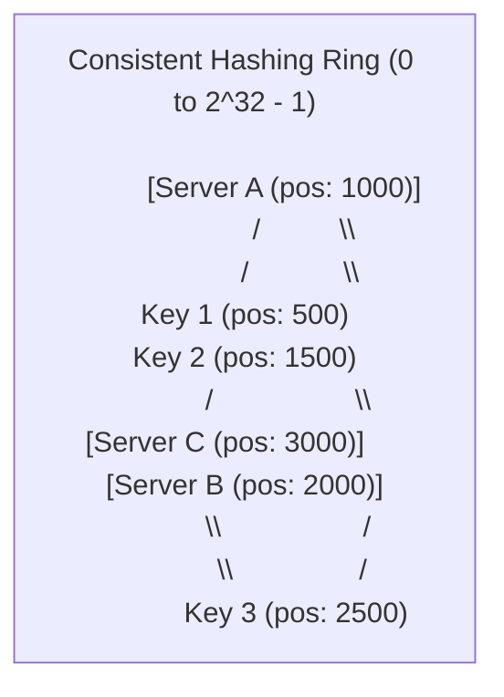
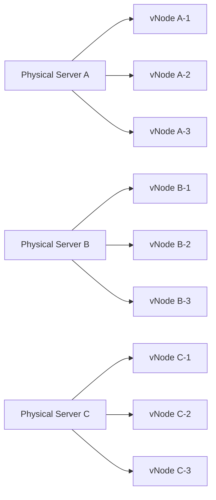

# Consistent Hashing

> High-Level System Design | Load Balancing & Distributed Caching

---

### 1. What is it?

Consistent Hashing is an algorithm that maps both **data keys** and **servers** onto a virtual circular ring ($0$ to $2^{32}-1$). A key is assigned to the first server found by walking clockwise along the ring.
* **Why it exists:** When a server is added or removed, standard hashing (`hash(key) % N`) reshuffles **nearly 100% of your keys**, wiping out your cache and crashing your database. Consistent Hashing moves **only $1/N$ of keys**.

---

### 2. The Disaster of Naive Modulo Hashing (`hash(key) % N`)

Suppose you have 4 cache servers ($N = 4$):
* `hash("user:101") = 1005` $\implies 1005 \pmod 4 = \mathbf{1}$ (Routed to Server 1)
* `hash("user:102") = 2006` $\implies 2006 \pmod 4 = \mathbf{2}$ (Routed to Server 2)
**Now Server 4 crashes, so $N = 3$:**
* `hash("user:101") = 1005` $\implies 1005 \pmod 3 = \mathbf{0}$ (Moved to Server 0!)
* `hash("user:102") = 2006` $\implies 2006 \pmod 3 = \mathbf{2}$ (Stayed)
Almost **all keys change their destination server**. Your cache hit rate plummets from 95% to 0% in one second, triggering a **Thundering Herd / Cache Stampede** that kills your primary database.

---

### 3. How Consistent Hashing Works (The Hash Ring)

1. **Hash the Servers:** Hash each server's IP/hostname to place it at a position on the $0$ to $2^{32}-1$ ring.
2. **Hash the Keys:** Hash incoming request keys (e.g. `user_id`) to place them on the exact same ring.
3. **Clockwise Routing:** To find which server stores a key, walk clockwise from the key's position until you hit the first server.
4. **When Server B Dies:** Only the keys that were mapped to Server B are re-routed to Server C. Keys belonging to Server A remain completely untouched!

---

### 4. The Virtual Nodes Solution (Preventing Hotspots & Cascading Failure)

#### The Problem: Non-Uniform Distribution

In a simple ring with only 3 physical servers, hash randomness could place all 3 servers close to each other, leaving one server responsible for 80% of the ring! Furthermore, if Server B dies, Server C absorbs 100% of Server B's load, causing Server C to crash next (a **Cascading Outage**).

#### The Fix: Virtual Nodes (vNodes)

Assign each physical server **100 to 250 virtual positions** on the ring:
* Server A is hashed as `ServerA#1`, `ServerA#2`, ..., `ServerA#200`.
* Server B is hashed as `ServerB#1`, `ServerB#2`, ..., `ServerB#200`.

* **Result:** Data is evenly distributed across the entire ring.
* When Physical Server A fails, its 200 virtual nodes are sprinkled everywhere across the ring, so **every surviving server absorbs a tiny, equal fraction of the lost load**.

---

### 5. Comprehensive Pros & Cons

#### Advantages (The Pros)

* [+] **Minimal Key Relocation:** Adding or removing a server relocates only $K/N$ keys on average (where $K$ is total keys and $N$ is total servers).
* [+] **Zero Cache Stampede on Scale-out:** You can double your cache fleet from 10 to 20 servers without evicting the majority of existing cache entries.
* [+] **Even Load Distribution (with VNodes):** Virtual nodes mathematically guarantee variance of less than 5% across nodes.
* [+] **Weighted Server Support:** Give a beefy 64-core machine 300 virtual nodes and an older 16-core machine 75 virtual nodes.

#### Disadvantages (The Cons)

* [-] **Ring Maintenance Overhead:** Every client or proxy must maintain an up-to-date copy of the virtual ring.
* [-] **Gossip / Coordination Delay:** When a node crashes, there is a brief window (a few hundred milliseconds) where some clients still route to the dead node before the ring updates.
* [-] **Memory Footprint for VNodes:** Maintaining 200 virtual nodes for 1,000 servers equals 200,000 positions in memory (requires a balanced Binary Search Tree like a Red-Black Tree to perform $O(\log M)$ lookups).

---

### 6. Real-World Case Studies

* **Amazon DynamoDB & Apache Cassandra:** Use consistent hashing with virtual nodes to partition rows across hundreds of storage nodes without central coordinators.
* **Discord Voice Guilds:** Discord routes millions of concurrent voice calls to voice servers using consistent hashing to guarantee that all members of a server land on the exact same voice node.
* **Akamai & Cloudflare CDN:** Route URL caching to edge servers using consistent hashing to maximize cache hit rates worldwide.
