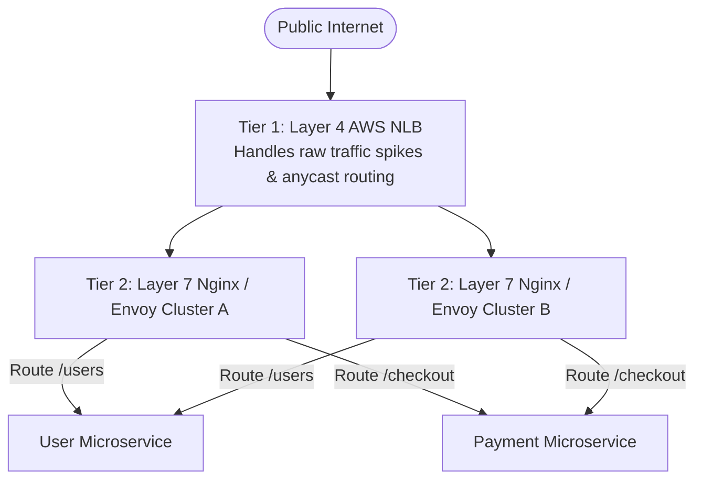

# Layer 4 vs. Layer 7 Load Balancing

> High-Level System Design | Load Balancing & Proxies

---

### 1. What is it?

* **Layer 4 (Transport Layer - Ultra Fast):** Operates at the TCP/UDP layer. It routes packets based purely on **Source/Destination IP addresses and Ports** without decrypting or inspecting the application payload.
* **Layer 7 (Application Layer - Ultra Smart):** Operates at the HTTP/HTTPS/WebSocket layer. It decrypts TLS, parses HTTP headers, reads cookies, and routes requests based on the URL path (e.g. `/api/v1/auth` vs. `/api/v1/video`).
```mermaid
flowchart TD
    subgraph L4_Routing [Layer 4: Transport Routing (Raw TCP)]
        ClientL4[Client] -->|TCP Packet: 198.51.100.1:443| LB_L4[Layer 4 LB: AWS NLB / HAProxy]
        LB_L4 -->|Forwards raw TCP stream without inspection| SrvL4[Backend Server]
    end
    subgraph L7_Routing [Layer 7: Application Routing (Smart HTTP)]
        ClientL7[Client] -->|HTTPS GET /images/avatar.png| LB_L7[Layer 7 LB: AWS ALB / Nginx / Envoy]
        LB_L7 -->|Terminates TLS & Inspects Path| PathRouter{URL Path Router}
        PathRouter -->|/api/auth| AuthPool[Auth Service Pool]
        PathRouter -->|/images/*| S3Proxy[Media Cache / S3]
        PathRouter -->|Cookie: tier=vip| VIPPool[Dedicated VIP Server]
    end
```

---

### 2. Comprehensive Pros & Cons

#### Layer 4 Load Balancing

* **Pros:**
  * [+] **Extreme Throughput:** Handles tens of millions of packets per second with minimal CPU and memory overhead.
  * [+] **Ultra-Low Latency:** Latency is measured in microseconds (`µs`) because it does not buffer or inspect packet payloads.
  * [+] **Protocol Agnostic:** Works with any TCP/UDP protocol (HTTP, DNS, SMTP, Minecraft, Redis, VoIP, database connections).
  * [+] **High Security:** Does not require your SSL/TLS private certificates on the load balancer.
* **Cons:**
  * [-] **No Smart Routing:** Cannot route based on URL path, HTTP headers, query params, or cookies.
  * [-] **No Caching or Compression:** Cannot cache static assets or gzip/brotli compress HTTP responses.
  * [-] **No SSL Termination:** Each backend server must independently decrypt TLS connections, wasting backend CPU cycles.
  * [-] **Uneven Load on Long-Lived Connections:** If a client opens a persistent TCP socket, all requests over that socket hit the same server forever.

#### Layer 7 Load Balancing

* **Pros:**
  * [+] **Smart Path & Content Routing:** Route `/search` to the Search cluster and `/checkout` to the Payment cluster.
  * [+] **SSL / TLS Termination:** Decrypts HTTPS once at the load balancer; backend microservices communicate over fast private HTTP.
  * [+] **Cookie-Based Sticky Sessions:** Keeps a user routed to the same backend node if needed.
  * [+] **Built-in Security (WAF):** Can detect SQL injection, Cross-Site Scripting (XSS), and rate limit malicious IPs before they reach your app.
* **Cons:**
  * [-] **Higher Latency:** Parsing HTTP headers, decrypting TLS, and re-encrypting adds 2ms–10ms of latency.
  * [-] **Higher CPU & RAM Consumption:** Buffers complete HTTP requests and responses; consumes substantially more memory.
  * [-] **Certificate Management Overhead:** Requires managing and rotating SSL/TLS certificates directly on the load balancer.

---

### 3. Head-to-Head Comparison Matrix

| Feature | Layer 4 (e.g. AWS NLB, HAProxy TCP) | Layer 7 (e.g. AWS ALB, Nginx, Envoy) |
|---|---|---|
| **OSI Layer** | Layer 4 (Transport) | Layer 7 (Application) |
| **Inspects** | IP Address & Port | URLs, Headers, Cookies, JSON body |
| **Throughput** | **Extreme** (Millions of QPS) | High (Tens to hundreds of thousands of QPS) |
| **Latency** | **< 1 millisecond** (Microseconds) | 2 – 10 milliseconds |
| **TLS Termination** | No (Pass-through) | **Yes** (Standard practice) |
| **Path-Based Routing** | [-] Impossible | [+] `/auth` vs `/feed` vs `/orders` |
| **WebSocket Support** | Raw TCP socket pass-through | Protocol upgrade & connection management |
| **DDoS Protection** | Mitigates SYN flood attacks | Mitigates HTTP slowloris, SQLi, bad bots |

---

### 4. Production Standard: The Two-Tier Architecture

In real-world FAANG architectures, you don't choose one over the other—**you use both in tandem**:

* **Tier 1 (L4 NLB):** Accepts all public internet traffic, absorbs DDoS packet floods, and distributes TCP streams across multiple L7 nodes.
* **Tier 2 (L7 Nginx/ALB):** Terminates TLS, enforces rate limiting, parses headers, and dispatches to specific microservices.
