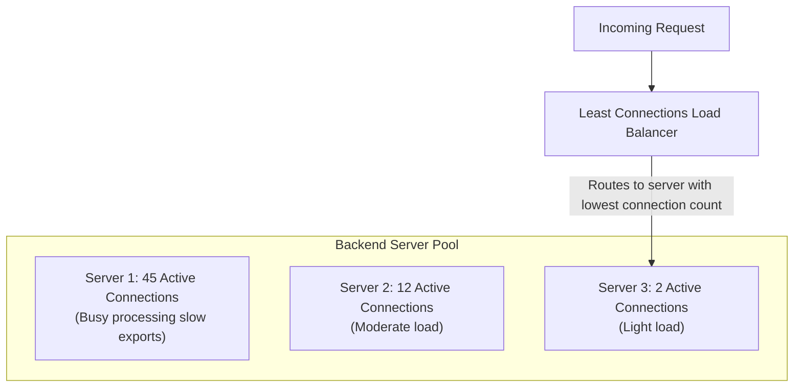

# 04. Least Connections Load Balancing

[🏠 Home](../README.md) > [04. Load Balancing](./README.md) > **Least Connections**

---

### 1. What is it?

The **Least Connections** algorithm routes each new incoming request to the server that currently has the **fewest active, in-flight connections**.
* **Why it exists:** Round Robin fails when requests take unpredictable amounts of time (e.g. 5ms vs 5,000ms). Least Connections dynamically balances the actual workload on each machine.

---

### 2. Weighted Least Connections (For Mixed Hardware)

When servers have different hardware specs, simple connection counts are not enough.
* **Formula:** The load balancer computes a load score for each server:
  $$\text{Load Score} = \frac{\text{Active Connections}}{\text{Server Weight}}$$
* The server with the **lowest score** gets the next request:
  * Server A (Weight: 2, Active: 20) $\implies \text{Score} = 20 / 2 = \mathbf{10}$
  * Server B (Weight: 1, Active: 8) $\implies \text{Score} = 8 / 1 = \mathbf{8}$ $\implies$ **Wins!**

---

### 3. Comprehensive Pros & Cons

#### Advantages (The Pros)

* [+] **Prevents Server Overload on Variable Tasks:** If one server is stuck processing a 10-second machine learning query or image upload, its connection count stays high, so the load balancer **stops sending it traffic** until it recovers.
* [+] **Self-Healing on Degraded Nodes:** If Server B experiences high disk latency or CPU throttling, requests take longer to finish, causing its active connection count to swell. The algorithm naturally diverts traffic away from the struggling server without needing an explicit alert.
* [+] **Ideal for Long-Lived Protocols:** Perfect for WebSockets, gRPC bidirectional streams, database connection pooling, and live video streaming.

#### Disadvantages (The Cons)

* [-] **State Tracking Overhead:** The load balancer must actively maintain a real-time counter for every backend server. Every connection open and close requires state synchronization.
* [-] **Slightly Slower Routing ($O(\log N)$):** The load balancer must maintain a min-heap or priority queue to find the server with the lowest connection count, whereas Round Robin is an immediate $O(1)$ pointer bump.
* [-] **The "Thundering Herd" on New Servers:** When you deploy a brand-new, cold server into the pool, its connection count is **zero**. The load balancer immediately directs all new traffic to this fresh node, potentially crashing it before its cache or JIT compiler is warm.
  * *Fix:* Use **Warm-up Ramping** (gradually increasing weight over 60 seconds).

---

### 4. Head-to-Head: Round Robin vs. Least Connections

| Dimension | Round Robin | Least Connections |
|---|---|---|
| **Routing Metric** | Request sequence counter | **Active concurrent connection count** |
| **LB State Required** | None ($O(1)$ counter) | Active state per server ($O(\log N)$ min-heap) |
| **Best For** | Short, uniform REST APIs (< 20ms) | **WebSockets, DB queries, file uploads** |
| **Reaction to Slow Nodes** | Blindly keeps sending traffic | **Automatically routes traffic away** |
| **CPU Overhead on LB** | Negligible | Low to moderate |

> [!NOTE]
> **Least Connections vs. Least Requests:** In HTTP/2 environments where multiple requests multiplex across a single persistent TCP connection, connection counts can be misleading. Advanced load balancers (such as Envoy and Nginx Plus) support **Least Requests**, which makes routing decisions based on active in-flight HTTP requests rather than underlying TCP connections.

---

### 5. Step-by-Step Dry Run & State Transition Tables

#### 5.1 Dynamic Workload Balancing Dry Run
* **Backend Pool:** `[Server A, Server B, Server C]`
* **Initial State:**
  * Server A: $5$ active connections (e.g. processing image resize)
  * Server B: $2$ active connections (fast REST queries)
  * Server C: $8$ active connections (heavy CSV export)

| Step / Event | Server A Active | Server B Active | Server C Active | Selected Server / Action | State Note |
|:---:|:---:|:---:|:---:|:---:|---|
| **Initial State** | `5` | `2` | `8` | — | Server B has least connections |
| **Request R1 Arrives** | `5` | `2` | `8` | **Server B** selected | Routes to Server B ($2 \to 3$) |
| **Request R2 Arrives** | `5` | `3` | `8` | **Server B** selected | Routes to Server B ($3 \to 4$) |
| **Request R3 Arrives** | `5` | `4` | `8` | **Server B** selected | Routes to Server B ($4 \to 5$) |
| **Request R4 Arrives** | `5` | `5` | `8` | **Server A** selected (Tie-break) | Server A and B tied at 5; picks A ($5 \to 6$) |
| **Server C Finishes 4 Jobs**| `6` | `5` | `4` | Concurrency drop on C | Server C completed background tasks ($8 \to 4$) |
| **Request R5 Arrives** | `6` | `5` | `4` | **Server C** selected | Automatically shifts traffic to newly freed Server C ($4 \to 5$) |

#### 5.2 Weighted Least Connections Dry Run (Heterogeneous Fleet)
* **Score Formula:** $\text{Load Score} = \frac{\text{Active Connections}}{\text{Weight}}$
* **Servers:**
  * Server A: 16 vCPUs (Weight = 4)
  * Server B: 8 vCPUs (Weight = 2)
  * Server C: 4 vCPUs (Weight = 1)

| Current State | Server A (Weight 4) | Server B (Weight 2) | Server C (Weight 1) | Target Server | Routing Rationale |
|:---:|:---:|:---:|:---:|:---:|---|
| **Active Connections** | `12` | `5` | `3` | — | Raw counts: C seems lowest (3 vs 12) |
| **Load Score Calculation** | $\frac{12}{4} = \mathbf{3.0}$ | $\frac{5}{2} = \mathbf{2.5}$ | $\frac{3}{1} = \mathbf{3.0}$ | **Server B** | Server B has lowest score ($2.5$), preventing Server C from being overwhelmed |

> [!TIP]
> **Working C++ Implementation Available:**
> Check the dedicated code directory for the complete implementation:
> * [`code/least_connections.cpp`](./code/least_connections.cpp) — Thread-safe atomic Least Connections load balancer with RAII connection guards.

---

## Related Topics & Next Steps

* [Round Robin](./round-robin.md) — The baseline rotational scheduling algorithm.
* [Layer 4 vs. Layer 7 Load Balancing](./layer-4-vs-layer-7.md) — Transport vs. Application inspection.
* [Consistent Hashing](./consistent-hashing.md) — Key-based sticky hashing for distributed caches.

---

| ⬅️ Previous Topic | 🏠 Index | Next Topic ➡️ |
|:--- |:---:| ---:|
| [Round Robin](./round-robin.md) | [04. Load Balancing Index](./README.md) | [Consistent Hashing ➡️](./consistent-hashing.md) |
