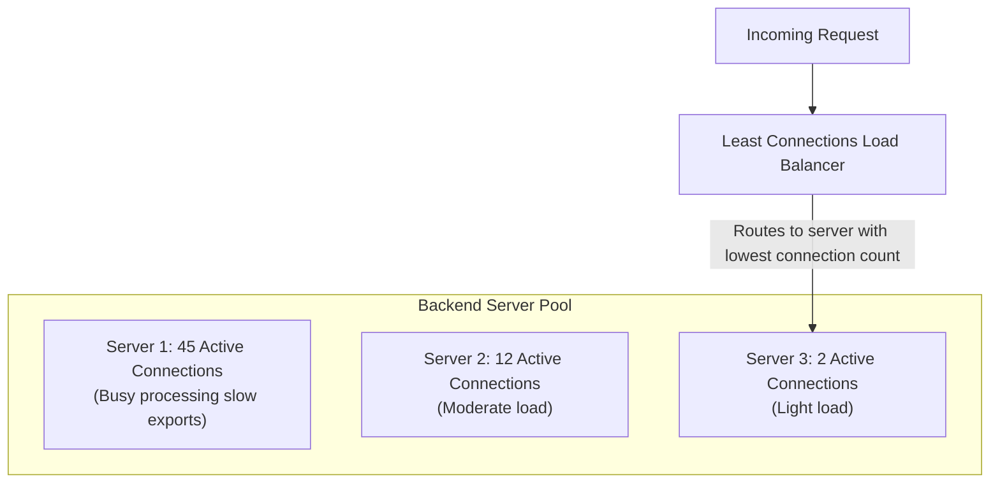

# Least Connections Load Balancing

> High-Level System Design | Load Balancing & Proxies

---

### 1. What is it?

* **Plain English:** The **Least Connections** algorithm routes each new incoming request to the server that currently has the **fewest active, in-flight connections**.
* **Why it exists:** Round Robin fails when requests take unpredictable amounts of time (e.g. 5ms vs 5,000ms). Least Connections dynamically balances the actual workload on each machine.

---

### 2. Weighted Least Connections (For Mixed Hardware)

When servers have different hardware specs, simple connection counts are not enough.
* **Formula:** The load balancer computes a load score for each server:
  $$\text{Load Score} = \frac{\text{Active Connections}}{\text{Server Weight}}$$
* The server with the **lowest score** gets the next request:
  * Server A (Weight: 2, Active: 20) $\implies \text{Score} = 20 / 2 = \mathbf{10}$
  * Server B (Weight: 1, Active: 8) $\implies \text{Score} = 8 / 1 = \mathbf{8}$ $\implies$ **Wins!**

---

### 3. Comprehensive Pros & Cons

#### Advantages (The Pros)

* [+] **Prevents Server Overload on Variable Tasks:** If one server is stuck processing a 10-second machine learning query or image upload, its connection count stays high, so the load balancer **stops sending it traffic** until it recovers.
* [+] **Self-Healing on Degraded Nodes:** If Server B experiences high disk latency or CPU throttling, requests take longer to finish, causing its active connection count to swell. The algorithm naturally diverts traffic away from the struggling server without needing an explicit alert.
* [+] **Ideal for Long-Lived Protocols:** Perfect for WebSockets, gRPC bidirectional streams, database connection pooling, and live video streaming.

#### Disadvantages (The Cons)

* [-] **State Tracking Overhead:** The load balancer must actively maintain a real-time counter for every backend server. Every connection open and close requires state synchronization.
* [-] **Slightly Slower Routing ($O(\log N)$):** The load balancer must maintain a min-heap or priority queue to find the server with the lowest connection count, whereas Round Robin is an immediate $O(1)$ pointer bump.
* [-] **The "Thundering Herd" on New Servers:** When you deploy a brand-new, cold server into the pool, its connection count is **zero**. The load balancer immediately directs all new traffic to this fresh node, potentially crashing it before its cache or JIT compiler is warm.
  * *Fix:* Use **Warm-up Ramping** (gradually increasing weight over 60 seconds).

---

### 4. Head-to-Head: Round Robin vs. Least Connections

| Dimension | Round Robin | Least Connections |
|---|---|---|
| **Routing Metric** | Request sequence counter | **Active concurrent connection count** |
| **LB State Required** | None ($O(1)$ counter) | Active state per server ($O(\log N)$ min-heap) |
| **Best For** | Short, uniform REST APIs (< 20ms) | **WebSockets, DB queries, file uploads** |
| **Reaction to Slow Nodes** | Blindly keeps sending traffic | **Automatically routes traffic away** |
| **CPU Overhead on LB** | Negligible | Low to moderate |
