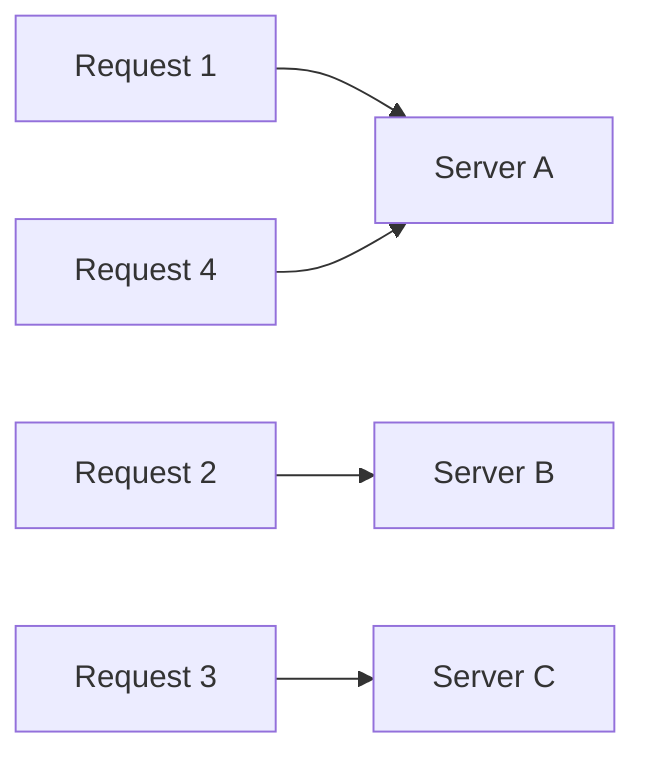
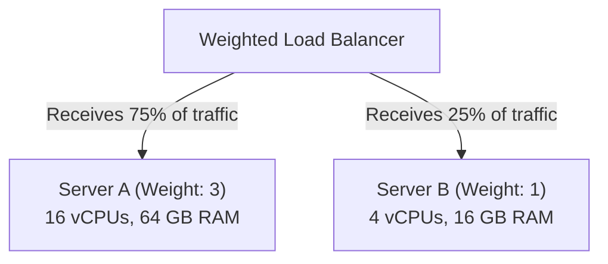

# 03. Round Robin Load Balancing

[🏠 Home](../README.md) > [04. Load Balancing](./README.md) > **Round Robin**

---

### 1. What is it?

Round Robin is the simplest load balancing algorithm. Incoming requests are forwarded to backend servers sequentially in a **repeating circular order**:
  * Request 1 $\to$ Server A
  * Request 2 $\to$ Server B
  * Request 3 $\to$ Server C
  * Request 4 $\to$ Server A (cycle restarts)

---

### 2. Weighted Round Robin (Handling Unequal Hardware)

In cloud environments, you might have mixed instance types (e.g. 16 vCPU machines alongside 4 vCPU machines).
* **Weighted Round Robin:** Assigns an integer weight to each server proportional to its capacity.
  * Server A (Weight: 3) $\to$ Receives 3 requests
  * Server B (Weight: 1) $\to$ Receives 1 request
  * Sequence: `A -> A -> A -> B -> A -> A -> A -> B`

---

### 3. Comprehensive Pros & Cons

#### Advantages (The Pros)

* [+] **Zero State Overhead:** The load balancer does not need to query backend servers or track active connections. It only needs an incrementing counter (`current_index = (current_index + 1) % N`).
* [+] **Extremely Fast Execution:** Algorithmic complexity is $O(1)$ with virtually zero CPU utilization.
* [+] **Fair Request Count:** Every server receives the exact same number of total requests over time.
* [+] **Simple Debugging:** Predicting which server handles a request is straightforward.

#### Disadvantages (The Cons)

* [-] **Assumes All Requests Take Equal Time:** If Request 1 is a 10-second PDF export job, and Request 2 is a 2ms health check, Server A becomes overloaded while Server B sits idle.
* [-] **Assumes All Servers Have Equal Capacity (Simple Round Robin):** A degraded or slow server still receives the exact same traffic volume as a healthy server.
* [-] **Traffic Hotspots on Long-Lived Connections:** If used for WebSockets or streaming, servers that get assigned long connections slowly accumulate traffic and crash.
* [-] **Requires External Health Checks:** If Server C crashes, a naive Round Robin algorithm will continue sending every 3rd request to the dead server unless health checks actively prune it from the pool.

---

### 4. Decision Matrix: When to Use Round Robin

| Scenario | Recommend Round Robin? | Reason |
|---|---|---|
| **Simple Stateless CRUD APIs** | [+] **Yes** | Requests are fast, uniform, and independent (< 20ms) |
| **Static File / CDN Assets** | [+] **Yes** | Uniform file downloads across homogeneous web servers |
| **Long-Running Database Reports** | [-] **No** | Use **Least Connections** to avoid overloading one node |
| **WebSockets / Live Chat** | [-] **No** | Persistent connections will unbalance server memory |
| **Heterogeneous Cloud VM Fleets** | Note: **Use Weighted Only** | Prevents smaller VMs from being crushed by equal load |

---

### 5. Step-by-Step Dry Run & State Transition Tables

#### 5.1 Simple Round Robin Dry Run (Modulo Arithmetic)
* **Backend Pool:** `[Server A, Server B, Server C]` ($N = 3$)
* **Algorithm:** `selected = servers[index % N]; index++`

| Request | Index Before | Calculation (`Index % 3`) | Selected Server | Index After | State Note |
|:---:|:---:|:---:|:---:|:---:|---|
| **R1** | `0` | `0 % 3 = 0` | **Server A** | `1` | First request to Server A |
| **R2** | `1` | `1 % 3 = 1` | **Server B** | `2` | Second request to Server B |
| **R3** | `2` | `2 % 3 = 2` | **Server C** | `3` | Third request to Server C |
| **R4** | `3` | `3 % 3 = 0` | **Server A** | `4` | Cycle restarts seamlessly |
| **R5** | `4` | `4 % 3 = 1` | **Server B** | `5` | Uniform load distribution |
| **R6** | `5` | `5 % 3 = 2` | **Server C** | `6` | Each server has served exactly 2 requests |
| **R7** | `6` | `6 % 3 = 0` | **Server A** | `7` | Predictable $O(1)$ routing |

#### 5.2 Weighted Round Robin Dry Run (Smooth Interleaving)
* **Backend Pool:** `Server A (Weight: 3)`, `Server B (Weight: 2)`, `Server C (Weight: 1)`
* **Total Weight:** $3 + 2 + 1 = 6$
* Rather than sending all 3 requests to A consecutively (`A, A, A, B, B, C`), production balancers (like NGINX's smooth weighted round robin) interleave requests evenly to prevent burst overloading:

| Request | Server A Effective Weight | Server B Effective Weight | Server C Effective Weight | Selected Server | Selected Server New Weight |
|:---:|:---:|:---:|:---:|:---:|:---:|
| **R1** | `+3 = 3` | `+2 = 2` | `+1 = 1` | **Server A** (Max: 3) | `3 - 6 = -3` |
| **R2** | `-3 + 3 = 0` | `2 + 2 = 4` | `1 + 1 = 2` | **Server B** (Max: 4) | `4 - 6 = -2` |
| **R3** | `0 + 3 = 3` | `-2 + 2 = 0` | `2 + 1 = 3` | **Server A** (Tie: 3) | `3 - 6 = -3` |
| **R4** | `-3 + 3 = 0` | `0 + 2 = 2` | `3 + 1 = 4` | **Server C** (Max: 4) | `4 - 6 = -2` |
| **R5** | `0 + 3 = 3` | `2 + 2 = 4` | `-2 + 1 = -1`| **Server B** (Max: 4) | `4 - 6 = -2` |
| **R6** | `3 + 3 = 6` | `-2 + 2 = 0` | `-1 + 1 = 0` | **Server A** (Max: 6) | `6 - 6 = 0` |

* **Final Traffic Ratio over 6 requests:** Server A received $3$ ($50\%$), Server B received $2$ ($33.3\%$), Server C received $1$ ($16.7\%$). No server experienced consecutive burst starvation!

> [!TIP]
> **Working C++ Implementations Available:**
> Check the dedicated code directory for working C++17 implementations:
> * [`code/round_robin.cpp`](./code/round_robin.cpp) — Thread-safe atomic Round Robin load balancer.
> * [`code/weighted_round_robin.cpp`](./code/weighted_round_robin.cpp) — Smooth Weighted Round Robin load balancer.

---

## Related Topics & Next Steps

* [Layer 4 vs. Layer 7 Load Balancing](./layer-4-vs-layer-7.md) — Application vs. transport routing.
* [Least Connections](./least-connections.md) — Handling requests with varying execution durations.
* [Consistent Hashing](./consistent-hashing.md) — Minimizing cache reassignments during cluster changes.

---

| ⬅️ Previous Topic | 🏠 Index | Next Topic ➡️ |
|:--- |:---:| ---:|
| [Layer 4 vs. Layer 7](./layer-4-vs-layer-7.md) | [04. Load Balancing Index](./README.md) | [Least Connections ➡️](./least-connections.md) |
