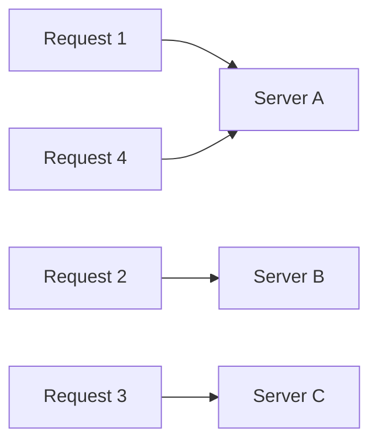
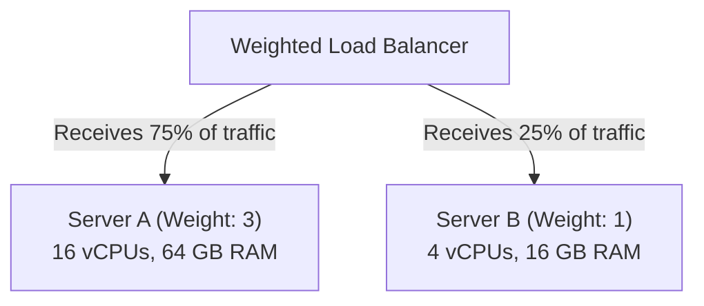

# Round Robin Load Balancing

> High-Level System Design | Load Balancing & Proxies

---

### 1. What is it?

Round Robin is the simplest load balancing algorithm. Incoming requests are forwarded to backend servers sequentially in a **repeating circular order**:
  * Request 1 $\to$ Server A
  * Request 2 $\to$ Server B
  * Request 3 $\to$ Server C
  * Request 4 $\to$ Server A (cycle restarts)

---

### 2. Weighted Round Robin (Handling Unequal Hardware)

In cloud environments, you might have mixed instance types (e.g. 16 vCPU machines alongside 4 vCPU machines).
* **Weighted Round Robin:** Assigns an integer weight to each server proportional to its capacity.
  * Server A (Weight: 3) $\to$ Receives 3 requests
  * Server B (Weight: 1) $\to$ Receives 1 request
  * Sequence: `A -> A -> A -> B -> A -> A -> A -> B`

---

### 3. Comprehensive Pros & Cons

#### Advantages (The Pros)

* [+] **Zero State Overhead:** The load balancer does not need to query backend servers or track active connections. It only needs an incrementing counter (`current_index = (current_index + 1) % N`).
* [+] **Extremely Fast Execution:** Algorithmic complexity is $O(1)$ with virtually zero CPU utilization.
* [+] **Fair Request Count:** Every server receives the exact same number of total requests over time.
* [+] **Simple Debugging:** Predicting which server handles a request is straightforward.

#### Disadvantages (The Cons)

* [-] **Assumes All Requests Take Equal Time:** If Request 1 is a 10-second PDF export job, and Request 2 is a 2ms health check, Server A becomes overloaded while Server B sits idle.
* [-] **Assumes All Servers Have Equal Capacity (Simple Round Robin):** A degraded or slow server still receives the exact same traffic volume as a healthy server.
* [-] **Traffic Hotspots on Long-Lived Connections:** If used for WebSockets or streaming, servers that get assigned long connections slowly accumulate traffic and crash.
* [-] **Requires External Health Checks:** If Server C crashes, a naive Round Robin algorithm will continue sending every 3rd request to the dead server unless health checks actively prune it from the pool.

---

### 4. Decision Matrix: When to Use Round Robin

| Scenario | Recommend Round Robin? | Reason |
|---|---|---|
| **Simple Stateless CRUD APIs** | [+] **Yes** | Requests are fast, uniform, and independent (< 20ms) |
| **Static File / CDN Assets** | [+] **Yes** | Uniform file downloads across homogeneous web servers |
| **Long-Running Database Reports** | [-] **No** | Use **Least Connections** to avoid overloading one node |
| **WebSockets / Live Chat** | [-] **No** | Persistent connections will unbalance server memory |
| **Heterogeneous Cloud VM Fleets** | Note: **Use Weighted Only** | Prevents smaller VMs from being crushed by equal load |
