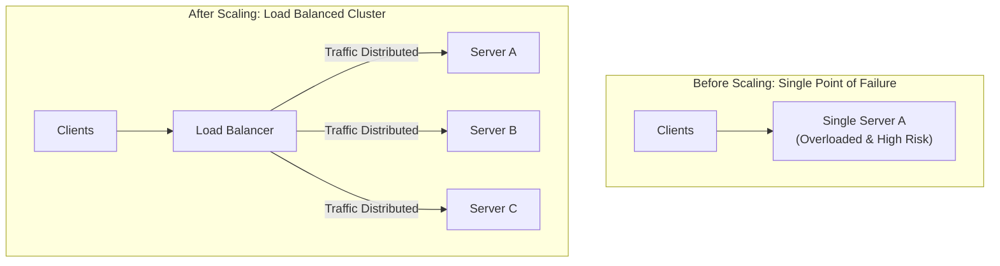
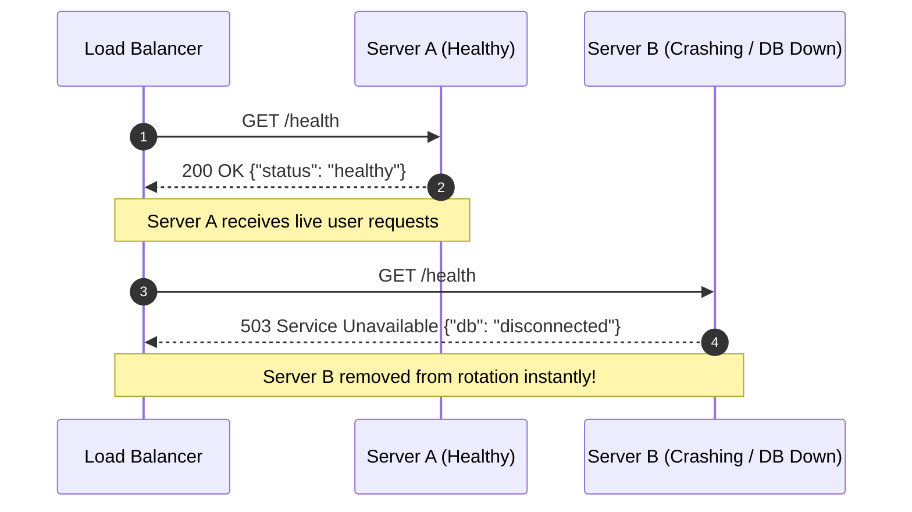
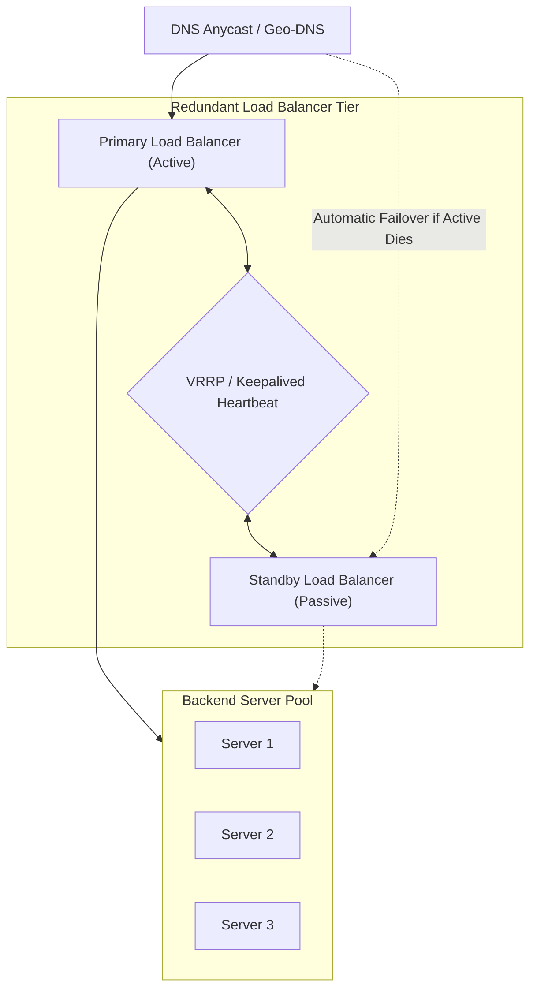

# 01. What Is a Load Balancer?

[🏠 Home](../README.md) > [04. Load Balancing](./README.md) > **What Is a Load Balancer?**

---

## 1. What is a Load Balancer?

A **Load Balancer (LB)** is a critical networking component that acts as the single reverse-proxy entry point for incoming client traffic, intelligently distributing requests across a pool of backend application servers.

It prevents any single server from becoming a performance bottleneck, ensures high availability by routing traffic away from unhealthy servers, and allows systems to scale horizontally by adding instances on demand.

---

## 2. Core Benefits of Load Balancers

1. **Traffic Distribution:** Spreads network load across multiple physical or virtual instances, maximizing hardware efficiency.
2. **High Availability & Fault Tolerance:** Detects server crashes immediately via health checks and stops sending traffic to dead nodes.
3. **Horizontal Autoscaling:** Allows adding or removing backend servers dynamically based on CPU/traffic metrics without disrupting active users.
4. **SSL / TLS Termination:** Decrypts HTTPS requests at the edge, freeing application servers from expensive cryptographic handshakes.
5. **Intelligent Traffic Routing:** Routes requests based on HTTP paths, geographical regions, device types, or client cookies.

---

## 3. Health Checks: Liveness vs. Readiness

A load balancer continuously monitors backend servers using **periodic health probes** (e.g., every 5 seconds):

> [!IMPORTANT]
> **Liveness vs. Readiness:**
> * **Liveness Check:** Verifies that the operating process is running and hasn't crashed (returns HTTP 200).
> * **Readiness Check:** Verifies that the server has finished warming its caches, completed migrations, and established healthy database connection pools before accepting user traffic.

---

## 4. The Single Point of Failure (SPOF) Risk

If an application sits behind a single load balancer, **the load balancer itself becomes a Single Point of Failure**. If it crashes, the entire system goes offline.

### How to Eliminate Load Balancer SPOF

1. **Active-Passive Pair (VRRP / Keepalived):** Two load balancers share a virtual floating IP. The passive node continuously monitors the active node. If the primary drops heartbeat packets for 1 second, the backup claims the IP address.
2. **Active-Active with Anycast BGP:** Multiple load balancers announce the exact same public IP address to internet routing routers using BGP. Network packets are routed to the nearest healthy balancer.

---

## 5. Related Topics & Next Steps

* [Layer 4 vs. Layer 7 Load Balancing](./layer-4-vs-layer-7.md) — Transport-level vs. Application-level routing.
* [Round Robin](./round-robin.md) — The simplest rotation scheduling algorithm.
* [Least Connections](./least-connections.md) — Dynamic connection-aware balancing.
* [Consistent Hashing](./consistent-hashing.md) — Key-based sticky hashing for distributed caches.

---

| ⬅️ Previous Topic | 🏠 Index | Next Topic ➡️ |
|:--- |:---:| ---:|
| [Communication Style Comparison](../03-networking/communication-style-comparison.md) | [04. Load Balancing Index](./README.md) | [Layer 4 vs. Layer 7 ➡️](./layer-4-vs-layer-7.md) |
