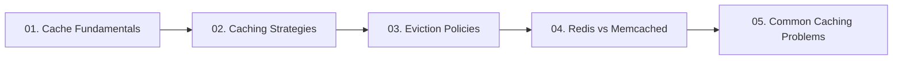

# 05. Caching and In-Memory Acceleration

[🏠 Home](../README.md) > **05. Caching**

---

## Overview

Caching is the primary mechanism in high-level system design to achieve sub-millisecond response times, eliminate redundant database queries, and protect backend services from high read traffic. By storing hot data in ultra-fast RAM, caches exploit temporal and spatial locality to serve up to 90%+ of incoming requests without touching disk storage.

---

## 🎯 Key Learning Objectives

* **Cache Mechanics & Metrics**: Calculate cache hit ratios, understand latency gaps (RAM 100ns vs. SSD 100μs vs. Network 50ms), and apply the 80/20 Pareto principle.
* **Caching Tiers**: Identify and position caching layers across the entire architecture (Browser, CDN, Reverse Proxy, Application Memory, Distributed Redis, Database Query Cache).
* **Write Strategies**: Master Cache-Aside (Lazy loading), Read-Through, Write-Through, Write-Back (Write-Behind), and Write-Around trade-offs.
* **Eviction Algorithms**: Analyze data structures and complexities for LRU (Doubly Linked List + Hash Map), LFU (Min-Heap / Frequency lists), FIFO, and Volatile-TTL.
* **Engine Selection**: Deeply compare Redis (data structures, single-threaded event loop, replication, persistence) vs. Memcached (multi-threaded, slab allocator).
* **Distributed Pitfalls**: Diagnose and remediate Cache Stampede (Thundering Herd), Cache Penetration (Bloom filters), Cache Avalanche (jittered TTLs), and Hot Key bottlenecks.

---

## 📚 Module Table of Contents

| # | Topic | Key Focus | Link |
|---|---|---|---|
| **01** | **Cache Fundamentals** | Hits, misses, hit ratio formula, 6 caching locations (Browser to DB), 80/20 Pareto rule | [Read Guide ➡️](./cache-fundamentals.md) |
| **02** | **Caching Strategies** | Cache-Aside (Lazy), Read-Through, Write-Through, Write-Back, Write-Around | [Read Guide ➡️](./caching-strategies.md) |
| **03** | **Cache Eviction Policies** | LRU (Doubly Linked List + Hash Map), LFU, FIFO, Volatile-TTL, sizing limits | [Read Guide ➡️](./eviction-policies.md) |
| **04** | **Redis vs. Memcached** | Multi-threading vs. single-threaded event loop, rich data types, persistence (RDB/AOF), clustering | [Read Guide ➡️](./redis-vs-memcached.md) |
| **05** | **Common Caching Problems** | Cache Stampede (Thundering Herd), Cache Penetration (Bloom filters), Avalanche & Hot Keys | [Read Guide ➡️](./common-caching-problems.md) |

---

## 🔍 Detailed Topic Breakdown

* 📌 **[01. Cache Fundamentals](./cache-fundamentals.md)**
  * **Core Concepts**: Storing high-demand data in volatile RAM to reduce expensive compute and disk read operations.
  * **The Hit Ratio Formula**: $\text{Hit Ratio} = \frac{\text{Hits}}{\text{Hits} + \text{Misses}} \times 100$. A healthy production cache typically targets $\ge 85–95\%$.
  * **The 6 Architectural Caching Layers**:
    * *Browser / Client*: Local storage, indexedDB, HTTP cache headers (`Cache-Control: max-age`, `ETag`).
    * *CDN Edge*: Geo-distributed static files, full HTML page caches, and edge API caching.
    * *Reverse Proxy (Nginx/Varnish)*: In-memory micro-caching for popular API payloads.
    * *Application In-Process*: Guava / Go in-memory maps (fastest, but memory-isolated and causes cross-server cache drift).
    * *Distributed Cache (Redis/Memcached)*: Centralized shared RAM pool accessible by all application instances.
    * *Database Buffer Pool*: Engine-level caching of disk pages directly in memory.

* 📌 **[02. Caching Strategies](./caching-strategies.md)**
  * **Cache-Aside (Lazy Loading)**:
    * Application checks cache first. On miss, reads from DB and populates cache.
    * *Pros*: Resilient to cache crashes; only caches genuinely requested data.
    * *Cons*: Initial cache miss penalty; risk of stale data if DB is updated directly.
  * **Read-Through**: Application treats the cache as the sole data store; cache provider fetches transparently from DB on misses.
  * **Write-Through**: Application writes data to the cache, and the cache synchronously writes to the database before returning success.
    * *Pros*: Zero stale cache reads.
    * *Cons*: Increased write latency.
  * **Write-Back (Write-Behind)**: Writes immediately to cache; writes to database asynchronously in batches.
    * *Pros*: Massive write throughput (perfect for write-heavy counters and audit logs).
    * *Cons*: Risk of data loss if cache crashes before flushing to disk.
  * **Write-Around**: Writes bypass the cache directly to the DB; cache is populated only on subsequent read misses.

* 📌 **[03. Cache Eviction Policies](./eviction-policies.md)**
  * **Least Recently Used (LRU)**:
    * Evicts items that haven't been accessed for the longest time.
    * Implementation: Hash Map (for $O(1)$ lookup) + Doubly Linked List (for $O(1)$ node repositioning and eviction).
  * **Least Frequently Used (LFU)**:
    * Tracks access count frequency; evicts the least requested item.
    * Trade-off: Historical hot items can linger long after their popularity wanes; requires frequency decay algorithms.
  * **First In, First Out (FIFO)**: Queue-based eviction; evicts oldest created key regardless of access patterns.
  * **Volatile / Allkeys TTL**: Evicts only keys with an explicit expiration (`EXPIRE`) configured or cleans up expired keys lazily/periodically.

* 📌 **[04. Redis vs. Memcached](./redis-vs-memcached.md)**
  * **Redis (Remote Dictionary Server)**:
    * Single-threaded reactor event loop (ultra-fast, lock-free execution).
    * Rich native data types: Strings, Hashes, Lists, Sets, Sorted Sets (`ZSET`), Bitmaps, HyperLogLogs, Geospatial, Streams.
    * Persistence: Point-in-time snapshots (RDB) and append-only write logs (AOF).
    * High Availability & Clustering: Sentinel for automatic failover; Redis Cluster for multi-master sharding.
  * **Memcached**:
    * Multi-threaded architecture leveraging all available CPU cores on massive servers.
    * Simple string/binary key-value store; no complex data structures or disk persistence.
    * Memory management via pre-allocated Slab Allocation to eliminate OS memory fragmentation.

* 📌 **[05. Common Caching Problems & Solutions](./common-caching-problems.md)**
  * **Cache Stampede (Thundering Herd)**:
    * *Symptom*: A hot key expires; 50,000 concurrent requests immediately miss and query the DB at once, bringing it down.
    * *Fixes*: Distributed mutex lock (e.g., Redis `SETNX`), pre-emptive early background refresh (probabilistic XFetch).
  * **Cache Penetration**:
    * *Symptom*: Malicious queries for non-existent IDs bypass the cache every single time, hammering the database.
    * *Fixes*: Bloom filters at the gateway to drop invalid IDs; caching null values with short TTLs (`TTL = 60s`).
  * **Cache Avalanche**:
    * *Symptom*: Thousands of keys initialized at midnight with the exact same TTL (e.g., 24 hours) expire simultaneously.
    * *Fixes*: Add random jitter to TTLs ($\text{TTL} = \text{base} + \text{rand}(0, 300\text{s})$).
  * **Hot Key Overload**:
    * *Symptom*: A celebrity profile or breaking news item overwhelms a single Redis shard.
    * *Fixes*: In-memory local caching (L1/L2 cache), key salting (`hot_key:shard_1`, `hot_key:shard_2`).

---

## 💡 Key Architectural Rules of Thumb

* **Always Set a TTL (Time-To-Live)**: Never write a key to a cache without an explicit TTL; unbounded caches without expiration will eventually consume all RAM and force emergency evictions.
* **Jitter Expiration Times**: Add uniform random noise (e.g., $\pm 10\%$) to cache expirations to prevent massive simultaneous cache avalanches.
* **Protect the Database with Mutexes**: For expensive queries, acquire a short distributed lock on cache miss so only one worker queries the database while other requests wait.
* **Remember: Cache is Ephemeral**: Never treat a cache as your primary source of truth unless using Write-Back with verified multi-replica persistence. Your application must function gracefully if the entire cache cluster disappears.

---

| ⬅️ Previous Module | 🏠 Index | Next Module ➡️ |
|:--- |:---:| ---:|
| [04. Load Balancing](../04-load-balancing/README.md) | [System Design Hub](../README.md) | [06. Databases & Storage ➡️](../06-databases/README.md) |
