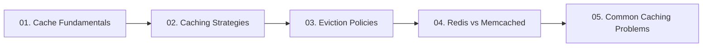

# 05. Caching and In-Memory Acceleration

[🏠 Home](../README.md) > **05. Caching**

---

## Overview

Caching is the primary mechanism in high-level system design to achieve sub-millisecond response times, eliminate redundant database queries, and protect backend services from high read traffic. By storing hot data in ultra-fast RAM, caches exploit temporal and spatial locality to serve up to 90%+ of incoming requests without touching disk storage.



---

## 🎯 Key Learning Objectives

* **Cache Mechanics & Metrics**: Calculate cache hit ratios, understand latency gaps (RAM 100ns vs. SSD 100μs vs. Network 50ms), and apply the 80/20 Pareto principle.
* **Caching Tiers**: Identify and position caching layers across the entire architecture (Browser, CDN, Reverse Proxy, Application Memory, Distributed Redis, Database Query Cache).
* **Write Strategies**: Master Cache-Aside (Lazy loading), Read-Through, Write-Through, Write-Back (Write-Behind), and Write-Around trade-offs.
* **Eviction Algorithms**: Analyze data structures and complexities for LRU (Doubly Linked List + Hash Map), LFU (Min-Heap / Frequency lists), FIFO, and Volatile-TTL.
* **Engine Selection**: Deeply compare Redis (data structures, single-threaded event loop, replication, persistence) vs. Memcached (multi-threaded, slab allocator).
* **Distributed Pitfalls**: Diagnose and remediate Cache Stampede (Thundering Herd), Cache Penetration (Bloom filters), Cache Avalanche (jittered TTLs), and Hot Key bottlenecks.

---

## 📚 Module Table of Contents

| # | Topic | Key Focus | Link |
|---|---|---|---|
| **01** | **Cache Fundamentals** | Hits, misses, hit ratio formula, 6 caching locations (Browser to DB), 80/20 Pareto rule | [Read Guide ➡️](./cache-fundamentals.md) |
| **02** | **Caching Strategies** | Cache-Aside (Lazy), Read-Through, Write-Through, Write-Back, Write-Around | [Read Guide ➡️](./caching-strategies.md) |
| **03** | **Cache Eviction Policies** | LRU (Doubly Linked List + Hash Map), LFU, FIFO, Volatile-TTL, sizing limits | [Read Guide ➡️](./eviction-policies.md) |
| **04** | **Redis vs. Memcached** | Multi-threading vs. single-threaded event loop, rich data types, persistence (RDB/AOF), clustering | [Read Guide ➡️](./redis-vs-memcached.md) |
| **05** | **Common Caching Problems** | Cache Stampede (Thundering Herd), Cache Penetration (Bloom filters), Avalanche & Hot Keys | [Read Guide ➡️](./common-caching-problems.md) |

---

## 🔍 Detailed Topic Breakdown

* 📌 **[01. Cache Fundamentals](./cache-fundamentals.md)**
  * **Core Concepts**: Storing high-demand data in volatile RAM to reduce expensive compute and disk read operations.
  * **The Hit Ratio Formula**: $\text{Hit Ratio} = \frac{\text{Hits}}{\text{Hits} + \text{Misses}} \times 100$. A healthy production cache typically targets $\ge 85–95\%$.
  * **The 6 Architectural Caching Layers**:
    * *Browser / Client*: Local storage, indexedDB, HTTP cache headers (`Cache-Control: max-age`, `ETag`).
    * *CDN Edge*: Geo-distributed static files, full HTML page caches, and edge API caching.
    * *Reverse Proxy (Nginx/Varnish)*: In-memory micro-caching for popular API payloads.
    * *Application In-Process*: Guava / Go in-memory maps (fastest, but memory-isolated and causes cross-server cache drift).
    * *Distributed Cache (Redis/Memcached)*: Centralized shared RAM pool accessible by all application instances.
    * *Database Buffer Pool*: Engine-level caching of disk pages directly in memory.

* 📌 **[02. Caching Strategies](./caching-strategies.md)**
  * **Cache-Aside (Lazy Loading)**:
    * Application checks cache first. On miss, reads from DB and populates cache.
    * *Pros*: Resilient to cache crashes; only caches genuinely requested data.
    * *Cons*: Initial cache miss penalty; risk of stale data if DB is updated directly.
  * **Read-Through**: Application treats the cache as the sole data store; cache provider fetches transparently from DB on misses.
  * **Write-Through**: Application writes data to the cache, and the cache synchronously writes to the database before returning success.
    * *Pros*: Zero stale cache reads.
    * *Cons*: Increased write latency.
  * **Write-Back (Write-Behind)**: Writes immediately to cache; writes to database asynchronously in batches.
    * *Pros*: Massive write throughput (perfect for write-heavy counters and audit logs).
    * *Cons*: Risk of data loss if cache crashes before flushing to disk.
  * **Write-Around**: Writes bypass the cache directly to the DB; cache is populated only on subsequent read misses.

* 📌 **[03. Cache Eviction Policies](./eviction-policies.md)**
  * **Least Recently Used (LRU)**:
    * Evicts items that haven't been accessed for the longest time.
    * Implementation: Hash Map (for $O(1)$ lookup) + Doubly Linked List with `splice()` (Front = LRU, Back = MRU).
    * Detailed Guide: [🚀 LRU Cache in C++ — Complete Guide](./lru-cache.md).
  * **Least Frequently Used (LFU)**:
    * Tracks access count frequency; evicts the least requested item (tie-broken by LRU).
    * Implementation: 4 Hash Maps (`keyToValue`, `keyToFrequency`, `frequencyToKeys`, `keyToIterator`) + `minimumFrequency`.
    * Detailed Guide: [🚀 LFU Cache in C++ — Complete Guide](./lfu-cache.md).
  * **First In, First Out (FIFO)**: Queue-based eviction; evicts oldest created key regardless of access patterns.
  * **Volatile / Allkeys TTL**: Evicts only keys with an explicit expiration (`EXPIRE`) configured or cleans up expired keys lazily/periodically.

* 📌 **[04. Redis vs. Memcached](./redis-vs-memcached.md)**
  * **Redis (Remote Dictionary Server)**:
    * Single-threaded reactor event loop (ultra-fast, lock-free execution).
    * Rich native data types: Strings, Hashes, Lists, Sets, Sorted Sets (`ZSET`), Bitmaps, HyperLogLogs, Geospatial, Streams.
    * Persistence: Point-in-time snapshots (RDB) and append-only write logs (AOF).
    * High Availability & Clustering: Sentinel for automatic failover; Redis Cluster for multi-master sharding.
  * **Memcached**:
    * Multi-threaded architecture leveraging all available CPU cores on massive servers.
    * Simple string/binary key-value store; no complex data structures or disk persistence.
    * Memory management via pre-allocated Slab Allocation to eliminate OS memory fragmentation.

* 📌 **[05. Common Caching Problems & Solutions](./common-caching-problems.md)**
  * **Cache Stampede (Thundering Herd)**:
    * *Symptom*: A hot key expires; 50,000 concurrent requests immediately miss and query the DB at once, bringing it down.
    * *Fixes*: Distributed mutex lock (e.g., Redis `SETNX`), pre-emptive early background refresh (probabilistic XFetch).
  * **Cache Penetration**:
    * *Symptom*: Malicious queries for non-existent IDs bypass the cache every single time, hammering the database.
    * *Fixes*: Bloom filters at the gateway to drop invalid IDs; caching null values with short TTLs (`TTL = 60s`).
  * **Cache Avalanche**:
    * *Symptom*: Thousands of keys initialized at midnight with the exact same TTL (e.g., 24 hours) expire simultaneously.
    * *Fixes*: Add random jitter to TTLs ($\text{TTL} = \text{base} + \text{rand}(0, 300\text{s})$).
  * **Hot Key Overload**:
    * *Symptom*: A celebrity profile or breaking news item overwhelms a single Redis shard.
    * *Fixes*: In-memory local caching (L1/L2 cache), key salting (`hot_key:shard_1`, `hot_key:shard_2`).

---

## 💻 Executable C++17 Caching Implementations

All cache algorithm implementations are organized into the dedicated [`./code/`](./code/) directory:

| Implementation | Source File | Core Data Structures | Comprehensive Guide |
|:---|:---|:---|:---|
| **LRU Cache** | [`./code/lru_cache.cpp`](./code/lru_cache.cpp) | `std::list` + `std::unordered_map` with `splice()` | [📖 LRU In-Depth Guide](./lru-cache.md) |
| **LFU Cache** | [`./code/lfu_cache.cpp`](./code/lfu_cache.cpp) | 4 Hash Maps + Doubly Linked Lists + `minFreq` | [📖 LFU In-Depth Guide](./lfu-cache.md) |
| **FIFO Cache** | [`./code/fifo_cache.cpp`](./code/fifo_cache.cpp) | `std::queue` + `std::unordered_map` | [Eviction Policies Guide](./eviction-policies.md#63-fifo-cache-complete-dry-run-capacity--3) |
| **TTL Cache** | [`./code/ttl_cache.cpp`](./code/ttl_cache.cpp) | `std::chrono` steady clock | [Eviction Policies Guide](./eviction-policies.md#5-other-eviction-policies) |
| **Cache-Aside Pattern** | [`./code/cache_aside.cpp`](./code/cache_aside.cpp) | Mock Redis + Mock PostgreSQL | [Caching Strategies Guide](./caching-strategies.md#1-cache-aside-lazy-loading) |

### How to Compile and Run Separately:
Navigate to the `code/` directory and compile/run any file directly:

```powershell
# Navigate to the code directory
cd "05-caching\code"

# 1. LRU Cache
g++ -std=c++17 lru_cache.cpp -o lru_cache.exe
.\lru_cache.exe

# 2. LFU Cache
g++ -std=c++17 lfu_cache.cpp -o lfu_cache.exe
.\lfu_cache.exe

# 3. FIFO Cache
g++ -std=c++17 fifo_cache.cpp -o fifo_cache.exe
.\fifo_cache.exe

# 4. TTL Cache
g++ -std=c++17 ttl_cache.cpp -o ttl_cache.exe
.\ttl_cache.exe

# 5. Cache-Aside Pattern Simulation
g++ -std=c++17 cache_aside.cpp -o cache_aside.exe
.\cache_aside.exe
```

---

## 🧪 Comprehensive Caching Dry Runs & State Tables

### Dry Run 1: LRU Cache (Capacity = 3)
* **Configuration:** Cache Capacity = 3.
* **Internal Data Structures:**
  * Doubly Linked List (DLL): Head = Most Recently Used (MRU), Tail = Least Recently Used (LRU).
  * Hash Map: Key $\to$ Iterator pointing to DLL node ($O(1)$ lookup).
* **Sequential Operations:**
  1. `put(1, 10)`
  2. `put(2, 20)`
  3. `put(3, 30)`
  4. `get(1)`
  5. `put(4, 40)`

| Step # | Operation | Action Taken | DLL State (MRU $\to$ LRU) | Hash Map Keys | Evicted Key | Detailed State Explanation |
|:---:|:---|:---|:---:|:---:|:---:|:---|
| **1** | `put(1, 10)` | Insert at head | `[{1:10}]` | `{1}` | *None* | Key 1 is inserted into the empty cache. It is both MRU and LRU. |
| **2** | `put(2, 20)` | Insert at head | `[{2:20}, {1:10}]` | `{1, 2}` | *None* | Key 2 is pushed to the head (MRU). Key 1 is pushed towards tail. |
| **3** | `put(3, 30)` | Insert at head | `[{3:30}, {2:20}, {1:10}]` | `{1, 2, 3}` | *None* | Key 3 is inserted at head. Cache reaches maximum capacity (3/3). |
| **4** | `get(1)` | **Cache HIT** (10) | `[{1:10}, {3:30}, {2:20}]` | `{1, 2, 3}` | *None* | Key 1 is accessed! It is unlinked from its position and spliced to the head (MRU). **Notice: Key 2 is now shifted to the tail (LRU)!** |
| **5** | `put(4, 40)` | **Cache FULL** | `[{4:40}, {1:10}, {3:30}]` | `{1, 3, 4}` | **Key 2** | Cache is full. Key 2 (at the tail/LRU) is evicted and erased from Hash Map. Key 4 enters at head (MRU). |

* **Final Cache Contents (MRU $\to$ LRU):** `[{4:40}, {1:10}, {3:30}]`
* **Why was Key 2 evicted instead of Key 1?** Even though Key 1 was inserted before Key 2, operation 4 (`get(1)`) refreshed Key 1's recency timestamp, making Key 2 the least recently used item!

---

### Dry Run 2: LFU Cache (Capacity = 2)
* **Configuration:** Cache Capacity = 2.
* **Internal Data Structures:**
  * `keyMap`: Key $\to$ Node iterator.
  * `freqLists`: Frequency Count $\to$ Doubly linked list of nodes with that frequency.
  * `minFreq`: Tracks lowest access frequency present in cache.
* **Sequential Operations:**
  1. `put(1, 10)`
  2. `put(2, 20)`
  3. `get(1)`
  4. `put(3, 30)`
  5. `get(2)`
  6. `get(3)`

| Step # | Operation | Frequency Buckets | `minFreq` | Evicted Key | Explanation |
|:---:|:---|:---|:---:|:---:|:---|
| **1** | `put(1, 10)` | `freq[1] = [{1:10}]` | 1 | *None* | Key 1 inserted with initial access count = 1. |
| **2** | `put(2, 20)` | `freq[1] = [{2:20}, {1:10}]` | 1 | *None* | Key 2 inserted with count = 1. Cache is at capacity (2/2). |
| **3** | `get(1)` | `freq[1] = [{2:20}]`<br>`freq[2] = [{1:10}]` | 1 | *None* | Key 1 is accessed $\implies$ frequency increments to 2. Key 1 moves to bucket 2. Lowest frequency remaining is still 1. |
| **4** | `put(3, 30)` | `freq[1] = [{3:30}]`<br>`freq[2] = [{1:10}]` | 1 | **Key 2** | Capacity full! Lowest frequency is `minFreq = 1` (Key 2 has 1 hit; Key 1 has 2 hits). **Key 2 is evicted!** Key 3 enters bucket 1. |
| **5** | `get(2)` | Unchanged | 1 | *None* | **Cache MISS (-1)** (Key 2 was evicted). |
| **6** | `get(3)` | `freq[2] = [{3:30}, {1:10}]` | 2 | *None* | **Cache HIT (30)**. Key 3 frequency increments from 1 to 2. Bucket 1 is now empty $\implies$ `minFreq` becomes 2! |

---

### Dry Run 3: FIFO Cache (Capacity = 3)
* **Configuration:** Cache Capacity = 3.
* **Rule:** Eviction strictly follows first-in, first-out insertion order. Reading/accessing an element does **not** alter its position in the queue.

| Step # | Operation | FIFO Queue (Front $\to$ Back) | Hash Map Storage | Evicted Key | Notes |
|:---:|:---|:---:|:---:|:---:|:---|
| **1** | `put(1, 100)` | `[1]` | `{1: 100}` | *None* | First inserted. |
| **2** | `put(2, 200)` | `[1, 2]` | `{1: 100, 2: 200}` | *None* | Pushed behind 1. |
| **3** | `put(3, 300)` | `[1, 2, 3]` | `{1: 100, 2: 200, 3: 300}` | *None* | Cache at capacity 3/3. |
| **4** | `get(1)` | `[1, 2, 3]` | Unchanged | *None* | **Cache HIT (100)**. In FIFO, Key 1 remains at the front of the eviction queue! |
| **5** | `put(4, 400)` | `[2, 3, 4]` | `{2: 200, 3: 300, 4: 400}` | **Key 1** | **Key 1 is popped and evicted**, even though it was accessed in step 4! |
| **6** | `get(1)` | `[2, 3, 4]` | Unchanged | *None* | **Cache MISS (-1)**. |

---

### Dry Run 4: TTL Cache (Lazy Eviction & Active Sweep)
* **Configuration:** Expiration timestamps calculated via `std::chrono::steady_clock`.

| Timestamp | Action | Key Queried | Cache State | Result / Behavior |
|:---:|:---|:---:|:---:|:---|
| $t = 0\text{ ms}$ | `set("session", "abc", 200ms)` | — | `store["session"]` expiry = $200\text{ms}$ | Key stored in memory. |
| $t = 0\text{ ms}$ | `set("abandoned", "xyz", 100ms)` | — | `store["abandoned"]` expiry = $100\text{ms}$ | Temporary key stored. |
| $t = 50\text{ ms}$ | `get("session")` | `"session"` | Expiry is $200\text{ms}$ ($50 < 200$) | **Cache HIT ("abc")** — Key still valid. |
| $t = 250\text{ ms}$ | `get("session")` | `"session"` | Expiry was $200\text{ms}$ ($250 > 200$) | **LAZY EVICTION:** Key detected expired upon access. Erased from memory $\implies$ **Cache MISS**. |
| $t = 300\text{ ms}$ | `cleanupExpired()` | — | Scans map for $t > \text{expiry}$ | **ACTIVE MEMORY SWEEP:** Sweeps `"abandoned"` (which was never queried with get). Memory freed! |

---

### Dry Run 5: Cache-Aside Pattern & Penetration Defense
* **Storage Components:** Application Server, Redis Cache (RAM), PostgreSQL Database (Disk).

| Step # | User Action | Cache Layer (Redis) | Database Layer (Postgres) | Flow Description & Defense |
|:---:|:---|:---:|:---:|:---|
| **1** | Request `user:1` | **MISS** | `SELECT * WHERE id = 1` $\implies$ Found "Alice" | **Cold Start:** App reads DB, populates Redis with 1-hour TTL, returns "Alice". |
| **2** | Request `user:1` | **HIT ("Alice")** | *Bypassed (0 queries)* | **Warm Cache:** Returned in $<1\text{ ms}$ directly from Redis. DB completely idle. |
| **3** | Update `user:1` | `DEL user:1` *(Invalidated)* | `UPDATE SET name = 'Alice Senior'` | **Write Invalidation:** Database is updated; stale cache key is immediately deleted. |
| **4** | Request `user:1` | **MISS** | `SELECT * WHERE id = 1` $\implies$ Found "Alice Senior" | **Fresh Reload:** Next read repopulates Redis with fresh data. |
| **5** | Malicious probe: `user:9999` | **MISS** | `SELECT * WHERE id = 9999` $\implies$ Not found! | **Penetration Defense Step 1:** App writes `SETEX user:9999 60 "__NULL__"`. |
| **6** | Malicious probe: `user:9999` | **HIT ("__NULL__")** | *Bypassed (0 queries)* | **Penetration Defense Step 2:** Known nonexistent ID rejected at Redis layer without touching DB! |

---

## 💡 Key Architectural Rules of Thumb

* **Always Set a TTL (Time-To-Live)**: Never write a key to a cache without an explicit TTL; unbounded caches without expiration will eventually consume all RAM and force emergency evictions.
* **Jitter Expiration Times**: Add uniform random noise (e.g., $\pm 10\%$) to cache expirations to prevent massive simultaneous cache avalanches.
* **Protect the Database with Mutexes**: For expensive queries, acquire a short distributed lock on cache miss so only one worker queries the database while other requests wait.
* **Remember: Cache is Ephemeral**: Never treat a cache as your primary source of truth unless using Write-Back with verified multi-replica persistence. Your application must function gracefully if the entire cache cluster disappears.

---

| ⬅️ Previous Module | 🏠 Index | Next Module ➡️ |
|:--- |:---:| ---:|
| [04. Load Balancing](../04-load-balancing/README.md) | [System Design Hub](../README.md) | [06. Databases & Storage ➡️](../06-databases/README.md) |
