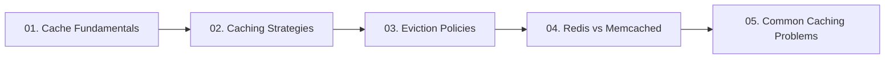

# 05. Caching and In-Memory Acceleration

[🏠 Home](../README.md) > **05. Caching**

---

## Overview

Caching is the primary mechanism in high-level system design to achieve sub-millisecond response times, eliminate redundant database queries, and protect backend services from high read traffic. By storing hot data in ultra-fast RAM, caches exploit temporal and spatial locality to serve up to 90%+ of incoming requests without touching disk storage.

---

## Module Table of Contents

| # | Topic | Key Focus | Link |
|---|---|---|---|
| **01** | **Cache Fundamentals** | Hits, misses, hit ratio formula, 6 caching locations (Browser to DB), 80/20 Pareto rule | [Read Guide ➡️](./cache-fundamentals.md) |
| **02** | **Caching Strategies** | Cache-Aside (Lazy), Read-Through, Write-Through, Write-Back, Write-Around | [Read Guide ➡️](./caching-strategies.md) |
| **03** | **Cache Eviction Policies** | LRU (Doubly Linked List + Hash Map), LFU, FIFO, Volatile-TTL, sizing limits | [Read Guide ➡️](./eviction-policies.md) |
| **04** | **Redis vs. Memcached** | Multi-threading vs. single-threaded event loop, rich data types, persistence (RDB/AOF), clustering | [Read Guide ➡️](./redis-vs-memcached.md) |
| **05** | **Common Caching Problems** | Cache Stampede (Thundering Herd), Cache Penetration (Bloom filters), Avalanche & Hot Keys | [Read Guide ➡️](./common-caching-problems.md) |

---

| ⬅️ Previous Module | 🏠 Index | Next Module ➡️ |
|:--- |:---:| ---:|
| [04. Load Balancing](../04-load-balancing/README.md) | [System Design Hub](../README.md) | [06. Databases & Storage ➡️](../06-databases/README.md) |
