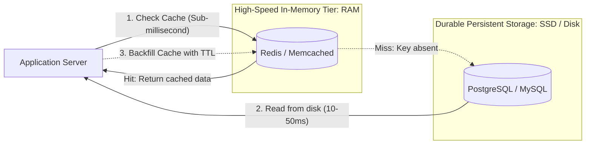
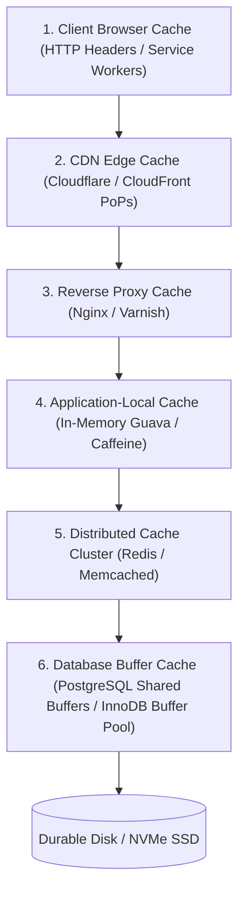

# 01. Cache Fundamentals

[🏠 Home](../README.md) > [05. Caching](./README.md) > **Cache Fundamentals**

---

## 1. What is Caching?

**Caching** is the technique of storing copies of data in a high-speed, temporary storage layer (predominantly in-memory RAM) so that future requests for that data can be served faster than querying the primary storage tier.

---

## 2. Cache Hit vs. Cache Miss

### Cache Hit
A requested item **exists** in the cache and is still valid (not expired).
$$\text{Application} \longrightarrow \text{Cache} \longrightarrow \text{Data Found (0.5 – 2 ms)}$$

### Cache Miss
A requested item is **not** present in the cache. The application must query the underlying database, retrieve the data, and populate the cache for subsequent requests.
$$\text{Application} \longrightarrow \text{Cache} \longrightarrow \text{Miss}$$
$$\text{Application} \longrightarrow \text{Database} \longrightarrow \text{Fetch Data (10 – 100 ms)}$$

---

## 3. The Cache Hit Ratio

The **Cache Hit Ratio** measures the proportion of total cache lookups that successfully find the requested data in the cache:

$$\text{Hit Ratio} = \frac{\text{Total Cache Hits}}{\text{Total Cache Lookups (Hits + Misses)}} \times 100\%$$

### Numerical Example:

* **Cache Hits:** $900$
* **Cache Misses:** $100$
* **Total Lookups:** $900 + 100 = 1,000$

$$\text{Hit Ratio} = \frac{900}{1,000} = \mathbf{90\%}$$

> [!IMPORTANT]
> A **90% hit ratio** dramatically reduces database traffic (9 out of 10 requests bypass disk I/O entirely). 
> However, **a high hit ratio does not automatically guarantee low end-to-end latency** if:
> 1. Cache requests themselves are expensive (e.g., retrieving massive 10MB serialized blobs over high-latency networks).
> 2. The remaining 10% of cache misses trigger catastrophic, unindexed, multi-table SQL queries that exhaust database connection pools.

---

## 4. Typical Caching Locations (From Client to Disk)

Caching exists across multiple physical and logical layers in modern distributed architectures:

| Caching Location | Where It Lives | What It Caches | Latency | Capacity | Invalidation Complexity |
|---|---|---|:---:|:---:|:---:|
| **1. Browser Cache** | User's local device disk / RAM | Static assets (CSS, JS, images), HTTP responses | **0 ms** | Low (MBs) | Hardest (controlled via `Cache-Control` / ETags) |
| **2. CDN Cache** | Geographically distributed Edge PoPs | Static assets, cached API response feeds | **5 – 20 ms** | Massive (TBs) | Purge API / cache tag invalidation |
| **3. Reverse Proxy** | Datacenter ingress (Nginx, Varnish) | Gzipped HTML fragments, public API endpoints | **1 – 3 ms** | Moderate (GBs) | File reload or proxy purge |
| **4. App-Local Cache** | App Server Heap (Guava, Caffeine) | Config flags, encryption keys, hot objects | **< 1 µs** | Low (GBs) | Difficult across multi-server fleets |
| **5. Distributed Cache** | Dedicated cluster (Redis, Memcached) | User sessions, shopping carts, precomputed views | **1 – 2 ms** | High (GBs–TBs) | Explicit keyspace delete / TTL expiry |
| **6. DB Buffer Cache** | Database server RAM | Table index pages, recently queried disk blocks | **< 1 ms** | High (RAM limit) | Automatic database-managed LRU |

Each layer presents trade-offs in **latency**, **storage capacity**, **invalidation complexity**, and **cache consistency**.

---

## 5. Related Topics & Next Steps

* [Caching Strategies](./caching-strategies.md) — Cache-Aside (Lazy Loading), Read-Through, Write-Through, Write-Back, Write-Around.
* [Cache Eviction Policies](./eviction-policies.md) — LRU vs. LFU with step-by-step memory eviction traces.
* [Redis vs. Memcached](./redis-vs-memcached.md) — Multi-threaded key-value caching vs. rich data structures.
* [Common Caching Problems](./common-caching-problems.md) — Stampedes, Penetration, Avalanches, and Hot Keys.

---

| ⬅️ Previous Module | 🏠 Index | Next Topic ➡️ |
|:--- |:---:| ---:|
| [Consistent Hashing](../04-load-balancing/consistent-hashing.md) | [05. Caching Index](./README.md) | [Caching Strategies ➡️](./caching-strategies.md) |
