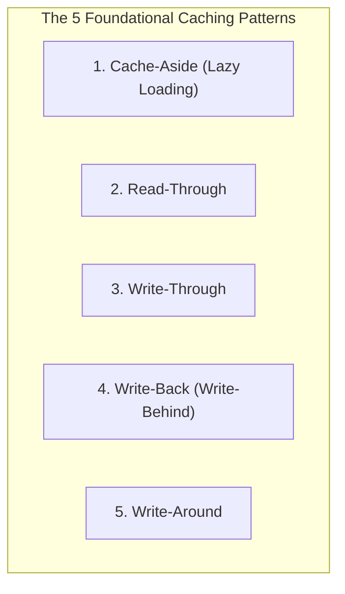
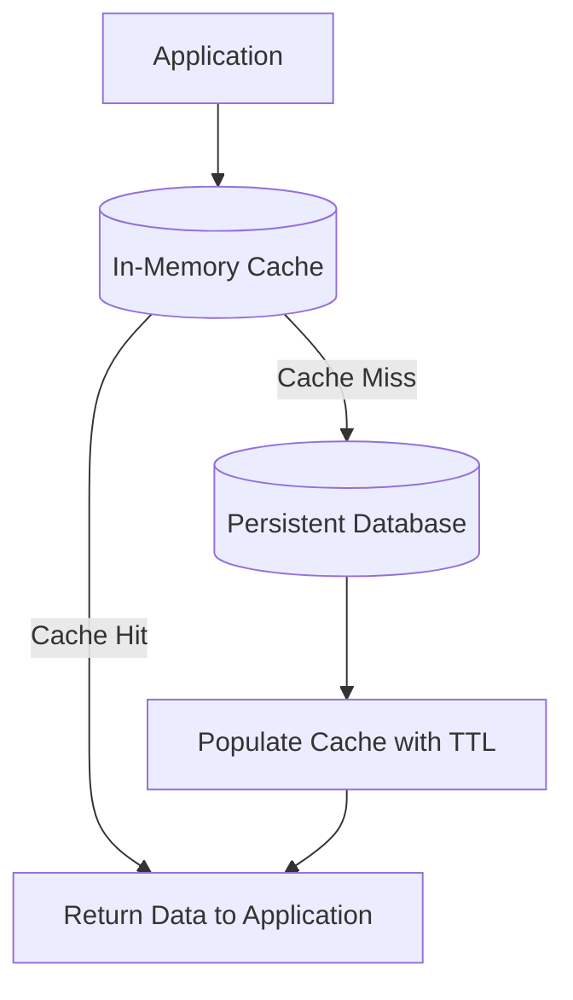
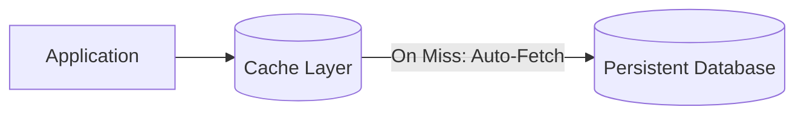
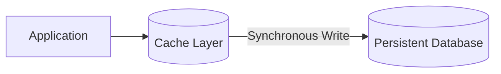
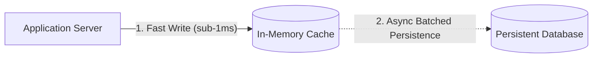
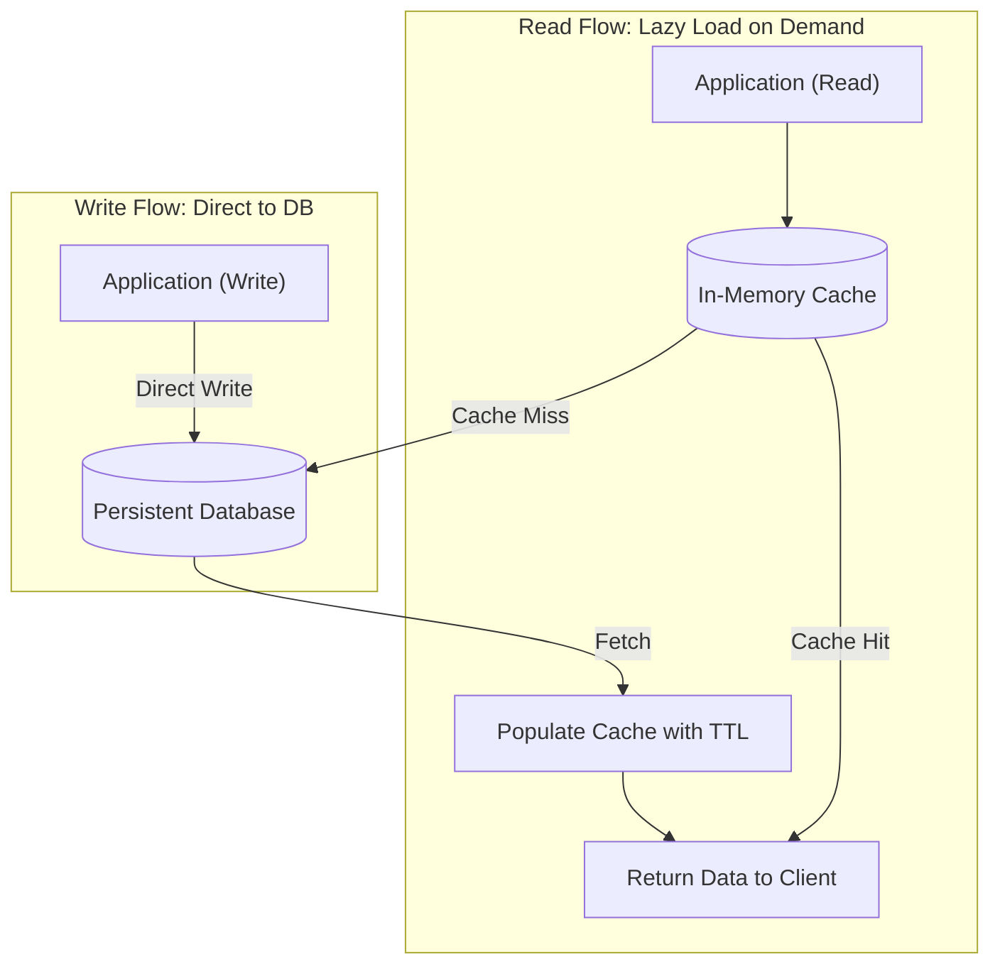

# 02. Caching Strategies

[🏠 Home](../README.md) > [05. Caching](./README.md) > **Caching Strategies**

---

## 1. What is a Caching Strategy?

A **Caching Strategy** is the architectural pattern that dictates **how and when data moves between the application, the in-memory cache layer, and the persistent database**. 

Choosing the right caching pattern defines your system's data freshness, read/write latencies, complexity, and tolerance to failures.



---

## 2. Cache-Aside (Lazy Loading)

In a **Cache-Aside** design, the application is responsible for coordinating reads and writes between the cache and the backing database. The application checks the cache first and explicitly fetches from the database when a cache miss occurs.

### Read Flow



### Python Code Example

```python
def get_user(user_id):
    key = f"user:{user_id}"

    # 1. Check cache first
    user = cache.get(key)
    if user is not None:
        return user

    # 2. On cache miss, query primary database
    user = database.get_user(user_id)

    # 3. If found, populate cache with a Time-To-Live (TTL)
    if user is not None:
        cache.set(key, user, ttl=300)

    return user
```
*(This example assumes standard cache and database client libraries).*

### Advantages
* **Memory Efficient:** Only requested data needs to be cached. Cold, unrequested records never waste expensive cache RAM.
* **Direct Control:** The application has full granular control over caching logic, custom TTLs, and serialization.
* **Resilient to Cache Outage:** The database remains the ultimate source of truth. If the cache crashes, the application can still function by querying the database directly (though database load increases).

### Disadvantages
* **Three Network Hops on Miss:** The initial request for an uncached item is noticeably slower because it incurs a cache check, database read, and cache backfill.
* **Potential Stale Data:** Data can become stale if another service updates the database directly without invalidating or evicting the cached key.
* **Manual Invalidation Complexity:** The application code must deliberately handle cache invalidation on every update/delete operation.

### Best Use Cases
* Read-heavy web applications.
* E-commerce product catalogs.
* User account profiles.
* Frequently requested system configuration data.

---

## 3. Read-Through

In a **Read-Through** architecture, the application treats the cache as the central data store. When a cache miss occurs, the cache layer itself transparently loads the missing data from the backing database and returns it to the application.



The application does not implement database-fetching logic for each cache miss; that responsibility belongs to the cache integration or provider plugin.

### Advantages
* **Cleaner Application Code:** Simplifies application-level read logic and avoids duplicate boilerplate queries.
* **Centralized Handling:** Centralizes cache-miss handling, serialization, and error recovery in one place.
* **Standardized Behavior:** Guarantees uniform caching behavior across multiple microservices calling the same data tier.

### Disadvantages
* Requires a cache integration or framework plugin that natively supports custom database loaders.
* Cache population and error handling still need to be carefully designed.
* Cache consistency is not automatic if external processes modify the database directly.

### Cache-Aside vs. Read-Through

| Dimension | Cache-Aside (Lazy Loading) | Read-Through |
|---|---|---|
| **Where Miss Logic Lives** | **Inside the Application** code | **Inside the Cache Layer** provider |
| **Direct DB Access** | Application connects to both Cache and DB | Application connects primarily to Cache |
| **Consistency** | Both patterns return stale data unless freshness and invalidation are managed |

---

## 4. Write-Through

In a **Write-Through** design, data is written to the backing store as part of the write operation, and the cache is updated synchronously at the same time.



The application writes to the cache layer, which synchronously persists the change to the database before confirming success to the caller.

### Advantages
* **Fresh Reads:** Cache entries are kept fresh immediately whenever writes succeed. Subsequent reads are far less likely to encounter stale values.
* **Simplified Writing Interface:** The application can interact with a consistent cache-writing interface without managing separate database write paths.

### Disadvantages
* **Higher Write Latency:** Every write operation is penalized because it must wait for two network round-trips (Cache write + Database write).
* **Failure Complexity:** Updating two separate systems introduces failure handling complexity.

> [!IMPORTANT]
> **Important Consideration:** Write-through does **not** inherently guarantee distributed ACID transactions across independently failing systems. The application must explicitly define what happens when a database write succeeds but a cache update fails, or vice versa (e.g., using retry queues or two-phase commits).

---

## 5. Write-Back (Write-Behind)

In a **Write-Back** design (also called **Write-Behind**), the cache accepts the write immediately and acknowledges it to the application in sub-millisecond time. The cache updates the persistent backing store **asynchronously in the background**, frequently batching multiple writes together.



### Advantages
* **Ultra-Low Write Latency:** The application does not wait for slow disk I/O.
* **Batched Database Writes:** The cache can aggregate multiple updates to the same row (e.g., video view counts incremented 1,000 times) and execute a single batched database write, drastically reducing write amplification.

### Disadvantages
* **Risk of Permanent Data Loss:** If an acknowledged write exists only in volatile cache RAM and the cache server loses power or crashes, **that data is permanently lost**.
* **Database Lags Cache:** The database temporarily lags behind the cache, causing inconsistent states if other systems read directly from disk.
* **Operational Complexity:** Recovery, retries, write ordering, and idempotent de-duplication must be handled by the cache pipeline.

### Best Use Cases
* Aggregated counters (e.g., YouTube video view counts, Twitter tweet impression counts).
* High-volume IoT telemetry and analytics ingestion workloads where delayed persistence is acceptable.
* **Caution:** **Never use a volatile cache as the only durable record for critical financial transactions, payment ledgers, or medical records!**

---

## 6. Write-Around

In a **Write-Around** design, writes go directly to the persistent database without updating the cache. The cache is only populated later when an item is requested on a subsequent read.



### Advantages
* **Prevents Cache Churn / Pollution:** Avoids flooding the cache with one-time write data that may never be read again (e.g., large bulk uploads, transaction archives).
* **Conserves Expensive Cache RAM:** Ensures only hot, repeatedly requested data occupies memory.

### Disadvantages
* **Guaranteed Miss on Immediate Read:** A read immediately after a write will miss the cache, incurring the latency penalty of a full database lookup.
* **Cache Invalidation Still Required:** If an existing cached entry was present before the write, it must be explicitly invalidated or updated to avoid serving stale data.

### Best Use Cases
* Bulk data imports.
* Write-heavy workloads with infrequent or delayed reads.
* Archival data that is unlikely to be accessed soon after creation.

---

## 7. Master Caching Pattern Comparison

| Pattern | Read Behavior | Write Behavior | Main Advantage | Main Trade-Off |
|---|---|---|---|---|
| **Cache-Aside** | Application checks cache and fetches from DB on a miss | Usually database write plus cache invalidation or update | Simple, flexible, resilient to cache failure | Application code handles consistency |
| **Read-Through** | Cache layer automatically loads missing data from DB | Depends on write strategy configured | Centralized, clean read logic | Requires suitable cache provider integration |
| **Write-Through** | Cache serves reads with fresh values | Cache and backing store are updated as part of the write flow | Helps maintain fresh cache entries | Higher write latency and coordination complexity |
| **Write-Back** | Cache serves reads | Cache is updated first; backing store is updated asynchronously | Fast writes and batching | Delayed persistence and risk of data loss |
| **Write-Around** | Cache is checked; misses read from database | Database is written directly, bypassing cache | Avoids caching every one-time write | First read immediately after write may miss |

> [!NOTE]
> **Patterns are Not Mutually Exclusive:** Real-world production architectures frequently combine patterns. For example, a system may use **Cache-Aside** for read queries combined with **Write-Around** for bulk batch imports, or **Write-Through** for critical user profiles.

---

## 8. Related Topics & Next Steps

* [Cache Fundamentals](./cache-fundamentals.md) — Hits, misses, locations, and hit ratio math.
* [Cache Eviction Policies](./eviction-policies.md) — LRU vs. LFU step-by-step algorithms.
* [Redis vs. Memcached](./redis-vs-memcached.md) — Evaluating memory engine architectures.
* [Common Caching Problems](./common-caching-problems.md) — Stampedes, penetration, and avalanches.

---

| ⬅️ Previous Topic | 🏠 Index | Next Topic ➡️ |
|:--- |:---:| ---:|
| [Cache Fundamentals](./cache-fundamentals.md) | [05. Caching Index](./README.md) | [Eviction Policies ➡️](./eviction-policies.md) |
