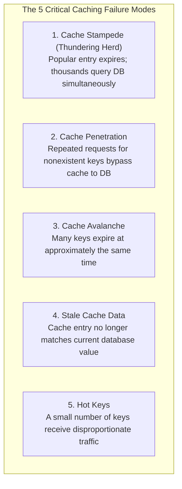

# 05. Common Caching Problems & Solutions

[🏠 Home](../README.md) > [05. Caching](./README.md) > **Common Caching Problems**

---

## 1. What are Production Caching Failures?

While in-memory caches (like Redis and Memcached) dramatically improve read performance, production caching systems are susceptible to specific failure modes. When these failures occur, high-velocity traffic cascades directly onto primary persistent databases, leading to connection pool exhaustion, CPU saturation, and cascading system outages.

---

## 2. The 5 Core Problems & Production Mitigations

### 1. Cache Stampede (Thundering Herd)
* **The Problem:** A popular cache entry expires or is invalidated, and many concurrent requests simultaneously encounter a cache miss and query the primary database to refill it at the exact same millisecond.
* **The Impact:** Massive spike in redundant database queries, connection pool lockup, and sudden 504 Gateway Timeouts.
* **Mitigation Strategies:**
  1. **Request Coalescing (Singleflight):** Ensure that only one in-flight database query executes per key at any given time. Other concurrent requests wait for that single query to finish and share its result.
  2. **Per-Key Distributed Locking (Mutex / Redlock):** Use `SET lock:key NX EX 5` to allow only the lock-winning thread to query the database and populate the cache. Other threads sleep briefly and read from the cache.
  3. **Stale-While-Revalidate (Background Refresh):** Serve the slightly stale cached value to incoming users while triggering an asynchronous background job to refresh the cache with fresh database data.
  4. **Randomized Expiration Times (TTL Jitter):** Avoid synchronized expiration across keys.

---

### 2. Cache Penetration
* **The Problem:** Repeated requests for nonexistent keys (e.g., `user_id = -9999` or random nonexistent UUIDs generated by bots/scrapers) bypass the cache and repeatedly query the database because the key is never found and thus never cached.
* **The Impact:** Database CPU hits 100% executing useless full-table index scans for keys that will never exist.
* **Mitigation Strategies:**
  1. **Cache Negative Results (Null Object Pattern):** Cache empty or `null` values with a short expiration (e.g., `SET user:-9999 "NULL" EX 60`). Subsequent queries for the missing key hit the cache and return null in 1 ms.
  2. **Strict Input Validation:** Validate and sanitize client inputs before querying the cache or database (e.g., reject negative integers, invalid regex formats, or out-of-range IDs at the API gateway).
  3. **Bloom Filters:** Place a probabilistic **Bloom Filter** in front of the cache. If the filter indicates a key is definitely absent, reject the request immediately without touching the cache or database.

---

### 3. Cache Avalanche
* **The Problem:** A large number of cache entries expire at approximately the exact same time (often due to bulk pre-warming with identical TTLs) or the entire cache cluster restarts.
* **The Impact:** A sudden cliff-edge increase in database traffic as thousands of diverse queries miss the cache simultaneously.
* **Mitigation Strategies:**
  1. **Add Random Jitter to TTLs:** Never set uniform expiration times. Add random variance to each key's TTL:
     $$\text{Effective TTL} = \text{Base TTL} \pm \text{Random}(0, \text{Jitter})$$
  2. **Refresh Hot Keys Before Expiration:** Use scheduled background workers or probabilistic early expiration (such as the **XFetch** algorithm) to refresh hot keys before they reach zero TTL.
  3. **Request Coalescing & Distributed Caching:** Distribute keys across multiple cache shards so a failure or bulk expiration does not impact the entire fleet.
  4. **Rate Limiting & Controlled Fallback:** Apply circuit breakers and rate limiters to protect the database during recovery.

---

### 4. Stale Cache Data
* **The Problem:** A cache entry no longer matches the current database value because an update or delete occurred on the database without properly updating or invalidating the cache.
* **The Impact:** Users observe obsolete data, phantom records, or inconsistent application states.
* **Mitigation Strategies:**
  1. **Explicit Invalidation on Write:** Always invalidate (delete) or update corresponding cache keys whenever a write transaction commits successfully to the database.
  2. **Use Suitable TTLs:** Configure realistic, short-to-medium Time-To-Live durations on all cached data so that stale data naturally expires quickly even if an explicit invalidation fails.
  3. **Event-Driven Invalidation (CDC):** Use Change Data Capture (CDC via Debezium or database triggers) listening to the database transaction log (WAL/Binlog) to stream invalidation events to Redis asynchronously.
  4. **Versioning / Generation Counters:** Attach an incremental version number or timestamp to cache keys (e.g., `user:12:v3`). Bumping the version instantly renders older cache keys obsolete.

---

### 5. Hot Keys (The Celebrity Problem)
* **The Problem:** A small number of keys receive a disproportionately massive amount of read traffic (e.g., a viral tweet, breaking news alert, or flash-sale product).
* **The Impact:** Even if the key is cached in Redis, all traffic routes to the **single cache node / shard** holding that specific key, saturating its network bandwidth (NIC) and single CPU core while other nodes remain idle.
* **Mitigation Strategies:**
  1. **Local Application In-Memory Caching:** Place a fast, local in-process cache (e.g., Caffeine in Java, FreeCache/sync.Map in Go) directly on application servers to intercept 95%+ of hot-key reads for 5–10 seconds.
  2. **Replicate Hot Data (Key Salting):** Replicate the hot key across multiple cache nodes by appending random numeric suffixes (`item:100_1`, `item:100_2`, $\dots$, `item:100_N`). Clients randomly query one of the replicas, spreading the load evenly across $N$ cache instances.
  3. **Careful Partitioning & Distribution:** Avoid clustering related hot keys onto the same hash slot or single node.

---

## 3. Summary Mitigation Matrix

| Problem | Root Cause | Primary Symptom | Key Mitigations |
|---|---|---|---|
| **Cache Stampede** | Popular key expires during heavy load | Sudden wave of duplicate DB queries | • Request coalescing • Per-key locking (Redlock) • Stale-while-revalidate |
| **Cache Penetration** | Requests for nonexistent keys | Queries bypass cache straight to DB | • Cache negative results (short TTL) • Input validation • Bloom filters |
| **Cache Avalanche** | Many keys expire simultaneously | Cliff-edge database CPU spike | • Add random jitter to TTLs • Background refresh before expiry • Rate limiting & fallback |
| **Stale Cache Data** | DB updated without cache eviction | Users see outdated data | • Explicit invalidation on write • Suitable TTLs • Versioning & CDC |
| **Hot Keys** | Massive traffic focused on single key | Single cache node CPU/NIC saturated | • Local in-memory caching • Replicate hot data (key salting) • Partition access |

---

## 4. Related Topics & Next Steps

* [Cache Fundamentals](./cache-fundamentals.md) — Hits, misses, and hit ratio formulas.
* [Caching Strategies](./caching-strategies.md) — Cache-Aside, Write-Through, and Write-Back patterns.
* [Eviction Policies](./eviction-policies.md) — LRU vs. LFU step-by-step algorithms.
* [Redis vs. Memcached](./redis-vs-memcached.md) — Architectural trade-offs and decision trees.

---

| ⬅️ Previous Topic | 🏠 Index | Next Module ➡️ |
|:--- |:---:| ---:|
| [Redis vs. Memcached](./redis-vs-memcached.md) | [05. Caching Index](./README.md) | [06. Databases & Storage ➡️](../06-databases/README.md) |
