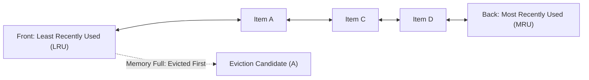
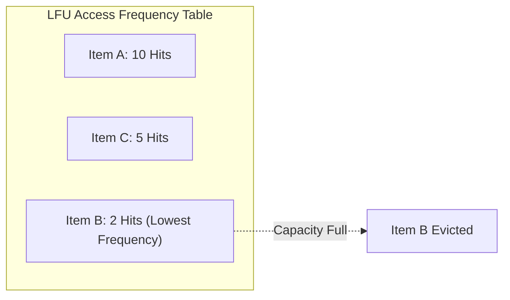

# 03. Cache Eviction Policies (LRU vs. LFU)

[🏠 Home](../README.md) > [05. Caching](./README.md) > **Cache Eviction Policies**

---

## 1. What is an Eviction Policy?

An **Eviction Policy** is the algorithm that determines **which items should be removed when a cache reaches its maximum capacity or memory limit**.

Because RAM is finite and expensive, an in-memory cache cannot expand indefinitely. When capacity is saturated, the cache must choose which existing records to sacrifice to accommodate new writes.

> [!IMPORTANT]
> **Expiration vs. Eviction: The Core Difference**
> * **Expiration (TTL):** Removes items passively or actively when their configured **time-to-live lifespan expires** (e.g., `EXPIRE key 300`).
> * **Eviction:** Forcibly purges valid, non-expired keys when **capacity is exhausted** based on access patterns.

---

## 2. LRU: Least Recently Used

**LRU** evicts the item that has not been accessed for the longest period of time.

* **Core Premise:** Temporal locality—data accessed recently is highly likely to be accessed again in the near future.
* **Standard Implementation:** A **Hash Map** combined with a **Doubly Linked List** (`std::list` + `std::unordered_map`) using `splice()` to achieve strict $O(1)$ lookup, update, and eviction operations.
* **Convention:**
  * **Front / Head:** Least Recently Used (LRU) — first candidate for eviction when full.
  * **Back / Tail:** Most Recently Used (MRU) — where new or recently accessed items are placed.

> [!TIP]
> 📖 **Comprehensive Guide Available:** Read the dedicated [🚀 Complete LRU Cache in C++ Beginner-Friendly Guide](./lru-cache.md) for a line-by-line explanation, real-life book stack analogies, and interview preparation notes.



### Step-by-Step LRU Walkthrough Example

Assume a cache with **Capacity = 3** (Front = LRU $\to$ Back = MRU):

| Step | Operation | Cache Contents (Front = LRU $\to$ Back = MRU) | Evicted Item | Notes |
|:---:|---|:---:|:---:|---|
| 1 | **Insert A** | `[A]` | None | Insert A at back (MRU) |
| 2 | **Insert B** | `[A, B]` | None | Insert B at back (MRU) |
| 3 | **Insert C** | `[A, B, C]` | None | Cache reaches max capacity (3/3). A is LRU, C is MRU. |
| 4 | **Access A** | `[B, C, A]` | None | A is accessed $\implies$ spliced to back (MRU). **B is now LRU!** |
| 5 | **Insert D** | `[C, A, D]` | **B** | Cache is full! **B is evicted from front**. D is inserted at back. |

**Final Cache State:** `[C, A, D]` (C is LRU, D is MRU)

---

## 3. LFU: Least Frequently Used

**LFU** evicts the item that has the **lowest total access frequency counter**. When two or more items have identical frequencies, a tie-breaking rule (such as age or recency) is applied.

* **Core Premise:** Items that are popular historically will remain popular in the future.
* **Standard Implementation:** Four Hash Maps (`keyToValue`, `keyToFrequency`, `frequencyToKeys`, `keyToIterator`) paired with doubly linked lists per frequency and a `minimumFrequency` pointer to achieve strict $O(1)$ average time operations.

> [!TIP]
> 📖 **Comprehensive Guide Available:** Read the dedicated [🚀 Complete LFU Cache in C++ Beginner-Friendly Guide](./lfu-cache.md) for a line-by-line explanation, frequency buckets architecture, LRU tie-breaking, and interview preparation notes.

### Step-by-Step LFU Walkthrough Example

Assume a cache with existing access counts:
* **Item A:** Accessed $10$ times
* **Item B:** Accessed $2$ times
* **Item C:** Accessed $5$ times



When a **New Item** arrives and the cache is full:
* **Candidate for Eviction:** **Item B** (Lowest frequency count: 2).
* **Aging Mechanisms:** Production LFU systems (like Redis LFU) implement **frequency decay / aging** so that historically popular items that are no longer accessed gradually lose their counts over time and do not dominate memory forever.

---

## 4. Head-to-Head Comparison: LRU vs. LFU

| Feature | LRU (Least Recently Used) | LFU (Least Frequently Used) |
|---|---|---|
| **Eviction Rule** | Least recently accessed item | Least frequently accessed item |
| **What It Tracks** | Access recency (timestamp / list position) | Access frequency counter |
| **Implementation** | Hash Map + Doubly Linked List | Frequency counters, frequency buckets, or Min-Heap |
| **Core Strength** | Adapts rapidly to shifting access trends & bursts | Preserves persistently popular hot items |
| **Main Weakness** | A sudden one-time table scan can evict useful hot items | Historic popular items may remain too long; new items risk instant eviction |
| **Best Suited For** | Workloads with strong **temporal locality** (social feeds, blogs) | Workloads with stable, persistent popularity patterns |

---

## 5. Other Eviction Policies

1. **FIFO (First-In, First-Out):**
   * Evicts the oldest inserted item regardless of how many times it was accessed.
   * *Trade-off:* Trivial to implement, but frequently evicts foundational cached data.

   ```mermaid
   flowchart LR
       In["New Item Enters"] --> Q["FIFO Queue: [ Item 4 -> Item 3 -> Item 2 -> Item 1 ]"]
       Q --> Out["Oldest Item 1 Evicted First"]
   ```
2. **Random Eviction:**
   * Evicts a randomly selected item uniformly.
   * *Trade-off:* Zero metadata tracking overhead, but risks evicting ultra-hot records.
3. **TTL-Based Eviction (Volatile-TTL):**
   * Selects and evicts the key with the shortest remaining Time-To-Live.
4. **TinyLFU:**
   * Uses space-efficient Count-Min Sketches to maintain frequency estimates for millions of keys, making highly accurate admission and eviction decisions with minimal memory overhead (utilized in modern caches like Caffeine).
5. **ARC (Adaptive Replacement Cache):**
   * Dynamically and automatically balances between recency (LRU) and frequency (LFU) by maintaining two tracked lists and tuning their sizes in real time based on cache hit history.

---

## 6. Comprehensive Dry Runs & State Transition Tables

### 6.1 LRU Cache Complete Dry Run (Capacity = 3)

We initialize an LRU cache with **Capacity = 3** (`Front = LRU`, `Back = MRU`) and execute:
1. `put(1, 10)`
2. `put(2, 20)`
3. `put(3, 30)`
4. `get(1)`
5. `put(4, 40)`

#### State Transition Table:
| Step | Operation | Cache Contents (Front = LRU $\to$ Back = MRU) | LRU Key | MRU Key | Evicted Key | Detailed Internal Explanation |
|:---:|---|:---:|:---:|:---:|:---:|---|
| **1** | `put(1, 10)` | `[1:10]` | `1` | `1` | *None* | Cache empty. Node `1` inserted at back. Map stores iterator to Node `1`. |
| **2** | `put(2, 20)` | `[1:10, 2:20]` | `1` | `2` | *None* | Node `2` inserted at back (MRU). Node `1` remains at front (LRU). Capacity = 2/3. |
| **3** | `put(3, 30)` | `[1:10, 2:20, 3:30]` | `1` | `3` | *None* | Node `3` inserted at back (MRU). Cache reaches full capacity (3/3). |
| **4** | `get(1)` $\to$ `10` | `[2:20, 3:30, 1:10]` | `2` | `1` | *None* | Cache Hit! Node `1` spliced in $O(1)$ to back (now MRU). **Key 2 is now LRU at front!** |
| **5** | `put(4, 40)` | `[3:30, 1:10, 4:40]` | `3` | `4` | **Key 2** | Capacity full (3/3). **Key 2 (LRU at front) is popped & evicted**. Key 4 pushed to back (MRU). |

#### Key Architectural Insights from Dry Run:
* **Why was Key 2 evicted instead of Key 1?** Although Key 1 was inserted earlier than Key 2, `get(1)` at step 4 refreshed Key 1's recency, moving it to the back (MRU). Key 2 became the least recently used item at the front.
* **Time Complexity:** Both `get()` and `put()` run in strictly **$O(1)$** average time because `unordered_map` provides instant node lookup, and `std::list::splice` moves nodes in $O(1)$ without memory reallocation or iterator invalidation.
* **Detailed Tutorial:** For a 2-capacity dry run and line-by-line breakdown, see [🚀 LRU Cache in C++ — Complete Guide](./lru-cache.md).

---

### 6.2 LFU Cache Complete Dry Run (Capacity = 2)

We initialize an LFU cache with **Capacity = 2** and execute:
1. `put(1, 100)`
2. `put(2, 200)`
3. `get(1)`
4. `put(3, 300)`

#### State Transition Table:
| Step | Operation | Frequency Buckets | `minFreq` | Evicted Key | Detailed Internal Explanation |
|:---:|---|---|:---:|:---:|---|
| **1** | `put(1, 100)` | `Freq 1: [1]` | `1` | *None* | Key 1 inserted with freq=1. Placed in bucket 1. |
| **2** | `put(2, 200)` | `Freq 1: [2, 1]` | `1` | *None* | Key 2 inserted with freq=1. Cache at capacity (2/2). |
| **3** | `get(1)` $\to$ `100` | `Freq 1: [2]`, `Freq 2: [1]` | `1` | *None* | Key 1 frequency increments to 2 ($1 \to 2$). Moved from bucket 1 to bucket 2. |
| **4** | `put(3, 300)` | `Freq 1: [3]`, `Freq 2: [1]` | `1` | **Key 2** | Capacity full. Evicts from `minFreq` bucket (`Freq 1`). **Key 2 evicted**! Key 3 inserted into `Freq 1`. |

* **Detailed Tutorial:** For the full 11-step walkthrough, 4-map architecture, and tie-breaking details, see [🚀 LFU Cache in C++ — Complete Guide](./lfu-cache.md).

---

### 6.3 FIFO Cache Complete Dry Run (Capacity = 3)

We initialize a FIFO cache with **Capacity = 3** and execute:
1. `put(A)`
2. `put(B)`
3. `put(C)`
4. `get(A)` (accessed again!)
5. `put(D)`

#### State Transition Table:
| Step | Operation | FIFO Queue Contents | Oldest Item | Evicted Item | Detailed Internal Explanation |
|:---:|---|:---:|:---:|:---:|---|
| **1** | `put(A)` | `[A]` | `A` | *None* | A enters queue |
| **2** | `put(B)` | `[A, B]` | `A` | *None* | B enters queue |
| **3** | `put(C)` | `[A, B, C]` | `A` | *None* | Capacity full (3/3) |
| **4** | `get(A)` | `[A, B, C]` | `A` | *None* | Cache hit on A! In FIFO, **accesses do NOT change queue order** |
| **5** | `put(D)` | `[B, C, D]` | `B` | **Key A** | Despite being accessed in step 4, **A is evicted because it arrived first** |

> [!TIP]
> **Working C++ Implementations & Detailed Guides Available:**
> Check the dedicated code directory and complete guides:
> * [`code/lru_cache.cpp`](./code/lru_cache.cpp) — $O(1)$ LRU Cache using `std::list` + `std::unordered_map` with `splice()`. (📖 [LRU In-Depth Guide](./lru-cache.md))
> * [`code/lfu_cache.cpp`](./code/lfu_cache.cpp) — $O(1)$ LFU Cache using 4 hash maps + frequency bucket lists. (📖 [LFU In-Depth Guide](./lfu-cache.md))
> * [`code/fifo_cache.cpp`](./code/fifo_cache.cpp) — $O(1)$ FIFO Cache using `std::queue` + `std::unordered_map`. (📖 [FIFO In-Depth Guide](./fifo-cache.md))

---

## 7. Related Topics & Next Steps

* [Cache Fundamentals](./cache-fundamentals.md) — Hits, misses, and the 80/20 Pareto sizing rule.
* [Caching Strategies](./caching-strategies.md) — Cache-Aside, Write-Through, Write-Back, and Write-Around.
* [Redis vs. Memcached](./redis-vs-memcached.md) — Comparing distributed cache engines.
* [Common Caching Problems](./common-caching-problems.md) — Mitigating stampedes and avalanches.

---

| ⬅️ Previous Topic | 🏠 Index | Next Topic ➡️ |
|:--- |:---:| ---:|
| [Caching Strategies](./caching-strategies.md) | [05. Caching Index](./README.md) | [Redis vs. Memcached ➡️](./redis-vs-memcached.md) |
