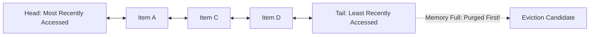
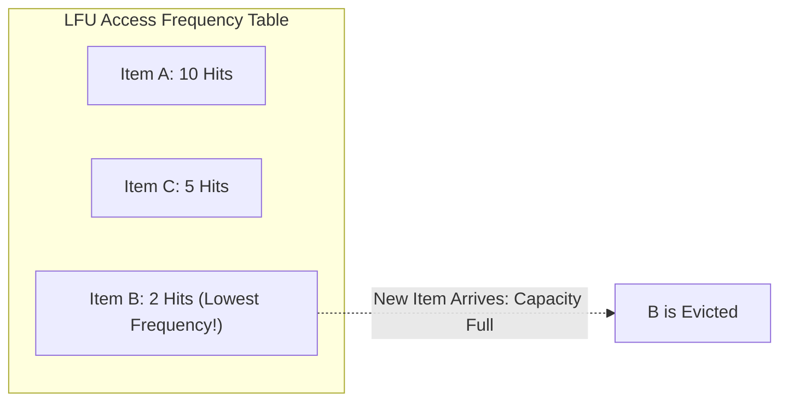

# 03. Cache Eviction Policies (LRU vs. LFU)

[🏠 Home](../README.md) > [05. Caching](./README.md) > **Cache Eviction Policies**

---

## 1. What is an Eviction Policy?

An **Eviction Policy** is the algorithm that determines **which items should be removed when a cache reaches its maximum capacity or memory limit**.

Because RAM is finite and expensive, an in-memory cache cannot expand indefinitely. When capacity is saturated, the cache must choose which existing records to sacrifice to accommodate new writes.

> [!IMPORTANT]
> **Expiration vs. Eviction: The Core Difference**
> * **Expiration (TTL):** Removes items passively or actively when their configured **time-to-live lifespan expires** (e.g., `EXPIRE key 300`).
> * **Eviction:** Forcibly purges valid, non-expired keys when **capacity is exhausted** based on access patterns.

---

## 2. LRU: Least Recently Used

**LRU** evicts the item that has not been accessed for the longest period of time.

* **Core Premise:** Temporal locality—data accessed recently is highly likely to be accessed again in the near future.
* **Standard Implementation:** A **Hash Map** combined with a **Doubly Linked List** to achieve strict $O(1)$ lookup, update, and eviction operations.

### Step-by-Step LRU Walkthrough Example

Assume a cache with **Capacity = 3**:

| Step | Operation | Cache Contents (Most $\to$ Least Recent) | Evicted Item | Notes |
|:---:|---|:---:|:---:|---|
| 1 | **Access A** | `[A]` | None | Insert A at head |
| 2 | **Access B** | `[B, A]` | None | Insert B at head |
| 3 | **Access C** | `[C, B, A]` | None | Cache reaches max capacity (3/3) |
| 4 | **Access A** | `[A, C, B]` | None | A is moved back to head (B becomes least recent) |
| 5 | **Insert D** | `[D, A, C]` | **B** | Cache is full! **B is evicted** because it was accessed longest ago |

**Final Cache State:** `[D, A, C]`

---

## 3. LFU: Least Frequently Used

**LFU** evicts the item that has the **lowest total access frequency counter**. When two or more items have identical frequencies, a tie-breaking rule (such as age or recency) is applied.

* **Core Premise:** Items that are popular historically will remain popular in the future.
* **Standard Implementation:** Hash map of keys coupled with frequency buckets or a min-heap.

### Step-by-Step LFU Walkthrough Example

Assume a cache with existing access counts:
* **Item A:** Accessed $10$ times
* **Item B:** Accessed $2$ times
* **Item C:** Accessed $5$ times

When a **New Item** arrives and the cache is full:
* **Candidate for Eviction:** **Item B** (Lowest frequency count: 2).
* **Aging Mechanisms:** Production LFU systems (like Redis LFU) implement **frequency decay / aging** so that historically popular items that are no longer accessed gradually lose their counts over time and do not dominate memory forever.

---

## 4. Head-to-Head Comparison: LRU vs. LFU

| Feature | LRU (Least Recently Used) | LFU (Least Frequently Used) |
|---|---|---|
| **Eviction Rule** | Least recently accessed item | Least frequently accessed item |
| **What It Tracks** | Access recency (timestamp / list position) | Access frequency counter |
| **Implementation** | Hash Map + Doubly Linked List | Frequency counters, frequency buckets, or Min-Heap |
| **Core Strength** | Adapts rapidly to shifting access trends & bursts | Preserves persistently popular hot items |
| **Main Weakness** | A sudden one-time table scan can evict useful hot items | Historic popular items may remain too long; new items risk instant eviction |
| **Best Suited For** | Workloads with strong **temporal locality** (social feeds, blogs) | Workloads with stable, persistent popularity patterns |

---

## 5. Other Eviction Policies

1. **FIFO (First-In, First-Out):**
   * Evicts the oldest inserted item regardless of how many times it was accessed.
   * *Trade-off:* Trivial to implement, but frequently evicts foundational cached data.
2. **Random Eviction:**
   * Evicts a randomly selected item uniformly.
   * *Trade-off:* Zero metadata tracking overhead, but risks evicting ultra-hot records.
3. **TTL-Based Eviction (Volatile-TTL):**
   * Selects and evicts the key with the shortest remaining Time-To-Live.
4. **TinyLFU:**
   * Uses space-efficient Count-Min Sketches to maintain frequency estimates for millions of keys, making highly accurate admission and eviction decisions with minimal memory overhead (utilized in modern caches like Caffeine).
5. **ARC (Adaptive Replacement Cache):**
   * Dynamically and automatically balances between recency (LRU) and frequency (LFU) by maintaining two tracked lists and tuning their sizes in real time based on cache hit history.

---

## 6. Related Topics & Next Steps

* [Cache Fundamentals](./cache-fundamentals.md) — Hits, misses, and the 80/20 Pareto sizing rule.
* [Caching Strategies](./caching-strategies.md) — Cache-Aside, Write-Through, Write-Back, and Write-Around.
* [Redis vs. Memcached](./redis-vs-memcached.md) — Comparing distributed cache engines.
* [Common Caching Problems](./common-caching-problems.md) — Mitigating stampedes and avalanches.

---

| ⬅️ Previous Topic | 🏠 Index | Next Topic ➡️ |
|:--- |:---:| ---:|
| [Caching Strategies](./caching-strategies.md) | [05. Caching Index](./README.md) | [Redis vs. Memcached ➡️](./redis-vs-memcached.md) |
