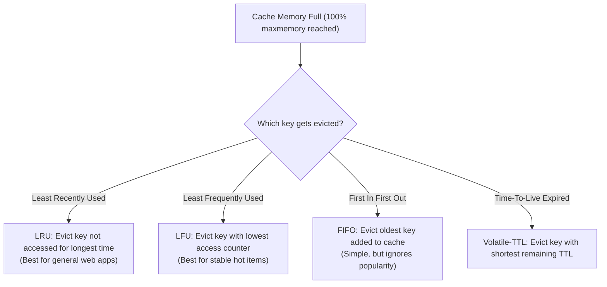

# Cache Eviction Policies

> High-Level System Design | Caching & Data Acceleration

---

### 1. What is it?
A Cache Eviction Policy is the algorithm that decides **which data to remove when the in-memory cache reaches its maximum memory limit** (`maxmemory`). Because RAM is finite and expensive, the cache must discard older or less valuable items to make room for new writes.

---

### 2. The Major Eviction Algorithms

---

### 3. Algorithm Comparison

| Policy | Eviction Criteria | Pros | Cons | Ideal Workload |
|---|---|---|---|---|
| **LRU (Least Recently Used)** | Evicts key that has not been read for the longest time | [+] Adapts quickly to shifting traffic trends | [-] A sudden one-off scan can evict popular hot keys | General web apps, user sessions, news feeds |
| **LFU (Least Frequently Used)** | Evicts key with the lowest total access count | [+] Protects historically popular items from eviction | [-] New items have count=1 and get evicted prematurely | Recommendation models, static assets |
| **FIFO (First In First Out)** | Evicts oldest key based on creation timestamp | [+] Extremely low algorithmic overhead | [-] Frequently accessed old keys get needlessly evicted | Sequential pipelines, streaming queues |
| **Random (AllKeys-Random)** | Evicts random keys uniformly | [+] Zero metadata memory overhead | [-] Evicts critical hot keys at random | Rarely used in production |

---

### 4. How LRU Works in Practice (Doubly Linked List + Hash Map)

A production LRU cache achieves **$O(1)$ read and $O(1)$ write** using two data structures together:
1. **Hash Map:** Maps key to node pointer for instant $O(1)$ lookups.
2. **Doubly Linked List:** Maintains chronological access order:
   * Whenever a key is accessed, move its node to the **Head** of the list ($O(1)$).
   * When memory is full, remove the node at the **Tail** of the list ($O(1)$).

