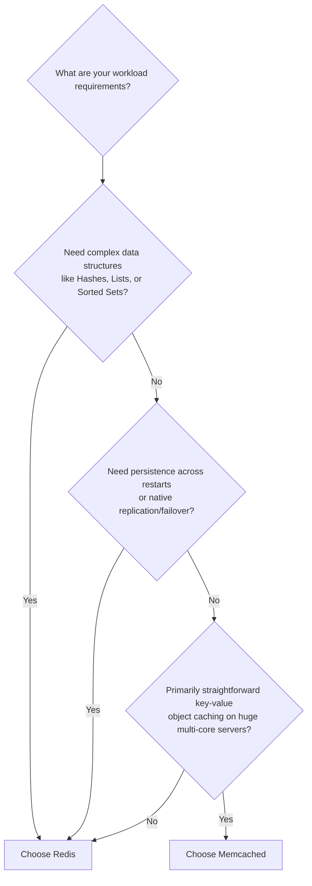

# 04. Redis vs. Memcached

[🏠 Home](../README.md) > [05. Caching](./README.md) > **Redis vs. Memcached**

---

## 1. What are Redis and Memcached?

**Redis** and **Memcached** are both widely used, high-performance in-memory data stores. While both can serve as lightning-fast caching tiers, their internal architectures, feature sets, and intended use cases differ significantly.

---

## 2. Overview of Both Technologies

### Redis (Remote Dictionary Server)
Redis is a multi-model in-memory data structure store that can function as a database, cache, streaming engine, and message broker.
* **Rich Data Structures:** Strings, Lists, Sets, Hashes, Sorted Sets (ZSETs), Streams, Bitmaps, and HyperLogLogs.
* **Advanced Features:** Built-in expiration controls, configurable disk persistence (RDB/AOF), primary-replica clustering, Redis Sentinel automatic failover, Lua scripting, and Pub/Sub messaging.

### Memcached
Memcached is a distributed, high-performance in-memory key-value cache designed primarily for straightforward, high-throughput object caching.
* **Simplicity & Speed:** Emphasizes simple key-value lookups with minimal overhead.
* **Native Multithreading:** Designed from the ground up with a multithreaded architecture that efficiently utilizes multi-core CPUs on a single machine.

---

## 3. Head-to-Head Comparison Matrix

| Feature | Redis | Memcached |
|---|---|---|
| **Data Model** | Multiple rich data structures | Simple key-value items (strings / blobs) |
| **Persistence** | **Optional persistence** (RDB snapshots + AOF append logs) | **No built-in durable persistence** (purely volatile) |
| **Replication** | **Supported natively** (Primary-Replica, Redis Cluster) | No built-in replication mechanism (client-managed) |
| **Data Structures** | Strings, Hashes, Lists, Sets, Sorted Sets, Streams | Primarily opaque string/byte values |
| **Multithreading** | Command execution is single-threaded; multi-threaded I/O (v6+) | **Natively multithreaded** (scales across all CPU cores) |
| **Common Use Cases** | Caching, atomic counters, leaderboards, pub/sub, streams | Large-scale object caching and simple key-value reads |

---

## 4. Practical Redis Example

```bash
# Store a key with a 300-second expiration (TTL)
SET user:12 "Asha" EX 300

# Retrieve the cached value
GET user:12
```

* The first command (`SET user:12 "Asha" EX 300`) stores the string `"Asha"` under the key `user:12` with an automatic Time-To-Live (TTL) of 300 seconds.
* The second command (`GET user:12`) retrieves the value in sub-millisecond time. Once 300 seconds elapse, Redis automatically expires and evicts the key.

---

## 5. When to Choose Redis vs. Memcached



### When to Choose Redis
* You need **rich data structures** (e.g., Sorted Sets for gaming leaderboards, Hashes for user profiles, Lists for activity feeds).
* You require **fine-grained expiration controls** or eviction mechanisms.
* You need **persistence options** so that the cache can recover state quickly after a server reboot.
* You need **native high availability**, replication, or pub/sub messaging capabilities.

### When to Choose Memcached
* You primarily need a **straightforward, high-speed, in-memory key-value cache** for serialized HTML fragments, JSON responses, or raw database row objects.
* You want to saturate multi-core machines with a single process without managing multiple single-threaded instances.

> [!NOTE]
> **Engineering Takeaway:** Neither technology is automatically the best choice for every workload. Benchmark representative operations under real production loads and evaluate your operational, monitoring, and clustering requirements before deciding.

---

## 6. Related Topics & Next Steps

* [Cache Fundamentals](./cache-fundamentals.md) — Hits, misses, and hit ratio formulas.
* [Caching Strategies](./caching-strategies.md) — Cache-Aside, Write-Through, and Write-Back.
* [Eviction Policies](./eviction-policies.md) — LRU vs. LFU step-by-step algorithms.
* [Common Caching Problems](./common-caching-problems.md) — Solving stampedes, avalanches, and penetration.

---

| ⬅️ Previous Topic | 🏠 Index | Next Topic ➡️ |
|:--- |:---:| ---:|
| [Eviction Policies](./eviction-policies.md) | [05. Caching Index](./README.md) | [Common Caching Problems ➡️](./common-caching-problems.md) |
