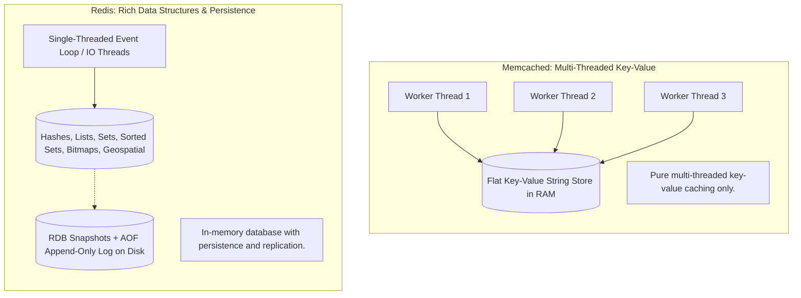

# Redis vs. Memcached

> High-Level System Design | Caching & Data Acceleration

---

### 1. What is it?
**Redis** and **Memcached** are the two industry-standard, high-performance in-memory key-value data stores used to accelerate database queries, store sessions, and handle caching.

---

### 2. Architectural Comparison

---

### 3. Head-to-Head Comparison Matrix

| Feature | Redis | Memcached |
|---|---|---|
| **Data Structures** | Strings, Hashes, Lists, Sets, Sorted Sets, Streams | Pure Key-Value Strings & Objects |
| **Threading Model** | Single-threaded core (multi-threaded I/O since v6) | **Multi-threaded** (scales across all CPU cores) |
| **Disk Persistence** | **Yes** (RDB snapshots + AOF append logs) | **No** (data is completely lost on restart) |
| **Replication & Clustering** | **Native** (Primary-Replica, Redis Sentinel, Cluster) | No native replication (handled by client library) |
| **Pub/Sub & Messaging** | **Yes** (Native Pub/Sub and Redis Streams) | No |
| **Geospatial & Bitmaps** | **Yes** (Geo distance, HyperLogLog, Bitmaps) | No |
| **Lua Scripting** | **Yes** (atomic server-side transactions) | No |
| **Max Key / Value Size** | Key: 512MB, Value: 512MB | Key: 250 bytes, Value: 1MB |

---

### 4. When to Pick Which?

* **Choose Redis (90% of modern use cases):**
  * You need rich data structures (e.g. Sorted Sets for gaming leaderboards, Hashes for user objects).
  * You need persistent caching that survives service restarts.
  * You need atomic counters, distributed locks (Redlock), or Pub/Sub messaging.
* **Choose Memcached:**
  * You have massive static caching workloads where multi-threaded scale-up across 64+ CPU cores on a single giant machine is required.
  * You only need simple, flat string/JSON key-value storage.
