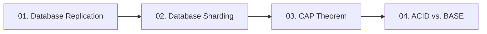

# 06. Databases and Distributed Storage

[🏠 Home](../README.md) > **06. Databases**

---

## Overview

Databases are the foundation of system durability and state. In modern high-level system design, scaling databases requires balancing consistency, availability, latency, and operational complexity. This module covers database scaling patterns from read-replica fan-out and horizontal sharding to distributed consensus, the CAP theorem, and the ACID vs. BASE paradigms.

---

## 🎯 Key Learning Objectives

* **Read Scaling Topologies**: Master Primary-Replica (Master-Slave) architectures, asynchronous vs. semi-synchronous replication, and replication lag mitigation.
* **Consistency Guarantees**: Solve Read-Your-Own-Writes and Monotonic Read inconsistencies in distributed read-replica configurations.
* **Horizontal Partitioning (Sharding)**: Distinguish vertical database partitioning from horizontal sharding, select shard keys, and evaluate range vs. hash vs. directory routing.
* **Distributed Sharding Complications**: Handle resharding, shard rebalancing, cross-shard joins, and distributed transactions.
* **The CAP Theorem Demystified**: Grasp why network partitions ($P$) are unavoidable in physical networks, and rigorously evaluate CP vs. AP design decisions.
* **Transaction Paradigms**: Contrast ACID properties in traditional relational databases against BASE (eventual consistency) and the Saga pattern in distributed NoSQL stores.

---

## 📚 Module Table of Contents

| # | Topic | Key Focus | Link |
|---|---|---|---|
| **01** | **Database Replication** | Scaling reads, primary-replica topologies, sync vs. async replication lag, read-your-own-writes | [Read Guide ➡️](./replication.md) |
| **02** | **Database Sharding** | Horizontal partitioning, shard keys, range vs. hash vs. directory routing, cross-shard joins | [Read Guide ➡️](./sharding.md) |
| **03** | **The CAP Theorem** | CP vs. AP in production, PACELC theorem, handling real-world network partitions | [Read Guide ➡️](./cap-theorem.md) |
| **04** | **ACID vs. BASE** | Relational transactions vs. distributed eventual consistency, two-phase commit, Saga pattern | [Read Guide ➡️](./acid-vs-base.md) |

---

## 🔍 Detailed Topic Breakdown

* 📌 **[01. Database Replication](./replication.md)**
  * **Primary-Replica Pattern**:
    * Single Primary (Master) accepts all write transactions (`INSERT`, `UPDATE`, `DELETE`) and records changes to a write-ahead log (WAL).
    * Multiple Read Replicas (Slaves) replicate the WAL to serve high-volume read traffic (`SELECT`).
  * **Replication Modes**:
    * *Synchronous*: Primary waits for replica ACK before committing. (Zero data loss, high write latency, blocked writes if replica crashes).
    * *Asynchronous*: Primary returns immediately after local disk commit; replicas sync in background. (Sub-millisecond writes, risk of replication lag and data loss on primary crash).
    * *Semi-Synchronous*: Primary waits for at least one replica confirmation before returning success.
  * **Replication Lag & Solutions**:
    * *Problem*: User posts a comment, refreshes the page, reads from a lagged replica, and sees their comment missing.
    * *Fix (Read-Your-Own-Writes)*: Route read queries for newly modified records directly to the Primary for a window of $T$ seconds (e.g., 5 seconds) after a write.

* 📌 **[02. Database Sharding](./sharding.md)**
  * **The Need for Sharding**: When dataset volume exceeds the storage limits of a single physical disk, or write IOPS exceed a single primary server's throughput.
  * **Shard Key Selection**:
    * The chosen column determines which partition holds a specific record (e.g., `user_id`, `tenant_id`, `order_id`).
    * Bad shard keys (e.g., `created_at` or `country`) cause extreme write hot-spots.
  * **Sharding Strategies**:
    * *Range-Based*: Partition by value range (e.g., IDs 1–1M $\rightarrow$ Shard 1, 1M–2M $\rightarrow$ Shard 2). Simple, but creates write hotspots on current ranges.
    * *Hash-Based*: Consistent hash or modulo on shard key (`hash(user_id) % N`). Uniformly distributes writes, but makes range queries scatter-gather.
    * *Directory / Lookup-Based*: Central lookup table mapping entities to shard IDs. Flexible, but introduces a SPOF and lookup latency.
  * **Sharding Complexities**:
    * Cross-shard joins become impossible or prohibitively expensive.
    * Distributed 2-phase commit transactions introduce high coordination latency.
    * Resharding when scaling from $N$ to $2N$ shards requires live data migration scripts.

* 📌 **[03. The CAP Theorem](./cap-theorem.md)**
  * **The Distributed Reality**:
    * *Consistency ($C$)*: Every read receives the most recent write or an error.
    * *Availability ($A$)*: Every non-failing node returns a non-error response (without guarantee of latest data).
    * *Partition Tolerance ($P$)*: The cluster continues to operate despite arbitrary network dropped packets or splits.
  * **The Trade-off**: You cannot choose "CA" on physical networks because network partitions ($P$) are a physical law of networking. Under a partition, you MUST choose:
    * *CP (Consistency over Availability)*: Reject writes/reads to partitioned nodes to prevent split-brain state (e.g., Banking, Paxos/Raft, Zookeeper, Google Spanner).
    * *AP (Availability over Consistency)*: Allow writes/reads on both sides of partition; resolve data conflicts asynchronously later (e.g., DNS, Cassandra, DynamoDB, social feeds).
  * **PACELC Extension**: If there is a Partition ($P$), trade off Availability ($A$) or Consistency ($C$); Else ($E$), trade off Latency ($L$) or Consistency ($C$).

* 📌 **[04. ACID vs. BASE](./acid-vs-base.md)**
  * **ACID (Relational / SQL Focus)**:
    * *Atomicity*: All operations succeed, or the entire transaction is rolled back (all-or-nothing).
    * *Consistency*: State transitions strictly obey database constraints and foreign keys.
    * *Isolation*: Concurrent transactions do not interfere with each other (Read Committed, Repeatable Read, Serializable).
    * *Durability*: Committed changes survive crashes via write-ahead logging (WAL) to non-volatile disk.
  * **BASE (Distributed / NoSQL Focus)**:
    * *Basically Available*: System guarantees availability by tolerating local node failures.
    * *Soft State*: System state may change over time even without user input due to replication convergence.
    * *Eventual Consistency*: Given sufficient time without new updates, all replicas converge to identical data.
  * **Distributed Transaction Orchestration**:
    * *Two-Phase Commit (2PC)*: Strong consistency coordinator; heavy blocking and vulnerable to coordinator failure.
    * *The Saga Pattern*: Choreographed or orchestrated sequence of local transactions where each step has a compensating transaction to undo changes on failure.

---

## 💡 Key Architectural Rules of Thumb

* **Scale Reads with Replicas, Scale Writes with Sharding**: Add read replicas first when read IOPS dominate; only introduce sharding when write throughput, connection pool limits, or dataset sizes exceed maximum single-node hardware.
* **Choose Shard Keys Carefully**: A poor shard key will kill your database scalability; always choose a high-cardinality key that spreads read and write traffic evenly across all nodes.
* **Favor Sagas over Distributed 2PC**: In modern microservice and distributed database systems, avoid blocking Two-Phase Commit; use event-driven Sagas with compensating transactions for eventual consistency.
* **Acknowledge Network Partitions**: Never claim a system is "CA" in distributed interviews or production design; networks drop packets, so always design explicitly for CP or AP behaviors.

---

| ⬅️ Previous Module | 🏠 Index | Next Module ➡️ |
|:--- |:---:| ---:|
| [05. Caching & Acceleration](../05-caching/README.md) | [System Design Hub](../README.md) | [07. Real-World System Design ➡️](../07-system-design-examples/README.md) |
