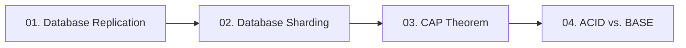

# 06. Databases and Distributed Storage

[🏠 Home](../README.md) > **06. Databases**

---

## Overview

Databases are the foundation of system durability and state. In modern high-level system design, scaling databases requires balancing consistency, availability, latency, and operational complexity. This module covers database scaling patterns from read-replica fan-out and horizontal sharding to distributed consensus, the CAP theorem, and the ACID vs. BASE paradigms.

---

## Module Table of Contents

| # | Topic | Key Focus | Link |
|---|---|---|---|
| **01** | **Database Replication** | Scaling reads, primary-replica topologies, sync vs. async replication lag, read-your-own-writes | [Read Guide ➡️](./replication.md) |
| **02** | **Database Sharding** | Horizontal partitioning, shard keys, range vs. hash vs. directory routing, cross-shard joins | [Read Guide ➡️](./sharding.md) |
| **03** | **The CAP Theorem** | CP vs. AP in production, PACELC theorem, handling real-world network partitions | [Read Guide ➡️](./cap-theorem.md) |
| **04** | **ACID vs. BASE** | Relational transactions vs. distributed eventual consistency, two-phase commit, Saga pattern | [Read Guide ➡️](./acid-vs-base.md) |

---

| ⬅️ Previous Module | 🏠 Index | Next Module ➡️ |
|:--- |:---:| ---:|
| [05. Caching & Acceleration](../05-caching/README.md) | [System Design Hub](../README.md) | [07. Real-World System Design ➡️](../07-system-design-examples/README.md) |
