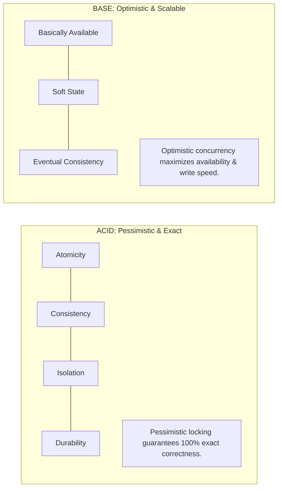

# 04. ACID vs. BASE in Distributed Databases

[🏠 Home](../README.md) > [06. Databases](./README.md) > **ACID vs. BASE**

---

## 1. What are ACID and BASE?

In database systems, **ACID** and **BASE** represent two fundamentally different philosophies for managing state, concurrency, and reliability:

* **ACID:** Emphasizes absolute transaction correctness, strict isolation, and mathematical consistency. Standard in traditional relational databases (PostgreSQL, MySQL, Oracle).
* **BASE:** Emphasizes continuous availability, partition tolerance, and horizontal scalability by accepting temporary data inconsistency. Common in distributed NoSQL systems (Cassandra, DynamoDB).

---

## 2. ACID Properties Explained

| Property | Meaning | Concrete Example |
|---|---|---|
| **Atomicity** | "All-or-Nothing." A transaction either succeeds completely or has no committed partial effect. | **Bank Transfer:** Moving \$100 from Account A to Account B requires debiting A and crediting B. The system must not commit the debit without the corresponding credit. If power cuts mid-way, both changes roll back. |
| **Consistency** | A transaction preserves all database-defined integrity constraints and invariants. | Account balance rules (e.g., `CHECK (balance >= 0)`) abort any transaction that would result in an overdraft. |
| **Isolation** | Concurrent transactions execute without interfering with one another, according to configured isolation levels. | If Alice and Bob attempt to buy the final available concert seat at the exact same millisecond, one transaction wins and the other is informed the seat is taken. |
| **Durability** | Committed changes survive system crashes, power loss, and hardware reboots. | Transactions are recorded to non-volatile disk via the **Write-Ahead Log (WAL)** before returning success to the caller. |

---

## 3. BASE Philosophy Explained

**BASE** is a design philosophy commonly associated with highly available distributed systems that prioritize scale and resilience over immediate consistency.

| Property | Meaning | Concrete Example |
|---|---|---|
| **Basically Available** | The system aims to continue responding to requests despite partial node failures. | Even if 2 out of 5 database nodes are partitioned or offline, remaining nodes continue serving user requests without failing. |
| **Soft State** | State may change over time without explicit user interaction as asynchronous updates propagate across replicas. | Replicas asynchronously synchronize via gossip protocols; a node's local state is "soft" until background sync finishes. |
| **Eventual Consistency** | Replicas may temporarily disagree, but will converge to the exact same value if updates stop and propagation succeeds. | When you upload a profile picture on Instagram, you see it immediately; your follower in Australia sees it 500 ms later once replication completes. |

> [!NOTE]
> **BASE is not a replacement for every ACID guarantee.** It describes deliberate trade-offs often used in distributed data systems to maximize uptime and horizontal write throughput.

---

## 4. Master Comparison: ACID vs. BASE

| Feature | ACID-Oriented Transactions | BASE-Oriented Design |
|---|---|---|
| **Primary Focus** | Transactional correctness & data integrity | Continuous availability & distributed scale |
| **Consistency** | Transaction guarantees defined by database (Strong/Immediate) | Temporary inconsistencies may be accepted (Eventual) |
| **Transactions** | Often central to the data model (multi-row, multi-table) | May rely more on asynchronous workflows & single-key atomic writes |
| **Typical Use Cases** | Financial ledgers, inventory counts, billing systems, order processing | Distributed social feeds, replicated views, telemetry, high-scale workloads |

---

## 5. Combining ACID and BASE in Modern Systems

The choice between ACID and BASE is **not all-or-nothing**. Real-world systems often combine both patterns:
* **The Core Transactional Tier (ACID):** The checkout and payment engine utilizes an ACID relational database (e.g., PostgreSQL) to ensure zero double-spending and accurate accounting.
* **The Derived Analytics & Feed Tier (BASE):** Post-checkout events are streamed asynchronously via message brokers to an eventually consistent distributed store (e.g., Cassandra / ElasticSearch) to power search, recommendations, and dashboards.

---

## 6. Related Topics & Next Steps

* [Database Replication](./replication.md) — Scaling reads with primary-replica clusters.
* [Database Sharding](./sharding.md) — Partitioning datasets across multiple database nodes.
* [The CAP Theorem](./cap-theorem.md) — Trade-offs between consistency and availability.
* [Cache Fundamentals](../05-caching/cache-fundamentals.md) — In-memory acceleration layers.

---

| ⬅️ Previous Topic | 🏠 Index | Next Module ➡️ |
|:--- |:---:| ---:|
| [The CAP Theorem](./cap-theorem.md) | [06. Databases Index](./README.md) | [07. Real-World System Design ➡️](../07-system-design-examples/README.md) |
