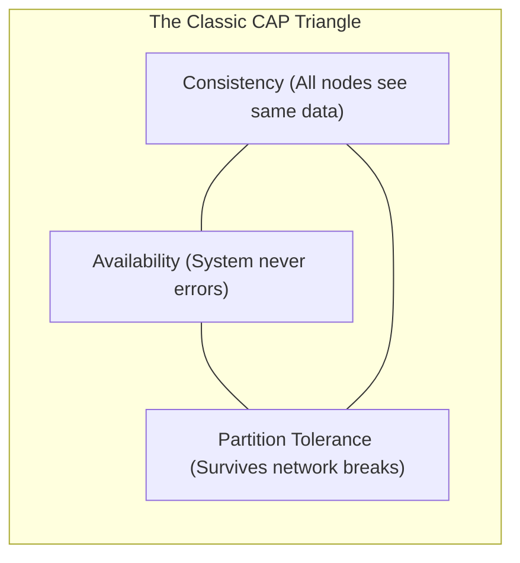

# The CAP Theorem in Distributed Systems

> High-Level System Design | Databases & Storage

---

### 1. What is it?

* **Plain English:** The CAP Theorem states that a distributed data system can simultaneously provide at most **two out of three** guarantees:
  1. **C — Consistency:** Every read receives the most recent write or an error.
  2. **A — Availability:** Every non-failing node returns a non-error response for every request (even if stale).
  3. **P — Partition Tolerance:** The system continues operating despite dropped or delayed network packets between nodes.


---

### 2. The Hard Truth: "CA" Does Not Exist in the Real World

In any network spanning multiple physical machines, **network partitions ($P$) are a mathematical certainty** (undersea cables get severed, top-of-rack switches reboot, routers drop packets).
You cannot "choose CA and reject P." A system that rejects Partition Tolerance is simply a single machine that will crash when the network cable is pulled.
> Key Decision: **The Real Engineering Decision:** Because $P$ is unavoidable, your actual architectural choice is **CP vs. AP**.
```mermaid
sequenceDiagram
    autonumber
    actor ClientA as  User A (US West)
    participant NodeA as  DB Node 1 (US West)
    participant NodeB as  DB Node 2 (US East)
    actor ClientB as  User B (US East)
    Note over NodeA,NodeB:  Network Partition: Transcontinental link is severed!
    ClientA->>NodeA: Write: balance = $50
    NodeA--xNodeB: Sync failed! Link is down!
    alt Choice 1: CP (Consistency over Availability)
        NodeA-->>ClientA: 500 Error: "Cannot guarantee quorum write"
        ClientB->>NodeB: Read balance
        NodeB-->>ClientB: 500 Error: "Partition detected; read locked"
        Note over NodeA,NodeB: 'I would rather return an error than return the wrong balance!'
    else Choice 2: AP (Availability over Consistency)
        NodeA-->>ClientA: 200 OK: balance = $50
        ClientB->>NodeB: Read balance
        NodeB-->>ClientB: 200 OK: balance = $100 (Stale data!)
        Note over NodeA,NodeB: 'I would rather return slightly stale data than show an error screen!'
    end
```

---

### 3. Detailed Pros & Cons: CP vs. AP

#### CP (Consistency + Partition Tolerance)

* **Design Philosophy:** *"Better dead than wrong."*
* **Pros:**
  * [+] **Guaranteed Data Correctness:** Every user across the world sees identical account balances and inventory numbers.
  * [+] **Prevents Split-Brain Disaster:** Two distinct datacenters will never accept conflicting writes for the same row.
  * [+] **Simpler Application Code:** Developers don't need to write complex reconciliation or merging algorithms.
* **Cons:**
  * [-] **Service Outages:** If a datacenter is cut off from the majority quorum, it **refuses all traffic** and returns errors.
  * [-] **Higher Write Latency:** A write cannot complete until a majority of consensus nodes (e.g. Raft/Paxos quorum) acknowledge it.

#### AP (Availability + Partition Tolerance)

* **Design Philosophy:** *"Better temporarily wrong than unavailable."*
* **Pros:**
  * [+] **99.999% High Availability:** Nodes accept reads and writes even when completely disconnected from the rest of the world.
  * [+] **Blazing Fast Local Latency:** Writes complete immediately on the local server without waiting for cross-region ACKs.
  * [+] **Superior User Experience for Social Apps:** Users never see an error message or broken feed.
* **Cons:**
  * [-] **Stale Reads:** Users may see outdated data or comments that appear in the wrong chronological order.
  * [-] **Write Conflicts:** If User A changes name to "Alice" on Node 1, and User B changes name to "Bob" on Node 2 during a partition, the system must use heuristics (Last-Write-Wins or Vector Clocks) to resolve the clash.

---

### 4. The PACELC Theorem (CAP in Normal Times)

The CAP Theorem only discusses what happens **when a partition occurs**. But 99.9% of the time, the network is working fine!
**PACELC** explains both modes:
* **If Partition (P):** Choose **Availability (A)** or **Consistency (C)**.
* **Else (E):** Choose **Latency (L)** or **Consistency (C)**.
| Database | PACELC Classification | Explanation |
|---|---|---|
| **MongoDB** | **PC/EC** | If partition, preserves Consistency (PC); In normal times, waits for replica sync (EC). |
| **Cassandra** | **PA/EL** | If partition, stays Available (PA); In normal times, gives lowest Latency (EL). |
| **DynamoDB** | **PA/EL** (Default) | Highly available and low latency by default; configurable to strong consistency. |

---

### 5. Practical Database Classification

| System | Classification | Primary Use Cases |
|---|---|---|
| **PostgreSQL / MySQL (Single Master)** | **CA (Single Node)** | Classic web apps, financial ledgers, transactional databases |
| **Google Spanner / CockroachDB** | **CP** | Globally distributed SQL, multi-region bank accounts |
| **etcd / ZooKeeper** | **CP** | Distributed leader election, configuration management, Kubernetes state |
| **Apache Cassandra / ScyllaDB** | **AP** | Real-time chat, analytics telemetry, social media feeds |
| **Amazon DynamoDB (Eventual)** | **AP** | E-commerce shopping carts, session storage, gaming leaderboards |

---

### 6. Interview Golden Rule

When an interviewer asks: *"Would you choose CP or AP for this system?"*
1. **Financial / Payment / Booking Service:** Choose **CP**. Overdrafting bank accounts or double-booking airplane seats causes legal and monetary disaster.
2. **Social Media / Streaming / Analytics Service:** Choose **AP**. Showing a view count of 1,000,000 instead of 1,000,050 for 2 seconds harms nobody.
